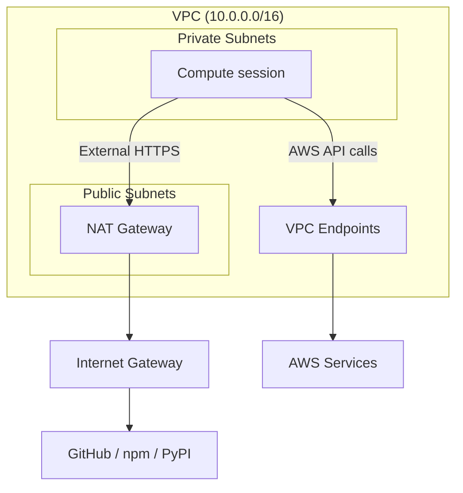

# Compute

Every task runs in an isolated cloud compute environment. Nothing runs on the user's machine. The agent clones the repo, writes code, runs tests, and opens a PR inside a compute session that is created for the task and destroyed when it ends.

- **Use this doc for:** understanding the compute environment, agent harness, network architecture, and the constraints that shape the platform's design.
- **Related docs:** [ORCHESTRATOR.md](./ORCHESTRATOR.md) for session management and liveness monitoring, [SECURITY.md](./SECURITY.md) for isolation and egress controls, [REPO_ONBOARDING.md](./REPO_ONBOARDING.md) for per-repo compute configuration.

## Compute options

The default runtime is **Amazon Bedrock AgentCore Runtime**, which runs each session in a Firecracker MicroVM with per-session isolation, managed lifecycle, and built-in health monitoring. The `compute_types` CDK context selects one or more backends: `agentcore`, `ecs`, and `lambda-microvm`. Its first entry is the default for repositories. A repository can explicitly select any deployed backend. The `ComputeStrategy` interface dispatches each task to its resolved backend.

| | AgentCore Runtime | ECS on Fargate | **Lambda MicroVMs** | ECS on EC2 | EKS | AWS Batch | Lambda (functions) | Custom EC2 + Firecracker |
|---|---|---|---|---|---|---|---|---|
| **Isolation** | MicroVM (Firecracker) | Task-level (Firecracker) | MicroVM (Firecracker) | Container on shared nodes | Pod on shared nodes | Backend-dependent | Function env (Firecracker) | MicroVM (you own it) |
| **Image limit** | 2 GB (non-adjustable) | No hard cap | Zip + Dockerfile → snapshot. Snapshot build size and OCI image size are different measures | No hard cap | No hard cap | Backend-dependent | 10 GB | N/A (you define) |
| **Filesystem** | Ephemeral + persistent mount (preview) | 20-200 GB ephemeral | 32 GB native disk in snapshot. Survives suspend and resume. `flock()` works | Node disk + EBS/EFS | Node disk + PVs | Backend-dependent | 512 MB-10 GB `/tmp` | You choose (EBS/NVMe) |
| **Max duration** | 8 hours | No hard cap | 8 hours (running + suspended, 28,800s) | No hard cap | No hard cap | Configurable | **15 minutes** | Unlimited |
| **Startup** | Service-managed | Slim images help | Snapshot resume | Warm ASGs + pre-pull | Karpenter + pre-pull | Backend-dependent | Provisioned concurrency | Snapshot pools (DIY) |
| **GPU** | No | No | No | Yes | Yes | Yes (EC2/EKS backend) | No | Yes (with passthrough) |
| **Ops burden** | Low (managed) | Low | Low (managed) | Medium | High | Low-Medium | Low | **Very high** |
| **Cost model** | vCPU-hrs + GB-hrs | vCPU + mem/sec | Baseline-priced (8 GiB / 4 vCPU) with 4× vertical burst (32 GiB / 16 vCPU peak). Suspended time is storage-only | EC2 + EBS | EKS control + EC2 | Underlying compute | Request + duration | EC2 metal + your ops |
| **Fit** | **Default choice** | Repos > 2 GB image | Suspend and resume economics, approval-wait-heavy workloads, default-sized repos. Heavy sustained-memory builds stay on ECS | GPU, heavy toolchains | Max flexibility | Queued batch jobs | **Poor** (15 min cap) | Best potential, highest cost |

> **Lambda MicroVMs are not Lambda functions.** They are a different kind of compute, so the 15-minute cap and the poor-fit verdict of the functions column do not apply. See [ADR-021](../decisions/ADR-021-lambda-microvms-compute-backend.md).

Repositories without a `compute_type` override inherit the first entry in the deployed list. An explicit Blueprint or RepoTable override must name a deployed backend. A mismatch fails before concurrency admission. Memory, Tool Gateway, Agent Registry, and Linear Identity Vault are separate service choices, so selecting ECS or MicroVM does not disable them. The orchestrator resolves the strategy and delegates session start, polling, and termination to the strategy implementation. See [REPO_ONBOARDING.md](./REPO_ONBOARDING.md) for the `ComputeStrategy` interface.

## Selecting and changing the backend

Set `compute_types` in `cdk/cdk.json` as an array, or pass a comma-separated list to the deployment task:

```bash
# AgentCore and MicroVM, with AgentCore as the repository default.
mise //cdk:deploy -- -c compute_types=agentcore,lambda-microvm

# Only ECS; removing an existing backend requires the transition below.
mise //cdk:deploy -- -c compute_types=ecs
```

`compute_types` takes precedence over the legacy `compute_type` context. Empty lists, non-string entries, and unsupported names fail synthesis. Duplicate names are collapsed, and the order is preserved. Without `compute_types`, the previous deployment behavior is preserved:

| Legacy context | Deployed backends | Repository default |
|---|---|---|
| Absent, or `compute_type=agentcore` | AgentCore | AgentCore |
| `compute_type=ecs` | AgentCore and ECS | AgentCore |
| `compute_type=lambda-microvm` | AgentCore and Lambda MicroVMs | AgentCore |

An upgrade with the same legacy context keeps AgentCore, its role, and its log delivery. Selecting a single optional backend explicitly, such as `compute_types=ecs`, opts into removing AgentCore. The bootstrap `ComputeTypes` CloudFormation parameter is a separate permission allowlist. In that parameter, also enable every backend that you plan to deploy.

`ComputeTypes` and `ComputeSubstrate` both publish the complete ordered comma list. `ComputeDeploymentMode` is `exclusive` for one backend and `additive` for several. `RuntimeArn` exists whenever AgentCore is included. The orchestrator receives the same list in `DEPLOYED_COMPUTE_TYPE`. Stack-level `compute_type` tags join the deployed names with `+`, a tag-safe separator. Backend-specific resources keep their own attribution.

Use the updated CLI when the first backend is not AgentCore, or when the list omits AgentCore. Older CLIs assume that AgentCore is present and is the default on additive stacks. The updated CLI reads `ComputeTypes` for onboarding, `repo show`, and `runtime status`. Stacks without the new outputs keep the legacy interpretation.

`bgagent repo show` and `bgagent runtime status` mark incompatible stored pins as **UNAVAILABLE** and explain how to reconcile them. The JSON output includes the ordered `compute_deployment.compute_types` array, `default_compute_type`, `compute_available`, and `configuration_error` (per repository in runtime status). Incompatible repositories are excluded from backend summaries and AgentCore probes. These commands check deployment configuration. MicroVM image readiness and live backend health remain separate checks.

Take these steps before you deliberately remove a backend or change the first entry:

1. Record the deployed context, templates, image identifiers, repository overrides, and active sessions. Pause task submissions. Let running or suspended work finish, or cancel it with the existing deployment.
2. Reconcile the stored overrides with the target list. An omitted `compute_type` inherits the first entry of the list. Explicit pins to other deployed backends remain valid. Remove obsolete `runtime_arn` overrides when you leave AgentCore.
3. Prepare the images and the bootstrap permissions. MicroVM needs a compatible snapshot. Rebuild the snapshot from this checkout before you enable Gateway or the vault, because their optional settings travel through `platform_config`. Infrastructure without an image cannot run tasks.
4. Review the full change set. Removing AgentCore removes its Runtime and delivery resources. The application keeps ownership of the two named AgentCore log groups across backend switches, with their existing destroy policies and retention periods. Shared data stores keep their existing lifecycle policies. A network ownership transfer is a separate, deferred migration.
5. Rehearse the deployment and the rollback. Then verify a task on each backend, repository-less work, cancellation, logs, and the enabled integrations before you resume submissions. Re-adding a backend cannot resume deleted sessions or recover runtime storage.

The resource budget applies to the complete combination. The split topology fits the sampled combinations, including all three backends. Wider inline combinations fail at the 490-resource ceiling. See [Network stack topology](../guides/DEPLOYMENT_GUIDE.md#network-stack-topology). Local synthesis verifies wiring and budget behavior. It does not establish a live migration guarantee, and it does not change MicroVM's experimental status.

## What runs in the session

Each session does the following:

- **Runs the agent harness** (Claude Agent SDK) with the foundation model inference loop
- **Clones the repo**, creates or checks out a branch, edits files, and runs shell commands (build, test, lint)
- **Makes outbound API calls** to GitHub (clone, push, PR), Bedrock (model invocation), and tool services (AgentCore Gateway, Memory)
- **Reads and writes memory** through AgentCore Memory for cross-session learning

Code is durable because the agent commits and pushes to the remote branch. Cross-session state uses external storage (Memory, DynamoDB).

## AgentCore Runtime constraints

### 2 GB image limit

This is the most significant constraint. The agent code, the runtimes, and the tools must fit in a 2 GB image.

| Layer | Estimated size |
|-------|---------------|
| Base OS (slim Linux) | ~50-100 MB |
| Python 3.x + pip | ~100-150 MB |
| Node.js 24.x + npm | ~100-150 MB |
| Git + CLI tools | ~50-80 MB |
| Agent code + SDK | ~100-200 MB |
| **Available for repo deps** | **~1.3-1.6 GB** |

When a repo exceeds 2 GB, the onboarding pipeline warns the operator, attempts optimization (multi-stage builds, slim bases), falls back to runtime install (slower cold start), or flags the repo for an alternate compute backend.

### Session storage

AgentCore supports persistent session storage (preview). It is a per-session filesystem mounted at `/mnt/workspace` that survives stop and resume cycles (14-day TTL). However, the S3-backed FUSE mount does not support `flock()`, so build tools such as `uv` fail on it.

The platform works around this limit by splitting storage:

| What | Location | Why |
|------|----------|-----|
| Repo clone | `/workspace` (ephemeral) | Build tools need `flock()` |
| npm cache | `/mnt/workspace` (persistent) | npm uses lockless atomic ops |
| Claude Code config | `/mnt/workspace` (persistent) | No `flock()` needed |
| mise data, uv cache | `/tmp/` (ephemeral) | Both use `flock()` internally |

### Timeouts

| Limit | Value | Notes |
|-------|-------|-------|
| Max session duration | 8 hours | Hard limit enforced by AgentCore |
| Idle timeout | 8 hours (configured) | Overridden from the default with `idleRuntimeSessionTimeout: Duration.hours(8)`, so that sessions blocked on long approval waits or heavy builds are not evicted while idle. The agent reports `HealthyBusy` on `/ping` to stay alive |

See [ORCHESTRATOR.md](./ORCHESTRATOR.md) for how the orchestrator handles these timeouts.

## Lambda MicroVMs backend

Lambda MicroVMs are an opt-in third backend. To opt in, include `lambda-microvm` in `compute_types`. Repositories inherit the first listed backend or choose a deployed backend through an override. The legacy `compute_type=lambda-microvm` deploys AgentCore and MicroVM, with AgentCore as the default. Image configuration has three states. A managed base-image ARN and version creates the snapshot image in CDK. An external image identifier uses a snapshot built out of band. Supplying neither provisions only the roles, buckets, and connectors that the bootstrap deploy needs. `cdk/scripts/package-microvm-artifact.sh` packages the agent as a zip and a Dockerfile, uploads the package to the artifact bucket, and can create the external image. Lambda MicroVMs are available in five launch regions (us-east-1, us-east-2, us-west-2, eu-west-1, ap-northeast-1) and will expand. The platform enforces regional availability in layers: a synth-time constant, live probes at onboarding, and classification at orchestration time.

A snapshot freezes its build-time environment, so deployment-specific, non-secret identifiers travel in the `platform_config` block of the `/run` hook instead. The strategy sends the canonical inline envelope. When that envelope exceeds the verified 4,096-byte `runHookPayload` limit, the strategy sends an S3-pointer envelope instead, with the configuration also merged into the uploaded payload. The agent accepts only allowlisted keys and installs them before pipeline initialization. [ADR-021 §3](../decisions/ADR-021-lambda-microvms-compute-backend.md#3-packaging-same-agent-image-source-new-build-path) defines the exact wire shapes and validation rules.

Networking separates image build from execution. The build-only connector permits TCP 80 and 443 because the Dockerfile uses `apt-get`. Running MicroVMs keep 443-only egress through the platform VPC. Every launch explicitly passes the Lambda-managed `NO_INGRESS` connector, because a launch without it would select the service's public-ingress default. The P2 image declares and serves `/ready` and `/validate` at build time and `/run` and `/terminate` at runtime. The P3 image also serves `/suspend` and `/resume`.

**Approval-wait sleep (P3).** While a task waits for a human decision, the orchestrator can suspend its MicroVM. Compute billing stops, and memory and disk are preserved. The orchestrator suspends the MicroVM only when all of the following hold: the deployment enables `microvm_approval_suspend_enabled`, the live Parameter Store switch is on, the launched image version declares the lifecycle protocol, and enough of the gate remains after the task's `microvm_sleep_after_s` delay (default 60 s). The MicroVM resumes inline when the decision is recorded, with the orchestrator poll as a fallback, and always 60 s before the original deadline. Approval windows stay bounded (300 s default, 3,600 s ceiling), so a suspended worker never outlives its gate. The guest declines an unsafe suspend with HTTP 200, because any other answer makes the service terminate the VM. See [ADR-021 P3 as delivered](../decisions/ADR-021-lambda-microvms-compute-backend.md#p3-as-delivered).

New MicroVM deployments place these resources in a nested stack (`--context microvm_nested_stack=true`, bootstrap 1.9.0 or later). Existing flat installations keep `false` until they are migrated.

## ECS Fargate task sizing (build vs. planning)

When a repo uses `compute_type: ecs`, `EcsAgentCluster` provisions **two** Fargate task definitions. For each task, the orchestrator picks one of them by whether the resolved workflow is **read-only**:

| Task definition | Size | Runs | Selected when |
|----------|------|------|---------------|
| Build | 4 vCPU / 16 GB (default, raise with `taskSizing`) | Coding workflows (`new-task`, `pr-iteration`, …) that clone and run a full CI-parity build | `workflowIsReadOnly(workflow) === false` (the default) |
| Planning | 2 vCPU / 8 GB | Read-only workflows (`coding/pr-review-v1`) that clone, then read and grep to reach a conclusion. They **never build** | `workflowIsReadOnly(workflow) === true` |

The size of the build task definition is measured, not guessed, and the number depends on how much of the build runs at once. A **fully parallel** `mise run build` of this repo peaks at ~31.6 GB and OOM-killed a 32 GB task. But the build tier sets `MISE_JOBS=1`, which serialises the per-package legs. The peak is then the largest single package, not the sum of all packages, and it measured **~3.1 GB** on the same repo and build. The default is therefore **4 vCPU / 16 GB**, roughly 5x headroom over the serialised peak, and not the Fargate ceiling of 16 vCPU / 120 GB. A default is what an adopter who changes nothing pays for. Disk is sized more conservatively (**50 GiB** against a measured ~14.7 GiB peak), because a full disk shows up as a spurious build failure and not as an obvious resource error. A repo that needs more, or that raises `MISE_JOBS`, should raise all three through `taskSizing` (`-c ecsBuildTaskCpu=` / `ecsBuildTaskMemoryMiB=` / `ecsBuildTaskEphemeralStorageGiB=`). Running a read-only workflow on a build task is still a large over-allocation, so planning keeps its own right-sized 2 vCPU / 8 GB task definition.

Both task definitions **share one task role, one execution role, one container image, and one base environment** (a single `makeTaskDef` helper and a `baseEnvironment` object in `ecs-agent-cluster.ts`), so IAM grants and env vars cannot drift between them. That design is a lesson from ECS-parity bugs, where a grant present on one path was missing on another. The only differences are `cpu`, `memoryLimitMiB`, and the build-tier-only `BUILD_VERIFY_TIMEOUT_S`. Routing is a boolean with a safe fallback. An older deploy without the planning task definition runs read-only workflows on the build task definition, which is never worse than before. Substrate **family** routing is unchanged. An ECS repo always plans on ECS. It is never silently downgraded to the AgentCore microVM, where a large repo could run out of memory on reads alone. The boolean picks only which ECS task definition runs. AgentCore has a single fixed MicroVM size and ignores the read-only flag. See [ECS_RIGHTSIZED_PLANNING.md](./ECS_RIGHTSIZED_PLANNING.md).

## Agent harness

The agent harness is the layer around the LLM that manages the execution loop: context, tools, guardrails, and lifecycle. The harness is not the agent. It is the infrastructure that makes long-running autonomous agents reliable.

### Claude Agent SDK

The platform uses the [Claude Agent SDK](https://github.com/anthropics/claude-agent-sdk-python) as the harness. The SDK provides the agent loop, built-in tools (filesystem, shell), and streamed messages, which allow per-turn trajectory capture (token usage, cost, tool calls).

**Execution model.** Tasks are fully unattended and one-shot. The agent loop runs in a background thread, so the FastAPI `/ping` endpoint stays responsive on the main thread. The agent thread uses `asyncio.run()` with the stdlib event loop. Uvicorn is configured with `--loop asyncio`, which avoids conflicts between uvloop and subprocess SIGCHLD handling.

**System prompt.** The workflow selects the system prompt. The prompt is a shared base template (`agent/src/prompts/base.py`) with per-workflow sections (`coding/new-task-v1`, `coding/pr-iteration-v1`, `coding/pr-review-v1`). The platform defines what the agent should do. The harness executes it.

**Result contract.** The agent follows the contract (push work, create PR), writes task state, and exits. The orchestrator infers the outcome from task state, backend liveness signals, and GitHub state. When an environmental fault stops the agent (missing secret, egress denial, unreachable dependency, fail-closed policy-engine error), the agent emits a typed `agent_blocked` event and carries a canonical `BLOCKED[<kind>]: …` reason in its terminal error. The orchestrator's classifier then attaches a precise remedy. See [Cedar HITL gates §13.16](./CEDAR_HITL_GATES.md#1316-observable-blocker-signal-251).

### Tool set

| Tool | Source | Description |
|------|--------|-------------|
| Shell execution | Native (compute session) | Build, test, lint via bash |
| File system | Native (compute session) | Read and write code |
| GitHub | AgentCore Gateway + Identity | Clone, push, PR, issues |
| Web search | AgentCore Gateway | Documentation lookups |

Plugins, skills, and MCP servers are out of scope for MVP. More tools can be added through Gateway integration.

### Policy enforcement

The harness enforces tool-call policy through Cedar-based hooks:

- **PreToolUse** (`agent/src/hooks.py` and `agent/src/policy.py`). This hook evaluates tool calls before execution. `pr_review` agents cannot use `Write` or `Edit`. Writes to `.git/*` are blocked. Destructive bash commands are denied. The hook fails closed: if Cedar is unavailable, all calls are denied.
- **PostToolUse** (`agent/src/hooks.py` and `agent/src/output_scanner.py`). This hook screens tool outputs for secrets and redacts them before the outputs re-enter the agent context.

A repo can add custom Cedar policies through Blueprint `security.cedarPolicies`. See [SECURITY.md](./SECURITY.md) for the full policy enforcement model.

## Network architecture

The agent runtime runs inside a VPC with private subnets. AWS service traffic stays on the private network through VPC endpoints. External traffic (GitHub, package registries) goes through a NAT Gateway.



### Egress paths

| Destination | Path | Examples |
|---|---|---|
| AWS services | VPC endpoints (private network) | Bedrock, DynamoDB, S3, Secrets Manager, ECR, CloudWatch, STS, X-Ray |
| GitHub | NAT Gateway -> internet | `github.com`, `api.github.com`, `*.githubusercontent.com` |
| Package registries | NAT Gateway -> internet | `registry.npmjs.org`, `pypi.org`, `files.pythonhosted.org` |
| Everything else | Blocked by security group (TCP 443 only) and DNS Firewall (domain allowlist) | - |

### VPC endpoints

| Endpoint | Type | Purpose |
|---|---|---|
| S3, DynamoDB | Gateway (free) | Image layers, task state |
| ECR API + Docker | Interface | Container image pull |
| CloudWatch Logs | Interface | Runtime logs |
| Secrets Manager | Interface | GitHub token |
| Bedrock Runtime | Interface | Model invocation |
| STS | Interface | Temporary credentials |
| X-Ray | Interface | Distributed tracing |

### DNS Firewall

Route 53 Resolver DNS Firewall filters egress by domain. It evaluates three rules in priority order:

1. **Priority 100.** ALLOW the platform baseline (GitHub, npm, PyPI, `*.amazonaws.com`).
2. **Priority 200.** ALLOW additional domains from Blueprint `networking.egressAllowlist`.
3. **Priority 300.** ALERT or BLOCK everything else.

**Current state: observation mode.** Domains that are not on the allowlist are logged but not blocked. The rollout to enforcement has these steps:

1. Deploy with `observationMode: true` (default).
2. Analyze DNS query logs over 1-2 weeks.
3. Add missing domains to the baseline or to Blueprint `egressAllowlist`.
4. Switch to `observationMode: false` to enforce blocking.

The firewall is configured with `FirewallFailOpen: ENABLED`, so a DNS Firewall outage does not stop running sessions.

**Limitations:**
- **VPC-wide, not per-session.** All sessions share one DNS Firewall rule group. Per-repo `egressAllowlist` values are aggregated (union).
- **DNS-only.** Direct IP connections bypass DNS filtering. This is acceptable for confused-agent threats, not for sophisticated adversaries.
- **Broad wildcards.** `*.amazonaws.com` and `*.githubusercontent.com` are necessary but broad.

### Security layers

Multiple layers restrict egress, and each catches what the others miss:

1. **Security group.** TCP 443 only (always enforced).
2. **DNS Firewall.** Domain allowlist (observation or enforcement mode).
3. **VPC endpoints.** AWS traffic stays on the private network.
4. **VPC flow logs.** All traffic (ACCEPT and REJECT) is logged to CloudWatch (30-day retention).

**Remaining gap.** DNS Firewall does not block direct IP connections. AWS Network Firewall (SNI filtering) would close this gap at ~$274/month/endpoint.

### NAT Gateway

A single NAT Gateway (~$32/month) provides internet egress for GitHub and package registries. The single-AZ deployment minimizes cost but creates an availability risk. If that AZ fails, running sessions lose egress. Production deployments that need multi-AZ can configure the `natGateways` prop.

### Network cost

| Resource | Monthly cost |
|---|---|
| NAT Gateway (1x, fixed + data) | ~$32 |
| Interface endpoints (7x, 2 AZs) | ~$102 |
| Flow logs (CloudWatch) | ~$3 |
| DNS Firewall + query logs | ~$2-4 |
| WAFv2 (4 rules) | ~$6 |
| **Total** | **~$145-150** |
