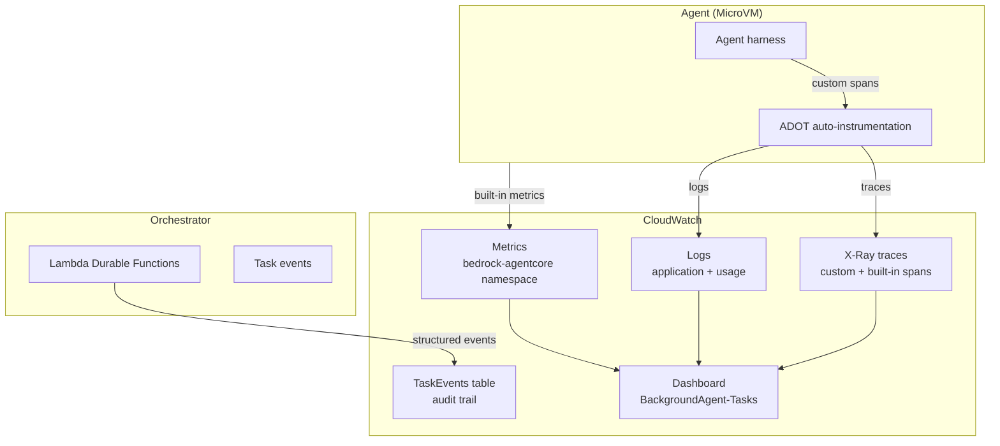

# Observability

For a system where agents run for hours and burn tokens autonomously, observability is load-bearing infrastructure. The platform captures task lifecycle, agent reasoning, tool use, and outcomes so operators can monitor health, debug failures, and improve agent performance over time.

- **Use this doc for:** understanding what the platform observes, how telemetry flows, metrics, dashboards, alarms, and deployment safety.
- **Related docs:** [ORCHESTRATOR.md](./ORCHESTRATOR.md) for task state machine, [MEMORY.md](./MEMORY.md) for code attribution and cross-session learning, [EVALUATION.md](./EVALUATION.md) for agent performance measurement.

## Telemetry architecture

The platform combines three telemetry sources: AgentCore built-in metrics, custom OpenTelemetry spans from the agent harness, and structured task events from the orchestrator. All data flows to CloudWatch. A fourth flow is derived from the task records: one metric line per finished task, see [Factory scoreboard](#factory-scoreboard).



**AgentCore built-in metrics** (automatic): invocations, session count, latency, errors, throttles, CPU/memory usage per session. Published to the `bedrock-agentcore` CloudWatch namespace.

**Custom spans** from the agent harness provide task-level tracing:

| Span | What it covers |
|------|----------------|
| `task.pipeline` | Root span: end-to-end task execution |
| `task.context_hydration` | GitHub issue fetch + prompt assembly |
| `task.repo_setup` | Clone, branch, mise install, initial build |
| `task.agent_execution` | Claude Agent SDK invocation |
| `task.post_hooks` | Safety-net commit, build/lint verification, PR creation |

Root span attributes (`task.id`, `repo.url`, `agent.model`, `agent.cost_usd`, `build.passed`, `pr.url`, etc.) enable CloudWatch querying and filtering.

**Session correlation**: the AgentCore session ID propagates via OTEL baggage, linking custom spans to AgentCore's built-in session metrics in the CloudWatch GenAI Observability dashboard.

## Correlation envelope

Every action in a task's lifecycle is attributable to a stable set of fields — the **correlation envelope** — so operators can answer "who triggered this, on which repo, in which task?" by joining CloudWatch logs, the `TaskEvents` table, and X-Ray traces on shared keys rather than manually stitching them.

| Field | Meaning | Authoritative source | Optional? |
|-------|---------|----------------------|-----------|
| `task_id` | ULID identifying the task | `createTask` (API) → `TaskRecord.task_id` | No — present on every plane |
| `user_id` | Platform identity (Cognito `sub`) that triggered the task | `TaskRecord.user_id`, set at task creation | No |
| `repo` | Target repository (`owner/repo`) | `TaskRecord.repo` | **Yes** — **absent** (key omitted, not `null`/`""`) for repo-less workflows (`requires_repo: false`, #248 Phase 3). Consumers must treat it as optional; the memory/attribution fallback namespace is `user:{user_id}` |
| `trace_id` | OTEL trace id (32-char lowercase hex) of the agent run | agent's active root span, via `current_otel_trace_id()`; persisted to `TaskRecord.otel_trace_id` | Yes — `null` when tracing is disabled or the span context is invalid |
| `session_id` | AgentCore session id | compute strategy at `start-session`; propagated via OTEL baggage | Yes — absent until a session starts; used as the `trace_id` proxy when the trace id is unavailable |

**Field naming is snake_case and shared** with Bedrock cost attribution (#215), the compliance export schema (#237), and delegation-chain propagation (#249), so the same names join across all four features.

### Join model

The orchestrator runs *before* the agent's trace exists, so there is no single W3C trace root spanning both planes. Instead, the `TaskRecord` is the orchestrator↔agent bridge:

```
orchestrator log ──task_id──▶ TaskRecord ──otel_trace_id──▶ agent trace + TaskEvents + S3 trace artifact
```

- **Orchestrator plane** (Lambda): structured logs and `TaskEvents` carry `{task_id, user_id, repo}`. The orchestrator never sees `trace_id` (the agent trace hasn't started), so it joins to the agent plane through the `TaskRecord`.
- **Agent plane** (MicroVM): OTel spans, baggage, and agent-emitted `TaskEvents` carry `{task_id, user_id, repo, trace_id}`, so the event stream is joinable to the X-Ray trace directly.
- **TaskRecord**: holds `otel_trace_id` and `session_id` (persisted at terminal write, #515), the durable link between the two planes and the basis of the [task replay bundle](#task-replay-bundle).

Where the agent runs under `opentelemetry-instrument`, the auto-instrumentation copies the trace context and the baggage into the headers of requests sent with an instrumented HTTP client. The agent image keeps that for boto3 and the tool gateway client and switches it off for `requests` and `urllib3` (`OTEL_PYTHON_DISABLED_INSTRUMENTATIONS` in `agent/Dockerfile`), so the agent's requests to Linear and Atlassian, which it sends with `requests`, carry neither.

**Coverage notes:**

- The `task_created` event is written at task creation, *before* the correlation envelope exists on the orchestration path; it joins by `task_id` alone. Every event from `hydration_started` onward carries the envelope. Rare safety-net writers (e.g. the stranded-task reconciler) likewise join by `task_id`.
- The envelope is stamped on the stored `TaskEvents` items and is queryable directly in DynamoDB / CloudWatch. The `GET /tasks/{id}/events` and `/replay` API responses surface `user_id`/`repo`/`trace_id` per event when present; CLI consumers (`bgagent watch`/`events`/`replay`) can also join at the task level via `TaskRecord.otel_trace_id` (exposed on the replay bundle).

## What to observe

The platform tracks four categories of signals, each serving different consumers (operators, users, evaluation pipeline).

### Task lifecycle

Every task emits structured events at each state transition, stored in the TaskEvents table:

- State transitions: `task_created`, `admission_queued`, `queue_pickup`, `uploads_confirmed`, `hydration_started`, `hydration_complete`, `session_started`, `pr_created`, `task_completed`, `task_failed`, `task_cancelled`, `task_timed_out`
- Blueprint custom step events: `{step_name}_started`, `{step_name}_completed`, `{step_name}_failed`
- Guardrail events: `guardrail_blocked` (content blocked during hydration)

All events carry `task_id` for filtering; the events the orchestrator and the agent write from `hydration_started` onward also carry `user_id` (see the coverage notes above).

### Agent execution

- **Logs** - Agent and runtime logs in CloudWatch (application log group). Primary debugging window after a session ends.
- **Traces** - Custom spans + AgentCore built-in spans in X-Ray, visible in CloudWatch GenAI Observability. Span attributes enable queries like "show all tasks for repo X that failed."
- **Live streaming** - Not available in MVP. Users poll task status via the API.

### System health

- **Concurrency** - RUNNING task count (system-wide and per user), SUBMITTED backlog depth. Used for admission control and capacity planning.
- **Counter drift** - Reconciliation of UserConcurrency counters with actual task counts. Alert when drift is detected.
- **Orchestration health** - Durable function execution status, failures, and retries.

### Cost and performance

- **Token usage** - Per task, per user, per repo. Feeds cost attribution and budget enforcement.
- **Monthly estimated spend** - Terminal task `cost_usd` rolled up by user and Cognito team for the UTC month.
- **Task duration** - End-to-end, cold start (clone + install), and time to first agent output.
- **Error rates** - By failure type (agent crash, timeout, cancellation, orchestration failure).

## Metrics

| Metric | Type | Purpose |
|--------|------|---------|
| Task duration (p50, p95) | Latency | Performance baseline and regression detection |
| Token usage per task | Cost | Cost attribution and budget enforcement |
| `ABCA/Budgets:BudgetThresholdCrossed` | Cost | Claimed 80%/100% monthly user/team budget crossings; retries can rarely duplicate a metric |
| `ABCA/Budgets:BudgetTeamMembershipUnresolved` | Correctness | Count of admissions where Cognito could not resolve a mapped user, so team-budget enforcement was skipped |
| Cold start duration | Latency | Image optimization signal |
| Active tasks (RUNNING count) | Capacity | Admission control and capacity planning |
| Pending tasks (SUBMITTED count) | Capacity | Backlog depth and throughput monitoring |
| Task completion rate | Reliability | Success vs failed/cancelled/timed out |
| Error rate by failure type | Reliability | Regression and bottleneck detection |
| Agent crash rate | Reliability | Runtime stability |
| Counter drift frequency | Correctness | Concurrency accounting health |
| Guardrail blocked rate | Security | Content screening activity |
| Guardrail screening failure rate | Availability | Bedrock Guardrail API health |
| `ABCA/Factory` (seven metrics) | Business | What each finished task came to: its outcome, the time to a verified pull request, human touchpoints, cost, guardrail stops and blanket approvals. Defined in [The metric stream](#the-metric-stream) |

Emitted as custom CloudWatch metrics and used in dashboards and alarms.

## Dashboard

A CloudWatch dashboard (`BackgroundAgent-Tasks-${stackName}`, i.e. the base name suffixed with the stack name) is deployed via the `TaskDashboard` CDK construct. It provides widgets for:

- Task success rate and count by status
- Cost per task and turns per task
- Duration distribution
- Build and lint pass rates
- AgentCore built-in metrics (invocations, errors, latency)
- The factory scoreboard, the first row: `ABCA/Factory` metric widgets that cover the last 30 days whatever time range the dashboard shows, for time to verified pull request, verified pull requests with no stop for a person, human touchpoints and spend per verified pull request, guardrail stops and blanket approvals, and tasks finished per day by outcome (see [Factory scoreboard](#factory-scoreboard))

The "Task Success Rate (24h)" widget counts what the agent reported at the end of its own run: a task that stopped to ask a question and a pull request on a build that was already failing both count as success, and tasks that were cancelled or that the platform failed are not in it. The factory scoreboard row is the outcome view.

The CloudWatch GenAI Observability console provides additional views: per-session traces, CPU/memory usage, trace timeline with custom spans, and transaction search by span attributes.

## Alarms

| Alarm | Trigger | Action |
|-------|---------|--------|
| Stuck task | RUNNING > 9 hours | Check session liveness. If dead, trigger manual finalization. If alive but unresponsive, cancel. |
| Counter drift | UserConcurrency differs from actual task counts | Reconciliation Lambda auto-corrects. If it fails, manual correction. |
| Orchestration failures | Repeated durable function execution failures | Check failing step, verify service health. Durable execution auto-retries transient failures. |
| Agent crash rate spike | Sustained high session failure rate | Check for model API errors, compute quota exhaustion, image pull failures. |
| Submitted backlog depth | SUBMITTED count exceeds threshold | System at capacity. Increase concurrency limits or wait for running tasks. |
| Guardrail screening failures | Sustained Bedrock Guardrail API failures | Tasks fail at submission (503) and hydration (FAILED). Recovers when Bedrock recovers. |
| Monthly budget warning | Estimated spend crosses 80% | Notify the shared `OperationalAlerts` SNS topic; inspect `OrchestrationReconciler` logs for scope details. |
| Monthly budget exceeded | Estimated spend crosses 100% | Notify the shared topic. Scopes configured with hard stop reject new tasks. |
| Budget team membership unresolved | Cognito cannot resolve a mapped task owner | Inspect create-task logs for `budget_team_membership_user_missing`, then repair the stale mapping or federated identity configuration. User-budget enforcement remains active, but team-budget enforcement was skipped. |

## Factory scoreboard

The factory scoreboard shows whether the work handed to agents turns into verified pull requests, how much human attention and money that takes, and whether it stayed inside the rules. One definition of what a finished task counts as (`cdk/src/handlers/shared/scoreboard.ts`) feeds two surfaces, the operator console and CloudWatch, so both count a task the same way. ABCA sees a task up to the pull request and its build verdict and nothing after that: review, merge, deploy and the outcome for customers are not in these numbers.

### Where the numbers appear

| Surface | Whose tasks | How far back | How it is computed |
|---------|-------------|--------------|--------------------|
| Operator console, **Scoreboard** page | The signed-in user's own | Up to 60 days: the last 7 or 30 days, beside the period of the same length before. It does not start at the deployment: the page reads the task records, which are kept 90 days by default (`taskRetentionDays`) | On request, from the task records: `GET /v1/tasks?view=scoreboard` (see [API_CONTRACT.md](./API_CONTRACT.md#list-tasks)) |
| CloudWatch dashboard, **Factory scoreboard** row | Every user's | From the deployment of the scoreboard on. The row shows the last 30 days, whatever time range the dashboard is set to | By CloudWatch, from one metric line per finished task (see [The metric stream](#the-metric-stream)) |

The page takes percentiles by nearest rank and CloudWatch computes its own, so small differences between the two are expected. A request reads a bounded number of task records: when a range holds more, the page says from which date its numbers count and leaves out the comparison with the period before.

The page reads records as they were written, so two kinds of older record count wrongly until they leave the range:

- An agent image from before 2026-11-19 (#1052) recorded a build command that could not run as passed: the pull request of such a task counts as verified. Until those records leave the range (up to 30 days for the numbers, 60 for the comparison), the verified numbers of a repository whose build command cannot run are too high.
- A deployment from before 2026-11-17 (#1048) left two kinds of finished task under the index key of an earlier status: tasks cancelled from Slack, and tasks that failed while their upload instructions were prepared. They are not on the page.

### Words

| Word | Meaning |
|------|---------|
| Finished task | A task in a terminal status: `COMPLETED`, `FAILED`, `CANCELLED` or `TIMED_OUT`. It counts in the period in which it finished (`completed_at`, or `updated_at` on a record without one) |
| Task that asked for a new pull request | A finished task that ran `coding/new-task-v1`. The internal integration task of an orchestration is not one: it combines the branches of other tasks. Work that was never handed to an agent is not visible |
| Coding task | A finished task that ran `coding/new-task-v1`, `coding/pr-iteration-v1` or `coding/restack-v1`: the work that goes into pull requests. Reviews and tasks without a repository are not charged to pull requests |
| Ran | The task's agent session started (`started_at` is set) |
| Verified pull request | A pull request opened by a task that asked for a new one, completed, and recorded a passed build: the repository's build command passed after the change. Lint does not count, and a pull request that a later follow-up repairs does not become verified |

Every finished task has exactly one outcome:

| Outcome | Console row | Rule |
|---------|-------------|------|
| `verified_pr` | Verified pull request | Asked for a new pull request, `COMPLETED`, has a pull request (`pr_url`), and `build_passed` is true |
| `unverified_pr` | Pull request without a passed build | Asked for a new pull request, `COMPLETED`, has a pull request, and `build_passed` is false (the build was already failing before the change and still fails) or absent (the build command could not run, which is always the case in a repository that has neither a build command in its blueprint nor a `mise run build` task) |
| `no_new_pr` | Finished, no new pull request | Every other `COMPLETED` task: one that asked for a new pull request and stopped to ask a question instead, a follow-up on a pull request, a review, a restack, a task without a repository, an integration task |
| `failed` | Failed | `FAILED`. This includes a change that broke a passing build, whose pull request stays on the record, and a task that never started |
| `cancelled` | Cancelled | `CANCELLED` |
| `timed_out` | Ran out of time | `TIMED_OUT` |

A touchpoint is a place where the work waited for a person or was redirected by one. A finished task has, by kind:

| Kind | Rule |
|------|------|
| `approve` | Its number of approval requests (`approval_gate_count`). These are requests, not approvals: each one asked for a person, and one that could not be stored is counted too |
| `clarify` | 1 when the agent stopped to ask a question instead of opening a pull request: a `coding/new-task-v1` task with `code_changed` false, an `answer_text` and no pull request |
| `follow_up` | 1 when the task ran `coding/pr-iteration-v1`: a request came back to an existing pull request |
| `cancel` | 1 when the task is `CANCELLED` and has no `error_message`. This is inferred: a cancel by a person writes no message, the automatic cancel of an expired upload does |

Two flags mark a finished task for the trust numbers:

| Flag | Rule |
|------|------|
| Guardrail stop | `FAILED`, and the `error_message` is classified as a guardrail block: content was blocked while the task was prepared |
| Blanket approval | `initial_approvals` contains `all_session`: every approval was granted in advance, at submission. Rules that always refuse an action still applied |

### The numbers

Each number is computed over the tasks that finished in one period: the 7 or 30 days of 24 hours up to the moment of the request, or the same length before that. A share with nothing to divide by has no value, and the page shows a dash.

| Number | What it counts | Start, stop, evidence | API field | CloudWatch metric |
|--------|----------------|-----------------------|-----------|-------------------|
| Time to verified pull request | Median and 90th percentile of the time from creation to finish, over the verified pull requests of the period. With fewer than 10 of them the 90th percentile is the slowest or close to it, and the page leaves it out | Start: the task is created (`created_at`). Stop: it finishes with a pull request and a passed build (`completed_at`). Evidence: the task record. The clock restarts with every attempt: a retry, or a task resumed after a question, is a new task | `time_to_verified_pr_s`: `p50`, `p90` and `count`, in whole seconds | `TimeToVerifiedPrSeconds`: p50 and p90, which the row shows in minutes |
| Second line of that tile: the part before the agent started | Median time from creation to the start of the session, time in the admission queue included, over the same tasks | Start: the task is created. Stop: its session starts (`started_at`) | `wait_p50_s` | None: `wait_s` is a plain field of the metric line |
| Waited in line | Finished tasks that waited in the admission queue, of the finished tasks that waited in it or ran | Evidence: `queued_at`, `started_at`. A task that was cancelled while it waited, or failed because it waited too long, counts as having waited | `queued` | None |
| Ended in a verified pull request | Verified pull requests, of the tasks that asked for a new pull request | Evidence: the outcome rules above. A repository with no build command to run never has a verified pull request, so its share is zero | `verified` | The count only: `TasksFinished` with `Outcome=verified_pr` |
| Not reworked through ABCA, so far | New pull requests of the period, verified or not, that no follow-up task reworked before the period's end, of those pull requests | Evidence: the repository and the pull request number. A follow-up task on the same pull request is rework unless it is known to have changed no code (`code_changed` false). Only rework requested through ABCA by the same user is visible, and a pull request whose number cannot be read is in neither count | `not_reworked` | None |
| Verified pull request with no stop for a person | Verified pull requests whose task has no touchpoint, of the tasks that asked for a new pull request | Such a task can only have approval requests, so this is "no approval request" | `untouched` | `UntouchedVerifiedPrs`: average |
| Human touchpoints per verified pull request | Touchpoints of all four kinds on the coding tasks of the period, failed ones included, divided by the verified pull requests | Evidence: the touchpoint rules above | `touchpoints` by kind: divide their sum by `outcomes.verified_pr` | Sum of `HumanTouchpoints` with `Work=coding`, over the sum of `TasksFinished` with `Outcome=verified_pr` |
| Spend per verified pull request | Recorded cost of the coding tasks of the period, failed attempts and follow-ups included, divided by the verified pull requests | Evidence: `cost_usd`, an estimate of model usage that does not include compute. A task that was cancelled, timed out or lost its session records none: `uncosted` counts the coding tasks that ran without a recorded cost | `spend_usd` and `uncosted`: divide `spend_usd` by `outcomes.verified_pr` | Sum of `CostUsd` with `Work=coding`, over the sum of `TasksFinished` with `Outcome=verified_pr` |
| Stopped by a guardrail | Finished tasks with the guardrail-stop flag | Evidence: `error_message` | `guardrail_stops`: `count`, and `task_ids` of the newest 10 | `GuardrailStops`: sum |
| Held for approval | Coding tasks that ran and made at least one approval request, of the coding tasks that ran | Evidence: `approval_gate_count`. The person who submitted the task answers the request: there is no second reviewer | `gated` | None |
| Started with blanket approval | Finished tasks with the blanket-approval flag | Evidence: `initial_approvals` | `blanket_approvals`: `count`, and `task_ids` of the newest 10 | `BlanketApprovals`: sum |
| Tasks finished, by outcome | Finished tasks per outcome. Activity is a diagnostic, not a score | Evidence: the outcome rules above | `finished` and `outcomes` | `TasksFinished` by `Outcome`: sum per day |

The places where a number is added are listed in the header of `cdk/src/handlers/shared/scoreboard.ts`. This table is one of them.

### Not counted and not measured

Touchpoints and stops that happen and are not in the numbers:

| Not counted | What counting it would need |
|-------------|-----------------------------|
| Reviewing and merging on GitHub | Review, merge and close events of the pull request: ABCA reads none |
| Messages sent to a running task | The nudges of the task: they are stored apart from the task record the scoreboard reads |
| New tasks submitted to retry or continue earlier work | A link from a task to the task it retries or continues: the record has none |
| Follow-ups by other people, on the console page | A read across users: a follow-up task that belongs to someone else is on their page, not against the pull request on yours |
| Work a person finished by hand | The authors of the commits on the pull request's branch, from GitHub |
| Requests and attachments refused before a task started | A record of the refusal: a refused request creates no task, and a refused attachment fails its task with the same kind of message as one that is too large |
| Tool calls refused during a run | A count on the task record: the refusals are in the agent's logs (`POLICY_DECISION` events), and the task goes on |
| Network destinations refused during a run | The DNS Firewall's query log, with the firewall set to block: the task record holds only the agent's reading of a failed connection |
| A blanket approval granted during a run | A mark on the task record: the flag reads the approvals granted at submission only. Such a task shows under Held for approval |

Numbers ABCA does not measure:

| Not measured | What measuring it would need |
|--------------|------------------------------|
| Lead time past the pull request: review, merge, deploy, the outcome for customers | Pull request events from GitHub, then deploy and product data |
| Deploy frequency | Deploy data |
| Change failure rate and time to restore | Deploy and incident data |
| The hours people spent, and review time | Time records, and review events from GitHub |
| The share of gated actions that a pre-approval let through | A count of those calls on the task record: they are in the agent's logs only |
| Tokens and changed lines | They are activity, not a score, and are left out on purpose. Token usage is in the dashboard's "Token Usage per Task" widget; changed lines would need the diff statistics of the pull request |

### The metric stream

When a task finishes, the consumer of the TaskTable stream (`OrchestrationReconciler`) writes one log line in CloudWatch embedded metric format, and CloudWatch extracts these metrics from it into the `ABCA/Factory` namespace:

| Metric | Unit | Dimension | Emitted |
|--------|------|-----------|---------|
| `TasksFinished` | `Count` | `Outcome` | 1 on every finished task |
| `HumanTouchpoints` | `Count` | `Work` | On every finished task: its touchpoints of all four kinds, 0 included |
| `CostUsd` | `None` | `Work` | Only when the task recorded a cost |
| `GuardrailStops` | `Count` | none | 0 or 1 on every finished task |
| `BlanketApprovals` | `Count` | none | 0 or 1 on every finished task |
| `TimeToVerifiedPrSeconds` | `Seconds` | none | Only on a task that ended in a verified pull request and whose creation time is known |
| `UntouchedVerifiedPrs` | `Count` | none | 0 or 1 on every task that asked for a new pull request, so that its average is the share with no stop for a person |

`Outcome` takes the six outcomes above. `Work` is `coding` for a coding task and `other` for every other task. Both sets are closed, so the namespace holds at most 14 time series: 6 for `TasksFinished`, 2 each for `HumanTouchpoints` and `CostUsd`, and 4 without a dimension. The task, the user, the repository and the workflow are plain fields of the line (`task_id`, `user_id`, `repo`, `workflow`), as is the wait before the session started (`wait_s`), and never dimensions: every distinct value of a dimension is one more billed time series, and a metric should not carry the identifier of a person or a repository. The fields remain queryable with Logs Insights in the log group of that function.

One line, wrapped here:

```json
{
  "_aws": {
    "Timestamp": 1794997440000,
    "CloudWatchMetrics": [
      { "Namespace": "ABCA/Factory", "Dimensions": [["Outcome"]], "Metrics": [{ "Name": "TasksFinished", "Unit": "Count" }] },
      { "Namespace": "ABCA/Factory", "Dimensions": [["Work"]], "Metrics": [{ "Name": "HumanTouchpoints", "Unit": "Count" }, { "Name": "CostUsd", "Unit": "None" }] },
      { "Namespace": "ABCA/Factory", "Dimensions": [[]], "Metrics": [{ "Name": "GuardrailStops", "Unit": "Count" }, { "Name": "BlanketApprovals", "Unit": "Count" }, { "Name": "TimeToVerifiedPrSeconds", "Unit": "Seconds" }, { "Name": "UntouchedVerifiedPrs", "Unit": "Count" }] }
    ]
  },
  "Outcome": "verified_pr", "Work": "coding",
  "TasksFinished": 1, "HumanTouchpoints": 0, "CostUsd": 3.87,
  "GuardrailStops": 0, "BlanketApprovals": 0, "TimeToVerifiedPrSeconds": 1440, "UntouchedVerifiedPrs": 1,
  "task_id": "01HYX...", "user_id": "...", "repo": "owner/repo", "workflow": "coding/new-task-v1", "wait_s": 41
}
```

- **Once per task** - The record of a finished task is written again for as long as it lives, and stream records are redelivered. The step therefore claims the task before it writes: one conditional write sets `metrics_emitted_at` on the task record (an internal field that no API response shows), and only the write that sets it is followed by a line. A line is written at most once. It is lost when the function stops between the claim and the line, or when the claim succeeds but its response is lost and the retry finds the task already claimed. A step that fails is logged (`Scoreboard metrics step failed: task not counted`) and is not reported for retry, so that metrics never hold back orchestration or the budget rollup. When it failed before its claim, the task is still counted if its record reaches the step again within 24 hours of the finish: on a later write of the record, or when Lambda delivers the batch again for another reason.
- **History starts at deployment** - A delivery that reaches the step more than 24 hours after its task finished is skipped: that is a later write of a task that finished before the deployment, or of a task whose earlier claim failed. A task that finished within the 24 hours before the deployment is counted when its record is written again after it. A line carries the finish time of its task: CloudWatch drops values older than 14 days, and younger ones would show as data from before the deployment. The console page has no such limit, because it reads the task records.
- **Duplicates** - The embedded metric format delivers the values of a line at least once, so CloudWatch can on rare occasions count a value twice.
- **Not an audit record** - The row is an operational number, built from what each task record says when its task finishes. Use it to steer, not as evidence: the audit log is the TaskEvents table (see [Audit and retention](#audit-and-retention)).
- **Shared namespace** - Neither the namespace nor a dimension names the stack: two ABCA stacks in one account and Region add up in the same series.
- **Forwarding** - To send these metrics to another system, create a CloudWatch metric stream that includes the `ABCA/Factory` namespace: ABCA does not create one, and percentiles have to be added to the stream as an additional statistic.
- **When a number looks wrong** - The batch line of the stream consumer (`Orchestration reconciler batch processed`) carries `metrics_published` and `metrics_failed`. A line that CloudWatch could not use is counted for that function's log group in the `AWS/Logs` namespace: `EMFParsingErrors`, `EMFValidationErrors`, and `EMFDisabledErrors` when an account policy switches extraction off. On the page's side, the list function (`ListTasksFn`) logs a read that fails as `Failed to list tasks` with `view` set to `scoreboard`, and a read that stops at its cap as the warning `Scoreboard read stopped at its page cap`, with the `user_id`, the `range` and the time from which the numbers count (`covered_from`).

## Code attribution

Every agent commit carries `Task-Id:` and `Prompt-Version:` trailers (via a git hook installed during repo setup). This links code changes to the task and prompt that produced them, enabling queries like "what prompt led to this change?" and supporting the evaluation pipeline.

Task conversations, tool calls, decisions, and outcomes are persisted with metadata (`task_id`, `session_id`, `repo`, `branch`, `commit SHAs`, `pr_url`) in a searchable store. The agent retrieves relevant past context via memory search at task start. See [MEMORY.md](./MEMORY.md) for the memory lifecycle and retrieval strategy.

## Audit and retention

- **TaskEvents table** - Append-only audit log of all task events. Records carry a DynamoDB TTL and are auto-deleted after the retention period (default 90 days, configurable via `taskRetentionDays`).
- **Task records** - Status, timestamps, metadata. TTL is stamped when the task reaches a terminal state (default 90 days). Active tasks are retained indefinitely.
- **Budget records** - Recurring configs persist; monthly spend rows and task deduplication markers expire after about 400 days.
- **Logs** - Application and usage logs retained for 90 days in CloudWatch. Traces flow to X-Ray via CloudWatch Transaction Search.
- **Model invocation logs** - Bedrock model invocation logging with 90-day retention for compliance and prompt injection investigation.

## Task replay bundle

For post-mortems, eval-harness input, and compliance export, the API exposes a single **replay bundle** per task that aggregates the telemetry stores above — chronological `TaskEvents`, the verification verdict, the `--trace` S3 URI, `prompt_version` / `workflow_ref`, the OTEL trace id (or `session_id` as the correlation proxy when absent), and cost — without manually correlating CloudWatch, DynamoDB, and S3. It reads existing stores only (no new persistence).

- **API:** `GET /v1/tasks/{task_id}/replay` (Cognito, owner-scoped — same auth as task read). Schema and example in [API_CONTRACT.md](./API_CONTRACT.md#get-replay-bundle).
- **CLI:** `bgagent replay <task-id> [--json] [--output <file>]`.

Fields whose source did not run for a given task are returned `null`/empty (e.g. no `--trace` → `trace_uri: null`), so the schema is stable for consumers.

## AgentCore log delivery

The agent runtime's application and usage logs reach CloudWatch through a trio of resources per log type — `AWS::Logs::DeliverySource`, `AWS::Logs::DeliveryDestination`, and an `AWS::Logs::Delivery` link joining them. The stack does not declare these. The AgentCore `Runtime` L2 construct creates them from the `loggingConfigs` passed to it, and names them from its own internal construct path.

**The stack deliberately does not override their logical ids.** That is a load-bearing decision rather than an oversight, because the obvious alternatives are worse in a way that is not obvious until a deployment fails.

### Why a rename of these resources is fatal

A `DeliverySource` is unique per `(resource ARN, log type)` for the whole account. The agent runtime's ARN does not change when the delivery resources are renamed, so:

1. Changing a delivery resource's logical id makes CloudFormation treat it as a new resource, which it **creates before deleting** the old one.
2. The new source points at the same runtime ARN as the live one, which still exists at that moment.
3. CloudWatch Logs rejects it — `AlreadyExists`, "This ResourceId has already been used in another Delivery Source in this account."
4. The whole stack update rolls back.

The counter-intuitive consequence: **no choice of name avoids this.** The conflict is on the ARN the sources point at, not on their own names, so renaming them to library-generated ids, to hand-picked stable ids, or to anything else collides identically. Only leaving a logical id untouched avoids it, because that is what makes CloudFormation update in place instead of creating a second source for the same runtime.

### Why the ids are not pinned in the template

An earlier version of the stack held a table of logical ids to override, keyed by stack name, with values read off a live stack. This does not work, because **stack name is not a proxy for deployed state.** Two accounts running a stack of the same name can sit on different library versions' naming, so one set of literals is correct for one account and actively causes the fatal rename on the other. Re-recording the table inverts which account breaks rather than fixing either.

Since no set of literals can describe every account's deployed state, the stack holds none. Log delivery is left to the library, which generates the ids from the construct path — deterministically, identically in every account, with nothing to keep in sync.

The cost of this choice is bounded and one-time: a stack deployed before a library-side rename, or held on older ids by the pin table, must converge once. See the migration below. The cost of the alternative was unbounded — a hand-maintained table that silently breaks a different account every time any library version or any deployment moves.

### Migrating a stack that predates the current naming

Fresh deployments need nothing here. A stack whose live delivery resources already match what the library generates needs nothing either, and `cdk diff` will show the six resources untouched.

A stack still on older ids has to converge, and because the create-before-delete collision above applies, the old resources must be gone before the new ones are created.

**`mise //cdk:deploy` handles this automatically** (the CI pipeline reports it but does not migrate — see the deployment guide's known-issues entry)**.** The deploy task runs a preflight (`cdk/scripts/preflight-log-delivery.ts`) that reads the stack's own resource list and, only when it finds delivery resources under the retired pinned ids (a `CDKSource` or `CdkLogGroup` segment in the logical id), deletes exactly those before the deploy proceeds. It deletes by the physical ids CloudFormation reports for *this stack*, so other delivery configurations in the account — even on a shared account — are unreachable by construction. Already-migrated stacks and fresh installs pass through untouched, so the preflight is safe to leave on every deploy.

**Which stacks are affected is a property of deployed state, not of the stack's name.** The legacy ids are the *previous library's* naming, not a product of the pin table: `#339` (`9a58797c`, 2026-06-13) switched the stack from `@aws-cdk/aws-bedrock-agentcore-alpha` to `aws-cdk-lib/aws-bedrockagentcore`, and the pin table only landed seven weeks later in `#695` (`4357c353`, 2026-08-03). The alpha generated the `RuntimeCDKSource…` / `RuntimeCdkLogGroup…` shapes; `aws-cdk-lib` generates `RuntimeApplicationLogsDeliverySource<hash>`.

So the affected predicate is exactly what the preflight itself tests: **the stack's live `AWS::Logs::Delivery*` logical ids contain `CDKSource` or `CdkLogGroup`** — true of any stack last deployed before that library switch, whatever it is called, and whether or not the pin table ever applied to it. A custom-named stack is *not* immune, and neither is a stack created fresh from a commit that carried the table. "It deploys fine today" does not mean "unaffected", because the collision only appears on the deploy that renames.

Run the check once per stack, regardless of name — it deletes nothing:

```bash
STACK_NAME=<stack> mise //cdk:preflight:log-delivery -- --check-only
```

Exit 0 means nothing to migrate; exit 2 lists what would be deleted. The preflight exists because the affected operators cannot be enumerated or notified.

Knobs, all optional:

```bash
# Report what would be deleted; exit 2 if migration is needed
mise //cdk:preflight:log-delivery -- --check-only

# Non-default stack: set BOTH — see the note below
STACK_NAME=my-stack mise //cdk:deploy -- -c stackName=my-stack

# Skip the preflight entirely (at your own risk)
ABCA_SKIP_LOG_DELIVERY_PREFLIGHT=1 mise //cdk:deploy
```

**A non-default stack needs the name given twice, and the two are not interchangeable.** `cdk deploy` selects its stack from `stackName` CDK *context*, while the preflight reads `STACK_NAME` (or `--stack-name`, or `stackName` in `cdk.json` context). Arguments after `--` are appended to the `cdk deploy` command and never reach a mise `depends` task, so `-c stackName=x` alone leaves the preflight on its default target — and `STACK_NAME=x` alone leaves the *deploy* on its default target. Setting only one is how you end up migrating one stack while deploying another.

This is now closed rather than merely documented: the preflight runs as the first command of the `deploy` task, so the arguments after `--` reach it and `cdk deploy` alike, and `--profile` / `--region` are forwarded to its own AWS calls. It also reads `cdk.context.json` (the file the CI pipeline writes `stackName` into), not just `cdk.json`.

If the stack name still resolves from the built-in default *while arguments were supplied*, the preflight refuses to delete rather than guess — the case that would otherwise migrate one stack's delivery resources while deploying another, leaving the first one's agent logging dark until it is deployed itself. Every run prints the stack, where the name came from, and the account and region it resolved to:

```
log-delivery preflight: inspecting stack 'backgroundagent-dev'
  (from default)
```

To migrate by hand instead (e.g. deploying without mise), list the stack's delivery resources and delete only those, deliveries first — they reference the source and destination:

```bash
aws cloudformation list-stack-resources --stack-name backgroundagent-dev \
  --query "StackResourceSummaries[?contains(ResourceType,'Logs::Delivery')].\
[ResourceType,LogicalResourceId,PhysicalResourceId]" --output text
# For each row whose LogicalResourceId carries a CDKSource/CdkLogGroup segment:
#   AWS::Logs::Delivery            -> aws logs delete-delivery --id <PhysicalResourceId>
#   AWS::Logs::DeliverySource      -> aws logs delete-delivery-source --name <PhysicalResourceId>
#   AWS::Logs::DeliveryDestination -> aws logs delete-delivery-destination --name <PhysicalResourceId>
```

Do the deletion immediately before deploying, not in advance: agent logs stop being delivered from the deletion until the deploy completes, and a full deploy (image build included) can take an hour. The deploy then creates the delivery trio under the library's naming and drops the old logical ids, whose underlying resources are already gone — CloudFormation treats a delete of an absent resource as done. Nothing else is affected, and no log data already in CloudWatch is touched.

If the migration is skipped, the failure is loud but unexplained: the update fails on the new `AWS::Logs::DeliverySource` with `AlreadyExists` ("This ResourceId has already been used in another Delivery Source") and the whole stack rolls back. The stack keeps running on its previous template; run the preflight (or the manual steps) and deploy again.

## Deployment safety

Agent sessions run for up to 8 hours. CDK deployments replace Lambda functions, which can orphan in-flight orchestrator executions. The platform handles this through multiple mechanisms:

- **Drain before deploy** - Pre-deploy check for active tasks. Warn or block if tasks are running.
- **Durable execution resilience** - Lambda Durable Functions checkpoints are stored externally. A replaced Lambda can resume from its last checkpoint.
- **Consistency recovery** - If a deploy interrupts a running orchestrator, the `ConcurrencyReconciler` Lambda (every 15 minutes) corrects the concurrency counter. (This is distinct from the stranded-task reconciler, a separate Lambda that runs every 5 minutes to fail tasks whose pipeline never started.) The stuck task alarm fires and triggers manual finalization.
- **Blue-green deployment** - CI/CD pipeline uses blue-green for the orchestrator Lambda, with automatic rollback if error rates increase.

## Account prerequisites

Two one-time, account-level setup steps are required before deployment (not managed by CDK):

1. **X-Ray trace segment destination** - Run `aws xray update-trace-segment-destination --destination CloudWatchLogs`. Without this, `cdk deploy` fails.
2. **CloudWatch Transaction Search** - Enable in the CloudWatch console (Application Signals > Transaction Search > Enable, with "ingest spans as structured logs" checked).
