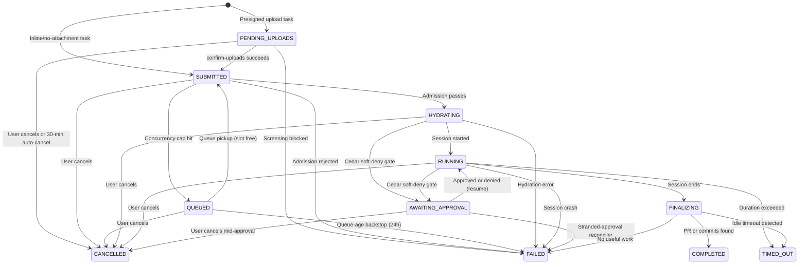
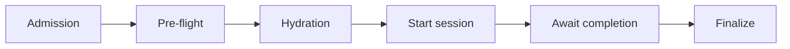
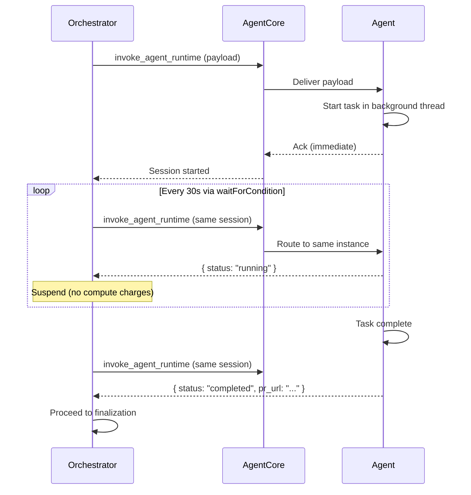

# Orchestrator

The orchestrator drives the task lifecycle from submission to completion. It runs every deterministic step (admission, context hydration, session start, result inference, cleanup) and delegates the non-deterministic step (the agent workload) to an isolated compute session. The split keeps bookkeeping cheap and predictable, and it contains the expensive, unpredictable agent work inside the compute environment.

The orchestrator is a Lambda Durable Function. Durable execution provides checkpoint and replay across process restarts, suspension without compute charges during long waits, and condition-based polling for session completion. See the Implementation section for details.

- **Use this doc for:** task state machine, admission and finalization flow, cancellation behavior, failure recovery, and concurrency management.
- **Related docs:** [ARCHITECTURE.md](./ARCHITECTURE.md) for the high-level blueprint model, [COMPUTE.md](./COMPUTE.md) for the session runtime, [MEMORY.md](./MEMORY.md) for context sources, [REPO_ONBOARDING.md](./REPO_ONBOARDING.md) for per-repo customization.

## API and agent contracts

The orchestrator sits between the API layer and the agent runtime. Changes to task submission, the CLI, or the container image touch these boundaries, so knowing where each contract lives avoids drift.

| Concern | Location | Notes |
|---------|----------|-------|
| REST request/response types | `cdk/src/handlers/shared/types.ts` | Mirror in `cli/src/types.ts`. The console mirrors a subset in `web/src/core/api/types.ts` |
| HTTP handlers and orchestration | `cdk/src/handlers/` | Tests under `cdk/test/handlers/` |
| Agent runtime | `agent/src/` (`pipeline.py`, `runner.py`, `config.py`, `hooks.py`, `prompts/`) | See `agent/README.md` for env vars and local run |

## Responsibilities

The orchestrator's scope is limited on purpose. It handles coordination and bookkeeping and never touches agent logic, compute infrastructure, or memory storage. Because of this boundary, a crashed agent does not leave orphaned state, and agent code cannot bypass platform invariants (concurrency limits, event audit, cancellation).

### What the orchestrator owns

| Responsibility | Description |
|---|---|
| Task lifecycle | Accept tasks, drive them through the state machine to a terminal state, persist state at each transition |
| Admission control | Validate repo onboarding, concurrency limits, rate limits, idempotency |
| Context hydration | Assemble the agent prompt from user input, GitHub data, memory, and repo config |
| Session management | Start the compute session, monitor backend liveness and heartbeats where applicable, detect completion |
| Result inference | Determine success or failure from agent response, DynamoDB record, and GitHub state |
| Finalization | Update status, emit events, release concurrency, persist audit records |
| Cancellation | Stop the session and drive the task to CANCELLED at any point |
| Concurrency | Track per-user and system-wide running task counts with atomic counters |

### What the orchestrator does NOT own

| Component | Owner | Reference |
|---|---|---|
| Request authentication | Input gateway | [INPUT_GATEWAY.md](./INPUT_GATEWAY.md) |
| Agent logic (clone, code, test, PR) | Agent runtime | [COMPUTE.md](./COMPUTE.md) |
| Compute substrate internals (VM or task provisioning, image pull) | Selected compute service | [COMPUTE.md](./COMPUTE.md) |
| Memory storage and retrieval | AgentCore Memory | [MEMORY.md](./MEMORY.md) |
| Repository onboarding | Blueprint construct | [REPO_ONBOARDING.md](./REPO_ONBOARDING.md) |

## Task state machine

Every task moves through a finite set of states from creation to a terminal outcome. The state machine determines which actions are valid at each point, when resources are acquired or released, and how the platform recovers from failures. Four of the eleven states are terminal. In a terminal state the task is done and no further transitions occur.

### States

| State | Description | Duration |
|---|---|---|
| `PENDING_UPLOADS` | Presigned-upload task awaiting client file uploads | Minutes (30-min auto-cancel) |
| `QUEUED` | Admission-capped task awaiting a free concurrency slot (#441) | Minutes to hours (24h backstop) |
| `SUBMITTED` | Task accepted, awaiting orchestration | Milliseconds |
| `HYDRATING` | Fetching GitHub data, querying memory, assembling prompt | Seconds |
| `RUNNING` | Agent session active in compute environment | Minutes to hours |
| `AWAITING_APPROVAL` | Cedar HITL soft-deny gate fired. Paused on human decision | Minutes to hours |
| `FINALIZING` | Result inference and cleanup in progress | Seconds |
| `COMPLETED` | Terminal. Task finished successfully | - |
| `FAILED` | Terminal. Task could not complete | - |
| `CANCELLED` | Terminal. Cancelled by user or system | - |
| `TIMED_OUT` | Terminal. Exceeded duration or idle timeout | - |

### State transitions

### Transition details

| From | To | Trigger | Condition |
|---|---|---|---|
| `PENDING_UPLOADS` | `SUBMITTED` | `confirm-uploads` succeeds | All attachments screened and passed |
| `PENDING_UPLOADS` | `FAILED` | Screening blocked | Any attachment fails security screening |
| `PENDING_UPLOADS` | `CANCELLED` | User cancels or auto-cancel | Upload window expired (30 min) or explicit cancel |
| `SUBMITTED` | `HYDRATING` | Admission passes | Concurrency slot acquired |
| `SUBMITTED` | `QUEUED` | Concurrency cap hit | Per-user cap reached. Task parked in FIFO admission queue (#441). No slot held. |
| `SUBMITTED` | `FAILED` | Admission rejected | Repo not onboarded, validation error |
| `QUEUED` | `SUBMITTED` | Queue pickup | Admission-queue pickup Lambda sees free capacity and re-invokes the orchestrator. FIFO by `created_at`. |
| `QUEUED` | `CANCELLED` | User cancels | Explicit cancel removes the task from the queue |
| `QUEUED` | `FAILED` | Queue-age backstop | Task waited longer than `QUEUE_MAX_AGE_SECONDS` (default 24h) without admission |
| `HYDRATING` | `RUNNING` | Hydration complete | Selected `ComputeStrategy.startSession` returns a session handle |
| `HYDRATING` | `AWAITING_APPROVAL` | Cedar soft-deny gate fires | Tool call triggers a soft-deny policy rule during hydration |
| `HYDRATING` | `FAILED` | Hydration error | GitHub API failure, guardrail blocks content, Bedrock unavailable |
| `RUNNING` | `AWAITING_APPROVAL` | Cedar soft-deny gate fires | Tool call triggers a soft-deny policy rule during execution |
| `RUNNING` | `FINALIZING` | Session ends | Response received or session terminated |
| `RUNNING` | `TIMED_OUT` | Max duration exceeded | AgentCore and Lambda MicroVMs have an 8h substrate cap. The orchestrator's own safety-net poll window is `MAX_POLL_ATTEMPTS` (1020) × 30s ≈ 8.5h. After that window, a task that is still `RUNNING` is driven to `TIMED_OUT` |
| `RUNNING` | `FAILED` | Session crash | Heartbeat or substrate liveness lost (see Liveness monitoring) |
| `AWAITING_APPROVAL` | `RUNNING` | Approved or denied | Human decision received. Agent resumes |
| `AWAITING_APPROVAL` | `CANCELLED` | User cancels | Explicit cancel while awaiting approval |
| `AWAITING_APPROVAL` | `FAILED` | Stranded reconciler | Approval request orphaned (agent died mid-wait) |
| `FINALIZING` | `COMPLETED` | Success inferred | PR exists or commits on branch |
| `FINALIZING` | `FAILED` | Failure inferred | No commits, no PR, or agent reported error |

### Cancellation

Users can cancel a task at any point. The orchestrator's response depends on how far the task has progressed. The guarantee is that every cancel request either transitions the task to `CANCELLED` or is rejected because the task already reached a terminal state.

| State when cancel arrives | Action |
|---|---|
| `PENDING_UPLOADS` | Transition to `CANCELLED`. Clean up S3 objects under the task's attachment prefix. No concurrency slot to release. |
| `QUEUED` | Transition to `CANCELLED`. Removes the task from the admission queue. No compute or concurrency slot to release (a queued task never held one). |
| `SUBMITTED` | Transition to `CANCELLED`. No cleanup needed. |
| `HYDRATING` | Abort hydration, release concurrency slot, transition to `CANCELLED`. |
| `RUNNING` | Transition to `CANCELLED` and stop the selected compute session best-effort. Partial work on GitHub remains for the user to inspect. |
| `AWAITING_APPROVAL` | Transition to `CANCELLED`. The pending approval row transitions to `STRANDED`. |
| `FINALIZING` | Let finalization complete. Mark `CANCELLED` only if the terminal state was not yet written. |
| Terminal | Reject the cancel request. |

When a running task is cancelled, backend dispatch calls ECS `StopTask`, Lambda `TerminateMicrovm`, or AgentCore `StopRuntimeSession`. The `lambda-microvm` branch is evaluated before the AgentCore `RUNTIME_ARN` fallback. Otherwise a mixed deployment could stop an unrelated AgentCore session and leave the MicroVM billing until its cap.

### Timeouts

Several timeout mechanisms work together to stop runaway tasks. The time limits of the substrate vary by backend. The agent SDK enforces the cost-based limits (turns, budget). The orchestrator acts as a safety net when external timeouts fire.

| Type | Default | Effect |
|---|---|---|
| Max session duration | 8 hours | AgentCore caps a session at 8h. Lambda MicroVMs use `maximumDurationInSeconds: 28,800`, including suspended time. The orchestrator's safety-net poll loop runs up to `MAX_POLL_ATTEMPTS` (1020) × 30s ≈ 8.5h. A task still `RUNNING` when that window is exhausted is driven to `TIMED_OUT`. |
| Idle timeout | Backend-specific | AgentCore has an idle timeout. Lambda MicroVMs omit `idlePolicy` because inbound-traffic idleness would suspend an outbound-only agent while it is working. See Liveness monitoring. |
| Max turns | 100 (range 1-500) | Agent stops after N model invocations. Configurable per task or per repo. |
| Max cost budget | $0.01-$100 | Agent stops when budget is reached. Per-task or per-repo via Blueprint. |
| Hydration timeout | 2 minutes | Fail the task if context assembly takes too long. |

## Blueprint execution

Every task follows a blueprint, a sequence of deterministic steps that wrap one agentic step. The default blueprint is the sequence described in [ARCHITECTURE.md](./ARCHITECTURE.md). Per-repo customization (see [REPO_ONBOARDING.md](./REPO_ONBOARDING.md)) changes which steps run without affecting the framework guarantees.

The orchestrator (`orchestrate-task.ts`) runs these as distinct durable-execution steps in this order: `admission-control`, `pre-flight`, `hydrate-context`, `start-session`, `await-agent-completion`, `finalize`. Pre-flight runs **before** hydration, so that GitHub-permission and reachability failures are caught before any prompt assembly or Bedrock screening work.

### Step 1: Admission control

Admission control validates the task before any compute is consumed. The checks run in this order:

1. **Repo onboarding.** `GetItem` on `RepoTable`. If the repo is not found or is inactive, reject with `REPO_NOT_ONBOARDED`. This check runs at the API handler level (`createTaskCore`) for fast rejection.
2. **User concurrency.** Atomic check-and-increment on the `UserConcurrency` counter. If the user is at the limit (default 10), the task is **queued, not failed** (#441). It transitions `SUBMITTED → QUEUED`, and a scheduled admission-queue pickup Lambda re-attempts admission in FIFO order (by `created_at`) as slots free up. It does so by flipping the task `QUEUED → SUBMITTED` and re-invoking the orchestrator. The pickup Lambda does a read-only capacity pre-check. The orchestrator's atomic increment remains the single writer of the counter, so a pickup that loses the race re-queues the task without harm and without losing its FIFO position. `GET /tasks/{id}` returns `queue_position` and `estimated_wait_s` while the task is queued.
3. **System concurrency.** Compare the total of running and hydrating tasks to the configured system limit and to the quotas of the selected backend.
4. **Rate limiting.** A sliding window counter (10 tasks per hour per user). A task over the rate limit is rejected at submit time, not queued. The concurrency cap queues instead.
5. **Idempotency.** If the request includes an idempotency key and a task with that key exists, return the existing task.

On acceptance, the concurrency slot is acquired and the orchestrator proceeds to pre-flight.

### Step 2: Pre-flight checks

Pre-flight runs as a distinct top-level step (`pre-flight` in `orchestrate-task.ts`, via `runPreflightChecks`) **after** admission and **before** hydration. Failures of an external dependency are therefore caught before any prompt assembly or Bedrock screening consumes work. Pre-flight verifies that the GitHub token has sufficient permissions for the task type, catches inaccessible or closed PRs and PRs that come from a fork, and confirms that the GitHub API is reachable. On failure it drives the task to `FAILED` and emits a `preflight_failed` event. A clear error such as `INSUFFICIENT_GITHUB_REPO_PERMISSIONS` is reported before a compute session is consumed.

### Step 3: Context hydration

Context hydration assembles the agent's user prompt and transitions the task to `HYDRATING`. The implementation is in `context-hydration.ts`. What it does depends on the resolved workflow:

**Non-PR workflows (for example `coding/new-task-v1`).** Hydration fetches the GitHub issue (title, body, comments) if `issue_number` is set, loads memory from past tasks, and combines everything with the user's task description.

**PR workflows (`coding/pr-iteration-v1` and `coding/pr-review-v1`).** Hydration fetches PR metadata, conversation comments, changed files (REST), and inline review comments (GraphQL, resolved threads filtered out) in four parallel calls. It extracts `head_ref` and `base_ref` for branch resolution.

For every workflow, Amazon Bedrock Guardrails screens the external GitHub content for prompt injection: issue or PR title, body, comment authors and bodies, plus PR branch names, rendered review paths and diff. The screening is fail-closed, so unscreened content never reaches the agent. A token budget (default 100K tokens, by a heuristic of about 4 characters per token) trims the oldest comments first when it is exceeded.

### Step 4: Session start

The orchestrator resolves the repository's `ComputeStrategy` and calls `startSession` with the hydrated payload. AgentCore invokes the runtime, ECS starts a Fargate task, and Lambda MicroVMs launch a snapshot and deliver the payload through `/run`. The orchestrator persists the returned backend handle in `compute_metadata`, records the `(task_id, session_id)` mapping, and transitions the task to `RUNNING`.

AgentCore's session ID is pre-generated and reused on retry. ECS and Lambda MicroVMs use their substrate identifiers as session IDs.

If `RunMicrovm` succeeds but persisting the session handle or emitting the start event fails, the start step terminates the MicroVM best-effort with its in-memory handle before it propagates the original error. This cleanup of the orphaned MicroVM is required because no later poll or finalization step can recover an unpersisted handle.

### Step 5: Await completion

The orchestrator polls for completion with `waitForCondition` from the Durable Execution SDK at a configurable interval (default 30s). The DynamoDB task status is common to all backends. Backend-specific checks supplement it:

| Backend | Additional poll signal |
|---|---|
| AgentCore | Agent heartbeat. `/ping` keeps the runtime healthy while the task thread works |
| ECS | `DescribeTasks`, including container exit status and exit code |
| Lambda MicroVMs | `GetMicrovm` state plus agent heartbeat |

Between polls, the durable orchestrator suspends without compute charges. If the session is terminated externally (crash, timeout, cancellation), the poll detects the termination. The orchestrator then proceeds to finalization and uses GitHub-based result inference as a fallback.

### Step 6: Finalization

After the session ends, the orchestrator determines the outcome from several signals.

**Completion signals (layered reliability):**

| Layer | Mechanism | Purpose |
|---|---|---|
| Primary | Poll response | Agent returns status directly |
| Secondary | DynamoDB completion record | Agent writes before exiting, survives poll failures |
| Fallback | GitHub inspection | Branch exists? PR exists? Commits? |

**Decision matrix:**

| Agent says | PR exists | Commits | Outcome |
|---|---|---|---|
| success | Yes | > 0 | `COMPLETED` |
| success | No | > 0 | `COMPLETED` (partial, no PR) |
| success | No | 0 | `FAILED` (nothing done) |
| error | Yes | > 0 | `COMPLETED` (with warning) |
| error | No | any | `FAILED` |
| unknown | - | - | `FAILED` |

**Cleanup.** Update the task status with metadata (PR URL, cost, duration). Set the TTL for data retention (default 90 days). Emit task events. Release the concurrency counter. Send notifications. Persist code attribution to memory. For `lambda-microvm`, finalization must call `TerminateMicrovm` after it writes the terminal outcome. Nothing in the guest self-terminates, and the 28,800-second maximum is a safety bound, not cleanup.

### Step execution contract

Every step in the pipeline satisfies these properties:

- **Idempotent.** A step is safe to retry after crashes. Context hydration produces the same prompt for the same inputs. Each backend strategy implements the retry semantics of session start.
- **Timeout-bounded.** Each step has a configurable timeout, so that it cannot block the pipeline.
- **Failure-aware.** A step returns `success` or `failed`. Infrastructure failures (throttle, transient errors) trigger exponential backoff retries (by default 2 retries, base 1s, max 10s). Explicit failures transition to `FAILED` without retry.
- **Least-privilege input.** Each step receives only the `blueprintConfig` fields it needs. Credential ARNs are stripped from the input of custom Lambda steps.
- **Bounded output.** `StepOutput.metadata` is limited to 10KB. `previousStepResults` is pruned to the last 5 steps to stay within the 256KB checkpoint limit.

### Extension points

As [REPO_ONBOARDING.md](./REPO_ONBOARDING.md) describes, blueprints customize execution through three layers:

1. **Parameterized strategies.** Select built-in implementations without code: `agentcore`, `ecs`, or `lambda-microvm`.
2. **Lambda-backed custom steps.** Inject custom logic at the `pre-agent` or `post-agent` phase. For example, run a SAST scan before the agent or a custom lint after it.
3. **Custom step sequences.** Override the default step order entirely with an ordered `step_sequence` list.

The framework enforces state transitions, event emission, cancellation checks, concurrency management, and timeouts regardless of customization.

## Session management

Agent sessions run for minutes to hours inside isolated compute environments. The orchestrator does not control the agent's behavior, but it needs to know whether the session is alive, healthy, and eventually done. This section describes how the orchestrator gets that information without blocking or consuming compute.

### Liveness monitoring

Liveness detection varies by compute backend. AgentCore sessions use DynamoDB heartbeats and a `/ping` health endpoint. ECS Fargate tasks rely on the ECS `DescribeTasks` API. Lambda MicroVMs combine control-plane state with the same in-guest heartbeat used by AgentCore.

**DynamoDB heartbeat (AgentCore and Lambda MicroVMs).** The agent writes `agent_heartbeat_at` every 45 seconds from a daemon thread. The orchestrator applies the same thresholds to both backends, and only while the task status is `RUNNING`:

- **Grace period (120s).** After the task enters `RUNNING`, the orchestrator waits before it expects heartbeats. The wait covers container startup.
- **Stale threshold (240s).** If the heartbeat exists but is older than this threshold, the session is treated as lost.
- **Early crash.** If no heartbeat is ever set after the combined window (360s), the agent died before the pipeline started.

When the session is unhealthy, the task transitions to `FAILED` with "Agent session lost: no recent heartbeat."

**ECS task status polling (ECS only).** The orchestrator calls `computeStrategy.pollSession` (ECS `DescribeTasks`) on each poll cycle. It detects three failure modes: container failure (immediate `FAILED`), container exit without DynamoDB terminal write (fail after 5 consecutive completed polls), and repeated API failures (fail after 3 consecutive errors). ECS has no heartbeat-based detection of a hung process. A hung but alive container is polled for the full `MAX_POLL_ATTEMPTS` window (about 8.5h) before the task times out.

**Task status reads that fail (AgentCore and ECS).** Each poll reads the task row. A read that is refused (`AccessDeniedException`, `ValidationException`, `UnrecognizedClientException`, `InvalidSignatureException`) ends the orchestration at that poll with the error. Finalization would have to read the same row, so the task row is left as it is. The agent's own terminal write, or a cancel, still ends the task. Any other failed read (a throttle, a 5xx, a timeout) is one missed poll. The wait goes on with the last known status, however many reads fail in a row, and the missed polls count toward the poll window. Lambda MicroVM tasks do not go through this poll. Their supervisor ends the wait at the first refused read of the task row or of `GetMicrovm`, or at the third failed read in a row. Finalization then stops the MicroVM and, when it can read the task row, fails the task with `MicroVM supervisor: <stage>-failed`.

**Lambda MicroVM state polling.** Liveness has two signals. The strategy maps the `GetMicrovm` state mechanically: `PENDING` and `RUNNING` report `running`, `SUSPENDING` and `SUSPENDED` report `suspended`, and `TERMINATING` and `TERMINATED` report terminal completion. The orchestrator interprets what the state means for health:

- `suspended` is healthy only while the task is `AWAITING_APPROVAL` and the supervisor recorded a suspend intent for that exact gate. Any other suspension is woken.
- A terminal substrate report paired with a non-terminal task is a failure, but the orchestrator first re-reads the task row to confirm that the agent did not write a terminal result between the original read and the VM termination.
- Substrate state detects a dead VM. Heartbeat staleness detects a hung, deadlocked, or OOM-killed pipeline inside a VM that still reports `RUNNING`.

`TERMINATED` is the normal terminal signal and remains observable for at least 10 minutes. `ResourceNotFoundException` maps to completion only as a late fallback after the control-plane record is eventually removed. Polling does not wait for `NotFound`.

**Lambda MicroVM approval-wait supervision (ADR-021 P3).** For MicroVM tasks the durable poll runs a supervisor instead of the generic loop. The supervisor persists its state (worker ID, first observation, session deadline, failure counters) across durable replays, so later polls never extend the original service deadline. While the task is `AWAITING_APPROVAL`, the supervisor decides, from the task row, the approval row and `GetMicrovm`, whether to keep waiting, to suspend or to resume:

- **Suspend** after the task's `microvm_sleep_after_s` grace (default 60 s), only when the live suspend switch is on, the launched image version declares the lifecycle protocol, and at least 30 s of sleep remain before the wake time. It records a suspend intent for the gate before it calls `SuspendMicrovm` and re-checks the gate immediately before the call.
- **Resume** when the decision is recorded (inline from `ApproveTaskFn`/`DenyTaskFn`, with the supervisor as backstop), when the gate's original deadline is 60 s away, when a suspension does not match a recorded intent, or when the gate cannot be read. A failed inline wake records `microvm_resume_orphan`. The supervisor retries.
- **Fail** the task, conditionally on its own worker ID, when the substrate is terminal before the agent wrote a result, the session deadline passes, or wake requests keep failing.

At finalization the supervisor's worker is always asked to stop, even if the database update fails. A stop that is not acknowledged is logged and recorded as a `microvm_cleanup_unconfirmed` event.

**`/ping` health endpoint (AgentCore only).** The agent's FastAPI server responds to AgentCore's `/ping` calls while the coding task runs in a separate thread. AgentCore sees `HealthyBusy` and keeps the session alive.

### The idle timeout problem

AgentCore terminates sessions after 15 minutes of inactivity. Because coding tasks can pause for a long time between tool calls (builds, complex reasoning), the agent registers background work with `add_async_task`. The SDK reports `HealthyBusy` through `/ping` while any async task is active, so the session is not terminated as idle.

One risk is that the whole agent process becomes unresponsive, not only one thread. Then `/ping` may not respond, and the session is terminated. The defense is to run the coding task in a separate thread that does not starve the main thread.

## Failure modes and recovery

The orchestrator is designed so that every failure mode has a defined recovery path and every task eventually reaches a terminal state. The table below lists the known failure modes of each step and what the orchestrator does about them.

### By pipeline step

| Step | Failure | Recovery |
|---|---|---|
| Admission | DynamoDB unavailable | Retry 3x with backoff, then reject |
| Admission | Concurrency counter drifted | Reconciliation Lambda corrects every 15 minutes |
| Hydration | GitHub API down or rate limited | Retry with backoff. Fail if the issue is essential. Degrade if the user also provided a description |
| Hydration | Memory service unavailable | Proceed without memory (it is enrichment, not required) |
| Hydration | Guardrail blocks content | Fail the task (content is adversarial, no retry) |
| Hydration | Guardrail API unavailable | Fail the task (fail-closed: unscreened content never reaches agent) |
| Session start | Selected compute service throttled | Exponential backoff. Fail after retries exhausted. |
| Session start | Session crashes immediately | AgentCore: heartbeat never set, detected after 360s grace window. ECS: `DescribeTasks` reports failure. Lambda MicroVMs: `GetMicrovm` reports terminal state or the heartbeat never appears. |
| Running | Agent crashes mid-task | AgentCore: heartbeat goes stale. ECS: `DescribeTasks` reports stopped task. Lambda MicroVMs: `GetMicrovm` detects VM death and heartbeat staleness detects an in-guest hang. Finalization inspects GitHub for partial work. |
| Running | Agent hits turn or budget limit | Session ends normally. Finalize based on what was produced. |
| Running | Idle for 15 min | AgentCore kills session. Task transitions to `TIMED_OUT`. |
| Finalization | GitHub API down | Retry 3x. If still failing, mark `FAILED` with infrastructure reason. |
| Orchestrator | Crash during any step | Durable execution replays from last checkpoint. |

### Recovery mechanisms

1. **Durable execution.** Lambda Durable Functions checkpoints at each state transition and replays after crashes.
2. **Idempotent operations.** All steps are safe to retry.
3. **Stuck-task scanner.** A periodic Lambda detects tasks stuck beyond expected durations and either resumes or fails them.
4. **Counter reconciliation.** A Lambda runs every 15 minutes, compares the counters to the actual running task counts, and corrects drift. It emits the `counter_drift_corrected` CloudWatch metric.
5. **Dead-letter queue.** Tasks that exhaust retries go to a DLQ for investigation.

## Concurrency and scaling

Each task runs in its own isolated compute session with no shared mutable state at the compute layer. The orchestrator manages concurrency at the coordination layer only. Atomic counters track how many tasks are active per user and system-wide, and admission control enforces limits before resources are consumed.

### Capacity limits

| Limit | Value | Source |
|---|---|---|
| `invoke_agent_runtime` TPS | 25 per agent/account | AgentCore quota (adjustable) |
| Concurrent sessions | Account-level limit | AgentCore quota |
| Per-user concurrency | Configurable (default 10) | Platform config |
| System-wide max tasks | Configurable | Bounded by selected-backend quotas |

### Counter management

- **UserConcurrency.** A DynamoDB item per user with `active_count`. It is incremented atomically (`active_count < max`) at admission and decremented at finalization.
- **SystemConcurrency.** A single DynamoDB item with the same pattern.

Concurrency is always released in `finalizeTask` (step 6), never inside the poll loop. ECS poll failure paths call `failTask` with `releaseConcurrency: false` to transition the task to `FAILED` without decrementing. `finalizeTask` handles the single decrement after it re-reads the task state. The heartbeat-detected crash path also guards against a double decrement. It releases the counter only after a successful state transition. If the transition fails because the task is already terminal, it re-reads the task and acts accordingly.

## Implementation

The orchestrator needed a runtime that survives hours-long waits without consuming compute, recovers from crashes without losing progress, and expresses the blueprint as readable code rather than a DSL. [Lambda Durable Functions](https://docs.aws.amazon.com/lambda/latest/dg/durable-functions.html) fits all three requirements. The blueprint is written as sequential TypeScript with durable operations (`step`, `wait`, `waitForCondition`). Each operation creates a checkpoint. If the function is interrupted, it suspends without compute charges and replays from the last checkpoint when it resumes.

Key properties:
- **No compute during waits.** The orchestrator pays nothing while the agent runs for hours. At 30-second poll intervals over an 8-hour session, total orchestrator compute is minutes.
- **Execution duration up to 1 year.** That far exceeds the 8-hour agent session limit.
- **Sequential code, not a DSL.** The blueprint maps to TypeScript with durable operations. It needs no Amazon States Language and no state machine abstractions.
- **Built-in retry with checkpointing.** Steps support configurable retry strategies without re-executing completed work.

### AgentCore session monitoring pattern

### Poll cost at scale

| Concurrent tasks | Polls/day (30s, 8h avg) | Peak TPS | Lambda cost/month |
|---|---|---|---|
| 10 | ~9,600 | ~0.3 | ~$0.002 |
| 50 | ~48,000 | ~1.7 | ~$0.01 |
| 200 | ~192,000 | ~6.7 | ~$0.04 |
| 500 | ~480,000 | ~16.7 | ~$0.10 |

At 500 concurrent tasks, peak TPS is about 16.7, within the 25 TPS AgentCore quota. The bottleneck is the concurrent session quota, not the poll mechanism.

## Data model

Three DynamoDB tables back the orchestrator: one for task state, one for the audit log, and one for concurrency counters. The Tasks table is the source of truth for every task. The orchestrator reads and writes it at every state transition. TaskEvents is append-only and backs the `GET /v1/tasks/{id}/events` API. UserConcurrency is a counter table used only during admission and finalization.

### Tasks table (DynamoDB)

| Field | Type | Description |
|---|---|---|
| `task_id` (PK) | String (ULID) | Unique, sortable task ID |
| `user_id` | String | Cognito sub |
| `status` | String | Current state |
| `repo` | String | `owner/repo` |
| `workflow_ref` | String? | Workflow reference as submitted (for example `coding/new-task-v1`). Default when absent |
| `resolved_workflow` | Map | Resolved workflow snapshot `{id, version}`. Replaces the former `task_type` enum (#248) |
| `issue_number` | Number? | GitHub issue number |
| `pr_number` | Number? | PR number (required for PR workflows) |
| `task_description` | String? | Free-text description |
| `branch_name` | String | `bgagent/{task_id}/{slug}` for new tasks. PR's `head_ref` for PR tasks |
| `session_id` | String? | Backend session identifier (AgentCore session ID, ECS task ARN, or MicroVM ID) |
| `compute_type` | String? | Selected backend: `agentcore`, `ecs`, or `lambda-microvm` |
| `compute_metadata` | Map? | Backend lifecycle handle. Lambda MicroVMs persist `microvmId` and `endpoint` |
| `execution_id` | String? | Durable execution ID |
| `pr_url` | String? | PR URL (set during finalization) |
| `error_message` | String? | Error reason if FAILED |
| `max_turns` | Number? | Turn limit (per-task overrides per-repo default) |
| `max_budget_usd` | Number? | Cost ceiling (per-task overrides per-repo default) |
| `model_id` | String? | Foundation model ID |
| `prompt_version` | String | System prompt hash for evaluation correlation |
| `blueprint_config` | Map? | Snapshot of `RepoConfig` at task creation |
| `cost_usd` | String? | Agent cost from SDK, written by the agent as a string |
| `duration_s` | String? | Total duration in seconds, written by the agent as a string |
| `ttl` | Number? | DynamoDB TTL (default: created_at + 90 days) |
| `created_at` / `updated_at` | String | ISO 8601 timestamps |

> **Derived field.** `error_classification` is not stored in DynamoDB. The API computes it at response time by passing `error_message` through the runtime error classifier (`error-classifier.ts`). The classifier returns a structured object with `category` (auth, network, concurrency, compute, agent, guardrail, config, timeout, blocked, or unknown), `title`, `description`, `remedy`, and a `retryable` flag. Because the field is derived, classifier updates take effect immediately for all existing tasks without data migration.

**GSIs:** `UserStatusIndex` (PK: `user_id`, SK: `status#created_at`), `UserCreatedAtIndex` (PK: `user_id`, SK: `created_at`; the task list, newest first), `StatusIndex` (PK: `status`, SK: `created_at`), `IdempotencyIndex` (PK: `idempotency_key`, sparse), `LinearIssueIndex` (PK: `linear_issue_id`, SK: `created_at`, sparse), `JiraIssueIndex` (PK: `jira_issue_identity`, SK: `created_at`, sparse).

### TaskEvents table

TaskEvents is an append-only audit log. See [OBSERVABILITY.md](./OBSERVABILITY.md).

| Field | Type | Description |
|---|---|---|
| `task_id` (PK) | String | Task ID |
| `event_id` (SK) | String (ULID) | Sortable event ID |
| `event_type` | String | For example `task_created`, `hydration_complete`, `session_started`, `pr_created`, `task_completed` |
| `timestamp` | String | ISO 8601 |
| `metadata` | Map? | Event-specific data |
| `ttl` | Number | Same retention as tasks |

### UserConcurrency table

| Field | Type | Description |
|---|---|---|
| `user_id` (PK) | String | User ID |
| `active_count` | Number | Running task count |

Increment: `SET active_count = active_count + 1` with `ConditionExpression: active_count < :max`.
Decrement: `SET active_count = active_count - 1` with `ConditionExpression: active_count > 0`.
