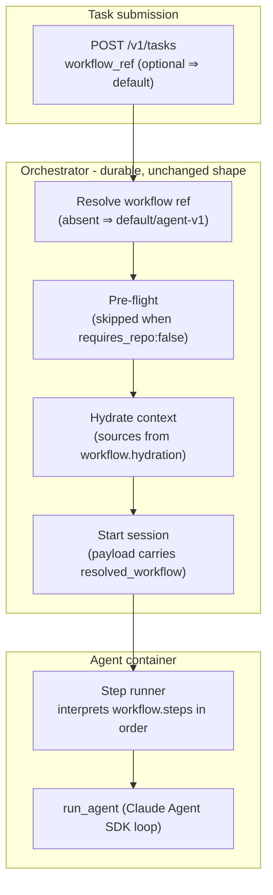

# Workflows (workflow-driven tasks)

A **workflow** is a versioned, declarative document that describes how the agent executes one kind of task. It declares the ordered steps to run inside the container, the system prompt, the agent configuration (tools, MCP servers, skills, plugins, rules, and Cedar policy), the context to hydrate, the post-execution gates, and what "done" means. Workflows replaced the hardcoded `task_type` branches that were spread across the Python agent runtime (`pipeline.py`, `post_hooks.py`, `repo.py`, `prompts/`). A single **step runner** now interprets the workflow file.

The three former task types, `new_task`, `pr_iteration`, and `pr_review`, are now first-party workflows (`coding/new-task-v1`, `coding/pr-iteration-v1`, `coding/pr-review-v1`). The `task_type` enum is removed. `workflow_ref` is the only task-selection field on the API. A new domain, such as research, document drafting, or data analysis, is a new workflow file, not a new orchestrator branch. A workflow can declare `requires_repo: false`. Such a workflow runs a **repo-optional task**: knowledge work with no GitHub clone and no PR finalization.

- **Use this doc for:** the workflow file schema, the step-kind catalog, the agent-side step runner model, and how a `workflow_ref` flows from API to agent.
- **Related docs:** [ARCHITECTURE.md](./ARCHITECTURE.md) for the model of deterministic steps that wrap one agentic step, [ORCHESTRATOR.md](./ORCHESTRATOR.md) for the durable lifecycle that the workflow runs inside, [REPO_ONBOARDING.md](./REPO_ONBOARDING.md) for the per-repo **Blueprint**, which is a distinct concept (see [Naming](#naming-workflow-vs-blueprint)), [CEDAR_HITL_GATES.md](./CEDAR_HITL_GATES.md) for the policy engine that a workflow's `agent_config` feeds, [SECURITY.md](./SECURITY.md) for tool tiers, and [API_CONTRACT.md](./API_CONTRACT.md) for the `workflow_ref` wire field.
- **Decision record:** [ADR-014](../decisions/ADR-014-workflow-driven-tasks.md).
- **Tracking issue:** [#248](https://github.com/aws-samples/sample-autonomous-cloud-coding-agents/issues/248). It pairs with the agent asset registry ([#246](https://github.com/aws-samples/sample-autonomous-cloud-coding-agents/issues/246)) and attribution ([#245](https://github.com/aws-samples/sample-autonomous-cloud-coding-agents/issues/245)). It is the scoped-down, current-architecture track of the broader AKW vision ([#99](https://github.com/aws-samples/sample-autonomous-cloud-coding-agents/issues/99)).

## Background: what workflows replaced

Before #248, the platform supported exactly three task types. They were fixed at the type level (`TaskType = 'new_task' | 'pr_iteration' | 'pr_review'`) and enforced by an exhaustiveness assert in `validation.ts`. Behavior for each type was not centralized. It was spread across eight Python files in the agent runtime plus a Cedar policy, and each one branched on the literal string:

| Where | What used to branch on `task_type` |
|---|---|
| `agent/src/models.py` | `TaskType` enum and the `is_pr_task` and `is_read_only` properties |
| `agent/src/config.py` | `PR_TASK_TYPES` frozenset. Required-input rules: a PR task needs `pr_number`, any other task needs `issue` or `description` |
| `agent/src/server.py` | duplicate required-input validation on the `/invocations` payload |
| `agent/src/prompts/__init__.py` | `_PROMPTS` lookup table → workflow-fragment injection |
| `agent/src/runner.py` | `PolicyEngine(task_type=...)`. The task_type became the Cedar principal |
| `agent/src/repo.py` | branch selection: resume the existing branch (PR tasks) or create a new one |
| `agent/src/post_hooks.py` | PR finalization: create, push and resolve, or resolve only |
| `agent/src/pipeline.py` | skip the safety-net commit and treat the build as informational for `pr_review` |
| `agent/policies/hard_deny.cedar` | read-only enforced by the literal `Agent::TaskAgent::"pr_review"` |

A fourth task type meant a change in every one of these places. A non-coding task type was impossible, because every task cloned a repo and the create-task API required an onboarded `repo` (`422 REPO_NOT_ONBOARDED`). "Requires a repo" was an implicit, universal assumption, not a declared property.

Workflows invert that model. The behavior of a task type is data, held in a workflow file that one generic runner interprets. So a new task type, coding or not, is authored as a workflow file and not coded.

## Naming: Workflow vs Blueprint

The platform already uses **Blueprint** for a different concept, and confusing the two would be a costly mistake. The two differ in scope:

| Concept | Scope | Answers | Authored by | Stored as | Lifecycle |
|---|---|---|---|---|---|
| **Blueprint** (existing) | Per **repository** | "How does the platform run tasks *for this repo*?" Covers the compute backend, model, turn and budget limits, GitHub credentials, egress, Cedar policy extensions, and poll interval | Operators, through the `Blueprint` CDK construct | `RepoConfig` row in DynamoDB (deploy-time `PutItem`) | CDK deploy |
| **Workflow** (new) | Per **task type** | "What steps does *this kind of task* run?" Covers the ordered steps, system prompt, agent config (tools, MCP, skills, plugins, rules, and Cedar), hydration sources, and terminal outcomes | Workflow authors and operators | Workflow file (YAML), resolved at task start. Published to the registry (#246) in Phase 4 | Versioned and promoted (`draft → validated → production → deprecated`) |

The two concepts compose and are independent of each other. A Blueprint pins which Workflows a repo may run, and a Workflow is repo-agnostic. The same `web_research` workflow runs identically for any repo, or with no repo at all. The same `acme/api` Blueprint applies its model and credentials to whichever workflow a task selects.

> **Wire-field note.** Issue #248 names the request field `capability_ref`. The shipped field is `workflow_ref`, and the recorded metadata is `resolved_workflow`, so that the user-facing vocabulary stays consistent with "workflow." `workflow_ref` is the single task-selection field. It replaces `task_type`, which is removed (see [Replacing `task_type`](#replacing-task-types)). Internally, the registry (#246) classifies these artifacts under its `capability` asset kind. "Workflow" is the ABCA-facing name for a capability of kind `workflow`.

## Concepts



### Workflow file

A workflow file is a versioned document. It is written in YAML and validated against a JSON Schema (see [Schema](#workflow-file-schema)). The file declares identity, domain, repo dependence, the ordered `steps`, the agent configuration (`agent_config`), the prompt, hydration requirements, and terminal outcomes. Post-agent gates are expressed as `steps`, not as a separate `post_hooks` list (see the note under [the schema](#workflow-file-schema)). First-party workflow files live under `agent/workflows/<domain>/<id>.yaml` in the container image. Published workflow files are resolvable from the registry (#246).

### Step runner

The step runner is a new agent-side component (`agent/src/workflow/runner.py`). It loads the resolved workflow and executes its `steps` list in order. It dispatches each step kind to a deterministic handler or to the agentic `run_agent` loop. The step runner replaces the inline `if task_type ==` checks. A step failure surfaces exactly as it does today, as a terminal `FAILED` state with a structured error and the failing step recorded on task metadata.

### Domain & `requires_repo`

Two declared properties drive admission and the defaults for the clone and PR steps:

- **`domain`.** One of `coding`, `knowledge`, or `hybrid`. It sets defaults. A `coding` workflow defaults to `requires_repo: true`, and a `knowledge` workflow defaults to `false`. It also tags the task for cost and eval segmentation.
- **`requires_repo`.** The explicit switch. When `requires_repo` is `false`, the orchestrator skips repo onboarding enforcement and GitHub pre-flight, hydration assembles from `task_description`, attachments, and declared sources instead of from issue or PR fetches, and the step runner skips `clone_repo` and any PR-finalization steps.

> **Repo-optionality is a wider refactor than it looks.** `repo` is a required field today across the TypeScript types `CreateTaskRequest`, `TaskRecord`, `TaskSummary`, and `TaskDetail`, and in the agent's `TaskConfig.repo_url` validator. Making it optional therefore touches about 6 TypeScript interfaces and their mappers, the agent config validator, and the ECS bootCommand (`repo_url=p.get("repo_url","")`). Three platform assumptions also break and must be handled, not deferred. First, the memory actorId is `repo` today (`memory.py`). A repo-less task has no actor namespace and fails without a per-user or per-workflow fallback. Second, the agent SessionRole tenant tags include `repo`. Third, `deliver_artifact` needs a defined S3 bucket, a key scheme scoped by `task_id`, an IAM grant, and a size limit. [Open questions](#open-questions) tracks these three assumptions. They are the real cost of Phase 3. The one-line "API + CLI" entry of the phasing table understates them deliberately, for brevity and not because they are small.

## Workflow file schema

A workflow file has the following top-level fields. The full machine-readable schema is `agent/workflows/schema/workflow.schema.json`. The Python loader and a CDK synth-time validator reference it.

| Field | Type | Req | Purpose |
|---|---|---|---|
| `id` | string | ✓ | Stable identity in the form `"<domain>/<name>-v<major>"`, for example `coding/new-task-v1`. |
| `version` | string (semver) | ✓ | Immutable per published version. Pinned by ref or Blueprint. |
| `domain` | enum | ✓ | `coding` \| `knowledge` \| `hybrid`. Drives admission defaults and eval tags. |
| `description` | string | – | One-line natural-language summary, read by humans and by an agent that selects a workflow. Powers registry search and `bgagent workflow list` (#246). Distinct from `prompt`, which is machine-facing. |
| `guidance` | string | – | Optional longer "how to use this workflow" note with patterns, examples, and constraints. Shown at discovery time, not injected into the agent prompt. |
| `requires_repo` | boolean | – | Mandatory GitHub clone and PR finalization. Default from `domain`. |
| `read_only` | boolean | – | The agent may not mutate the working tree. Sets `context.read_only` for the Cedar Write and Edit hard-deny, drops `Write` and `Edit` from `allowed_tools`, and skips the safety-net commit. Default `false`. |
| `prompt` | object | ✓ | `{ template: <inline string \| registry ref>, placeholders: [...] }`. The system-prompt fragment injected into the base template. |
| `hydration` | object | ✓ | Which context sources to assemble: any of `issue`, `pull_request`, `memory`, `attachments`, `urls`, `task_description`. Repo-less workflows omit `issue` and `pull_request`. |
| `agent_config` | object | ✓ | Everything that shapes the SDK session: `{ tier, model?, allowed_tools, mcp_servers, cedar_policy_modules, skills, plugins, subagents, prompt_fragments }`. Asset kinds mirror the [#246](https://github.com/aws-samples/sample-autonomous-cloud-coding-agents/issues/246) registry vocabulary. See [Agent configuration: the three planes](#agent-configuration-the-three-planes). `tier` and `allowed_tools` are required. The rest are optional. `skills`, `plugins`, `subagents`, and `prompt_fragments` are **registry-resolved (Phase 4)**. They are declared now and ignored by the runner until #246. |
| `agent_config.model` | object | – | Optional preferred Bedrock model `{ id, allow_task_override? }` (see [Model selection](#model-selection)). A suggestion, bounded by the allow-list of the repo Blueprint or the platform and by the per-task budget. Omit to inherit the default. |
| `repo_config` | object | – | How this workflow relates to a source-control repository: `{ provider (default github), discover (default true), ignore: [claude_md\|rules\|subagents\|settings\|mcp] }`. `provider` is a VCS abstraction (see [VCS provider abstraction](#vcs-provider-abstraction)). `discover` and `ignore` gate the config discovered from the cloned repo (`CLAUDE.md`, `.claude/`, `.mcp.json`). When `requires_repo:false`, the value must be `discover:false` and `provider` does not apply. |
| `steps` | Step[] | ✓ | Ordered pipeline phases (see [Step kinds](#step-kinds)). |
| `required_inputs` | object | – | Validation contract, for example `{ one_of: [issue_number, task_description] }` or `{ all_of: [pr_number] }`. Replaces the scattered required-input checks. |
| `terminal_outcomes` | object | ✓ | What "done" produces: `pr_url` \| `review_posted` \| `artifact` \| `comment`. Records the expected artifact. It does **not** override success inference (see [Success inference](#success-inference-terminal-outcomes-and-convergence)). |
| `convergence` | object | – | How a harness decides the task is done: `{ mode, required_sensors?, terminal_outcomes, early_exit? }`. Optional for backward compatibility. Validated at workflow load. In v1 this field is declarative metadata and does not change runtime finalization. |
| `limits` | object | – | `{ max_turns, max_budget_usd }` defaults. Per-task and per-repo values still override them, per [override precedence](./REPO_ONBOARDING.md#override-precedence). |
| `promotion_gate` | object | – | The check contract that a version must pass to reach `production` (see [Promotion is earned, not set](#promotion-is-earned-not-set)). Shape: `{ requires: [<check ids>] }`. Before #236, a check id is a concrete test target (`tests:agent/new_task`). After #236, it is an eval id (`eval:web-research-quality`). Optional until #236. When absent, promotion falls back to the test tier. |
| `status` | enum | ✓ | `draft` \| `validated` \| `production` \| `deprecated`. Only `production` resolves for normal tasks. |

> `post_hooks`, which issue #248 names, is **reserved and not interpreted**. The schema pins it to empty. Post-agent gates are authored as `steps` (`verify_build`, `ensure_pr`, `deliver_artifact`, and others). Authoring them as `steps` avoids two ways to express the same thing with undefined precedence.

### Step kinds

A step is the unit that the runner interprets. Each step has a `kind`, an optional `name`, and kind-specific fields. The catalog is extensible. A new kind registers a handler in the runner.

| Step kind | Side | Purpose | Notes |
|---|---|---|---|
| `clone_repo` | deterministic | Clone, run `mise trust` and `install`, run the initial build and lint, and select the branch | Forbidden when `requires_repo:false`. Replaces `setup_repo`. |
| `hydrate_context` | deterministic | Assemble the prompt from the declared `hydration` sources | Mostly done orchestrator-side. This step consumes the `HydratedContext` payload. |
| `run_agent` | agentic | The Claude Agent SDK loop with the workflow's prompt and `agent_config` | Exactly one per workflow. Today `pipeline.py` only ever calls one `run_agent`, so this is an emergent property that the schema now promotes to an enforced constraint. Multi-agent loops are out of scope (#99). |
| `verify_build` | deterministic | Run `mise run build`, then gate or inform | Gating is declared per step with `gate` (see below). `read_only` workflows treat the result as informational. Forbidden when `requires_repo:false`. |
| `verify_lint` | deterministic | Run `mise run lint` | Optional gate (`gate` field, see below). Advisory unless declared. |
| `ensure_pr` | deterministic | Create a PR, push and resolve one, or only resolve one | The step config chooses the strategy (`create` \| `push_resolve` \| `resolve`). Replaces the `post_hooks.ensure_pr` task_type branch. |
| `post_review` | deterministic | Post a GitHub review (Reviews API) | For review workflows, such as `coding/pr-review-v1`. |
| `deliver_artifact` | deterministic | Upload a produced artifact (S3) or post a comment | Repo-less terminal delivery for knowledge work. |

Each step declares `on_failure: fail | continue | skip_remaining`, with `fail` as the default. The runner's error behavior is therefore explicit and matches today's fail-closed default.

**The `gate` field (`verify_build` and `verify_lint`).** A verify step declares how its result affects the task verdict. With `strict`, any failure gates. With `regression_only`, a failure gates only when the check passed before the agent ran and fails after. `regression_only` is the default when `gate` is unset, and it matches the legacy pipeline behavior. With `informational`, the step never gates. A `read_only` workflow never gates, whatever `gate` says. The semantics live in exactly one place, `gate_status` in `agent/src/workflow/runner.py`, and both lanes use it (#301). The repo-less lane reaches it through the runner's `verify_*` step handlers. The coding lane reaches it through the inline post-hook resolution (`pipeline._apply_post_hook_gates`), which consults the `gate` and `on_failure` of each declared step. Steps with `continue` or `skip_remaining` are advisory for the verdict, as they are in the runner. On the coding lane, an undeclared `verify_lint` never gates. That is the legacy behavior, where lint is advisory unless a workflow opts in by declaring the step. The inline ordering is also preserved. `ensure_pr` still runs after a gating verify failure, so the agent's work appears as a reviewable PR even when the task is marked failed. Routing the coding post-hooks through the runner's step handlers would stop before `ensure_pr` on a gating failure. That routing is the broader runner unification, which is deferred out of the scope of #301.

### Convergence contract

`convergence` makes the workflow's stopping contract explicit for conformance tests and future harnesses. The loader validates the block before the step runner receives the workflow:

| Field | Required | Meaning |
|---|---|---|
| `mode` | ✓ | `test_gated` \| `artifact_delivered` \| `human_approved` \| `review_submitted`. Non-test modes require their matching terminal outcome. |
| `required_sensors` | For `test_gated` | Verification results that a conforming harness would evaluate with the existing `gate` semantics of their step. Current sensors are `verify_build` and `verify_lint`. Each must have a matching step, enforced at load. |
| `terminal_outcomes` | ✓ | Observable convergence signals: `pr_opened` \| `review_published` \| `artifact_delivered` \| `human_approved`. At least one is required. |
| `early_exit.allow_on_policy_deny` | – | Declares that a policy denial may terminate without the normal terminal outcome. Defaults to `false`. |

`convergence.terminal_outcomes` is distinct from the required top-level `terminal_outcomes` object. The top-level object identifies the result artifact that existing finalization consumes (`pr_url`, `review_posted`, `artifact`, or `comment`). `convergence.terminal_outcomes` names the external signal that a harness should observe before it considers the workflow complete. For example, a coding workflow can produce a `pr_url` and declare `pr_opened` as its convergence signal.

The v1 implementation is descriptive by intent. It parses and exposes the contract. It does not branch on the contract in `runner.py`, emit a new event, or replace `_resolve_overall_task_status`. Existing workflows without the optional block keep their current behavior.

### Example: shipped coding workflow (`new_task`)

```yaml
id: coding/new-task-v1
version: 1.0.0
domain: coding
description: Implement a GitHub issue or free-text task and open a pull request.
requires_repo: true
read_only: false
prompt:
  template: registry://prompt/coding-new-task-workflow   # or inline string
  placeholders: [repo_url, task_id, workspace, branch_name, default_branch, max_turns, setup_notes, memory_context]
hydration:
  sources: [issue, memory, task_description]
agent_config:
  tier: standard
  allowed_tools: [Bash, Read, Write, Edit, Glob, Grep, WebFetch]
  cedar_policy_modules: [builtin/hard_deny, builtin/soft_deny]
repo_config:
  provider: github          # the only implemented provider today; named explicitly so multi-provider is non-breaking later
  discover: true            # load the repo's CLAUDE.md / .claude/rules / .mcp.json and layer agent_config on top
required_inputs:
  one_of: [issue_number, task_description]
steps:
  - { kind: clone_repo,     name: setup }
  - { kind: hydrate_context, name: context }
  - { kind: run_agent,      name: implement }
  - { kind: verify_build,   name: build, gate: regression_only }
  - { kind: ensure_pr,      name: open_pr, strategy: create }
terminal_outcomes: { primary: pr_url }
convergence:
  mode: test_gated
  required_sensors: [verify_build]
  terminal_outcomes: [pr_opened]
limits: { max_turns: 100 }
promotion_gate: { requires: [tests:agent/new_task] }   # concrete test target; becomes eval:new_task once #236 lands
status: production
```

### Example: non-coding reference workflow (`web_research`, repo-optional)

```yaml
id: knowledge/web-research-v1
version: 1.0.0
domain: knowledge
description: Research a topic from a description and attachments; deliver a cited summary artifact. No repo required.
requires_repo: false        # ← no clone, no PR scaffolding
read_only: false
prompt:
  template: registry://prompt/web-research-workflow
  placeholders: [task_description, memory_context, min_sources]
hydration:
  sources: [task_description, attachments, urls, memory]
agent_config:
  tier: elevated
  allowed_tools: [Read, WebFetch]
  mcp_servers: [registry://mcp/web-search-v1]   # Phase 4
  cedar_policy_modules: [builtin/hard_deny, builtin/soft_deny]
  skills: [registry://skill/research-synthesis-v1]   # Phase 4 — ignored until #246
repo_config:
  discover: false           # no repo to discover config from
required_inputs:
  all_of: [task_description]
steps:
  - { kind: hydrate_context,  name: context }
  - { kind: run_agent,        name: research }
  - { kind: deliver_artifact, name: deliver, target: s3_and_comment }
terminal_outcomes: { primary: artifact }
convergence:
  mode: artifact_delivered
  terminal_outcomes: [artifact_delivered]
limits: { max_turns: 25, max_budget_usd: 5 }
promotion_gate: { requires: [eval:web-research-quality] }   # min-sources / citation-quality eval
status: production
```

This second example is the target shape for repo-less execution. It proves the acceptance criterion that a task runs end-to-end with no `repo`. `attachments` and `task_description` are sufficient, no `clone_repo` or `ensure_pr` step runs, and the terminal outcome is a delivered artifact or comment, not a PR. **This path is implemented (#248 Phase 3).** The create-task boundary admits a repo-less submission. The pipeline branches to a repo-less flow that drives `hydrate_context → run_agent → deliver_artifact` through the workflow runner. The two platform assumptions that gated the path are decided (ADR-014 addendum 2026-06-08):

- **Memory actorId.** A per-user `user:{cognito_sub}` fallback applies when `repo` is absent ([Open questions](#open-questions) #1, resolved). There is no schema field. The agent writes the episode to the `user:{user_id}` namespace, and the orchestrator hydration reads it back.
- **Artifact delivery.** `deliver_artifact.target` names a registered Python deliverer (`agent/src/workflow/deliverers.py`). The `s3` deliverer uploads the agent's result text to `artifacts/{task_id}/result.md`. The upload uses a SessionRole `s3:PutObject` grant scoped to `artifacts/${task_id}/*` and has a 5 MiB cap. `TaskDetail.artifact_uri` exposes the uploaded artifact. The `comment` deliverer records a `delivered_comment` milestone, which is visible through `bgagent watch`. Rendering that milestone to an external channel (Slack, email, or GitHub) is not yet wired, because the milestone is not in the fan-out's `ROUTABLE_MILESTONES`. So the S3 artifact is the deliverable to rely on today ([Open questions](#open-questions) #2, resolved).

## The agent-side step runner

Per [ADR-014](../decisions/ADR-014-workflow-driven-tasks.md), the runner is agent-side. It lives in the container and interprets `workflow.steps`. The orchestrator's durable shape (`admission-control → pre-flight → hydrate-context → start-session → await-agent-completion → finalize`) is unchanged. The workflow drives what happens inside the `RUNNING` state, not the platform lifecycle. This placement keeps the change away from durable orchestration and matches the issue's "executes steps in order *inside the container*."

```python
# agent/src/workflow/runner.py  (shape, not final code)
def run_workflow(workflow: Workflow, config: TaskConfig, hc: HydratedContext) -> WorkflowResult:
    ctx = StepContext(config=config, hydrated=hc, workflow=workflow)
    for step in workflow.steps:
        handler = STEP_HANDLERS[step.kind]          # registry of kind → handler
        progress.write_agent_milestone(f"step:{step.name or step.kind}:start")
        outcome = handler(step, ctx)                # deterministic or wraps run_agent
        ctx.record(step, outcome)
        if outcome.failed and step.on_failure == "fail":
            return WorkflowResult.failed(step, outcome)   # terminal FAILED + structured error
    return WorkflowResult.from_outcomes(ctx, workflow.terminal_outcomes)
```

`pipeline.run_task` becomes a thin caller. It resolves the workflow, builds the config and the system prompt from the workflow, then calls `run_workflow(...)`. The existing helpers (`setup_repo`, `run_agent`, `verify_build`, `ensure_pr`, `post_*`) become step handlers instead of inline calls. The logic changes little and the structure changes a lot. The `_PROMPTS` lookup and the `PR_TASK_TYPES` frozenset are deleted. Their semantics move into the workflow fields `prompt`, `requires_repo`, and `read_only`.

### Step execution semantics

The step runner runs inside the compute substrate, which is **not** a throwaway container. AgentCore provides persistent session storage. This storage is a per-session filesystem at `/mnt/workspace` that survives stop and resume cycles and has a 14-day TTL (see [COMPUTE.md](./COMPUTE.md)). The Claude Agent SDK can resume a prior session by its session UUID, and the runner already captures that UUID from the first `ResultMessage`. So the durability model that the runner should target is to resume from where the workflow stopped, not to replay from the beginning. The runner is designed to be resume-aware from the start, so that the steps become the checkpoint boundaries:

- **Step completion is checkpointed, and resume skips completed steps.** As the runner goes, it records the outcome of each step to a small `workflow_state.json` on the persistent mount (`/mnt/workspace`). A resume happens when the orchestrator re-invokes the same session or, once shipped, when a replacement worker rehydrates from the [S3-backed SDK session store](#relationship-to-portable-resume). On resume, the runner reads that checkpoint and skips the deterministic steps that already completed. `clone_repo` need not re-clone a populated `/workspace`, and a completed `verify_build` is not re-run. The runner then resumes the agent loop with the persisted SDK session UUID instead of restarting the loop from turn 0. The orchestrator already relies on the same property to make session start idempotent, with a pre-generated, reused session id.
- **Side-effecting steps remain idempotent.** Independent of resume, `clone_repo`, `ensure_pr`, `post_review`, and `deliver_artifact` must tolerate a partial prior run, because a resume can re-enter the step that was in flight when the worker died. Each step documents its idempotency key: the PR branch, the review id, or the artifact S3 key, which is `task_id`. Re-entry therefore reconciles and does not duplicate. Today's `ensure_pr` already does so. It checks `gh pr view` before it creates a PR.
- **`on_failure: continue` is forbidden after side effects** (validation rule 10). A failed `ensure_pr`, where the commits were pushed and the PR creation failed, must not reach a *succeeded* terminal state. That state would be committed work with no PR and no compensation. `continue` is permitted only for advisory steps without side effects, such as an informational `verify_lint`. `skip_remaining` ends the workflow cleanly and runs terminal-outcome resolution against whatever completed. `fail`, the default, is terminal `FAILED`.
- **Granularity boundary.** Resume works per workflow step on the agent side. It is not a new orchestrator-side durable checkpoint per step. The orchestrator still treats the whole session as one `await-agent-completion` step, so platform invariants stay outside the agent ([ADR-014](../decisions/ADR-014-workflow-driven-tasks.md)). The change from today is that the agent-side runner makes its own progress recoverable across a stop and resume. Today's monolithic `run_task` does not.

#### Relationship to portable resume

Resume depends on two capabilities, one shipped in preview and one planned. The design assumes the first and is forward-compatible with the second:

| Capability | Status | What the runner uses it for |
|---|---|---|
| Persistent session storage (`/mnt/workspace`, survives stop and resume) | Shipped (preview). See COMPUTE.md | Holds the `workflow_state.json` checkpoint and the populated workspace, so a resumed session skips completed work. |
| Claude Agent SDK session resume (by session UUID) | SDK feature. The runner already captures the UUID | Resume the agent loop mid-task instead of from turn 0. |
| S3-backed SDK session store (`task_id` ↔ session UUID, portable transcript) | **Planned**. See [GitHub issues](https://github.com/aws-samples/sample-autonomous-cloud-coding-agents/issues) | Resume on a *different* worker, for example after node loss, and not only in the same session. The workflow checkpoint should live alongside the session transcript so that the two resume together. |

Until the S3 session store lands, resume is limited to what persistent session storage and a same-session re-invoke provide. A total worker loss still re-runs from step 0, which the step idempotency above mitigates. When the S3 session store lands, the workflow checkpoint travels with the session transcript and resume becomes worker-portable. Per-step compensation or rollback of completed side effects is a non-goal for this issue. It is stated here so that it is a recorded decision, not an oversight.

### Agent configuration: the three planes

More than tools shapes a Claude Agent SDK session here. The session loads skills, plugins, subagents, rules or prompt fragments, MCP servers, settings, and Cedar policy. Today these arrive from two places. The first is the agent's own code, where `runner.py` resolves `allowed_tools`, `disallowed_tools`, and `setting_sources`. The second is the cloned repo, where `prompt_builder.discover_project_config` reads `CLAUDE.md`, `.claude/rules/*.md`, `.claude/agents/*.md`, `.claude/settings.json`, and `.mcp.json`. A workflow adds a third plane. The model is three layers, from lowest to highest precedence. It deliberately parallels the existing platform, repo, and task [override precedence](./REPO_ONBOARDING.md#override-precedence):

| Plane | Source | What it carries | Precedence |
|---|---|---|---|
| **Blueprint** (per-repo) | `RepoConfig` (CDK) | compute, model, credentials, egress, repo Cedar extensions | lowest |
| **Workflow** (`agent_config`, per-task-type) | the workflow file | `tier`, `allowed_tools`, `mcp_servers`, `cedar_policy_modules`, and (Phase 4) `skills`, `plugins`, `subagents`, `prompt_fragments` | middle |
| **Repo-discovered** (`repo_config`) | the cloned repo's `.claude/` and `.mcp.json` | repo-specific rules, subagents, MCP, settings | highest (repo wins for repo-specific guidance) |

The mechanisms in `agent_config` map one-to-one onto the #246 registry asset kinds (capability, skill, plugin, mcp_server, prompt_fragment, and cedar_policy_module), so a workflow is the first concrete consumer of that vocabulary. Two boundaries apply:

- **What ships in #248 vs Phase 4.** In Phases 1 to 3, the runner interprets `tier`, `allowed_tools`, `cedar_policy_modules`, and builtin `mcp_servers`, such as the existing Linear server. `skills`, `plugins`, `subagents`, `prompt_fragments`, and `registry://` refs are declared in the schema now, but the runner ignores them until the registry (#246) can resolve them. They are forward declarations, not Phase-1 behavior. The schema marks each accordingly.
- **A workflow can gate repo-discovered config.** `repo_config.discover`, which defaults to `true`, loads the repo's `.claude/` and `.mcp.json` and layers `agent_config` underneath them. `repo_config.ignore: [settings, mcp, ...]` opts out of specific sources. Examples are a locked-down workflow that refuses the repo's `.mcp.json`, and a knowledge workflow with `discover:false` because there is no repo. A repo-less workflow has no repo, so a validation rule requires it to set `discover:false`.

**Hard tool block (`disallowed_tools`), a different control from `allowed_tools`.** Per the Agent SDK, `allowed_tools` is an **auto-approve** list. It does not restrict which tools the agent can reach. A tool omitted from the list falls through to `permission_mode`, and the agent runs under `bypassPermissions`, so omitted tools are allowed. The setting that locks a tool out is `disallowed_tools`, which removes the tool from the model's context even under bypass. For every task, `runner.py` hard-blocks the tools that defer work outside the session: `Workflow`, `Task`, and `Agent`. It blocks them because a one-shot headless agent has no supervisor to await detached work. The `Workflow` tool launches a background orchestration and returns a task id, and the agent's turn ends. The runner would then finalize on the first `ResultMessage` with a placeholder while the real work continues, detached. This was observed on a repo-less research task. A repo-less task also loads no on-disk settings (`setting_sources=[]`). There is no cloned repo to discover config from, and the empty setting keeps a stray on-disk skill, such as one that spawns a `Workflow`, out of reach. As defense in depth, the workflow prompt also instructs the agent to finish in-session and not to defer.
- **`subagents` does not lift the single-`run_agent` invariant.** Subagents are SDK-internal delegations within the one agent loop, not additional top-level agent steps. Multi-agent workflows remain out of scope (#99).

#### Model selection

A workflow may declare a preferred Bedrock model with `agent_config.model`, because the right model depends on the task type: a cheap model for triage, a stronger one for implementation. The workflow's choice is a suggestion, not an authority. It sits in the middle of the existing model-resolution precedence and is bounded on both sides:

| Source | Role | Precedence |
|---|---|---|
| Platform or repo **Blueprint allow-list and `model_id`** | Which models the account or repo permits, and its default | bounds and lowest default |
| **Workflow `agent_config.model.id`** | Preferred model for this task type | middle |
| **Per-task override** (if the API exposes one) | Caller's explicit choice | highest, unless `allow_task_override:false` |

The create-task boundary validates the workflow's `model.id` against the platform or Blueprint allow-list. An unpermitted id fails admission and is not silently downgraded, consistent with the fail-closed behavior elsewhere. The per-task `max_budget_usd` still caps spend, whatever the model. A workflow that omits `model` inherits the Blueprint or platform default exactly as today, and `model_id` flows through the existing payload. With these rules, a task type can express a model choice, and a workflow file cannot escalate to an unapproved or unaffordable model.

### VCS provider abstraction

Everything repo-related in ABCA today is GitHub-specific. `repo` is an `owner/repo` slug, auth is a GitHub token secret, the agent shells out to `gh`, pre-flight checks GitHub permissions, and "done" means a GitHub PR. That is fine for today, but a workflow vocabulary that says "GitHub" would make multi-provider support a breaking change later. So the schema is provider-neutral from the start. `repo_config.provider` is an enum: `github` today, with `gitlab`, `bitbucket`, `codecommit`, and `generic_git` reserved. The workflow's repo-touching steps name provider-neutral intents, not GitHub operations.

The mapping from intent to provider implementation lives behind a **`VcsProvider` interface**, which is a platform concern and not a per-workflow one. A workflow therefore stays the same across providers:

| Provider-neutral concept (workflow) | GitHub implementation (today) | Future implementation (for example GitLab) |
|---|---|---|
| `clone_repo` step | `git clone` + `gh auth` | `git clone` + GitLab token |
| `ensure_pr` step → "open a change proposal" | `gh pr create`, Pull Request | Merge Request |
| `post_review` step → "post a review" | GitHub Reviews API | MR discussions and approvals |
| `terminal_outcomes.primary: pr_url` | PR URL | MR URL |
| repo permission pre-flight | GitHub GraphQL `viewerPermission` | provider equivalent |
| token | `github_token_secret_arn` (Blueprint) | provider token secret |

The scope of #248 is limited. `github` is the only implemented provider. Adding others is explicitly out of scope and is its own issue. What #248 delivers is the naming. The schema field exists. `ensure_pr`, `post_review`, and `pr_url` are understood as the GitHub realization of the generic concepts "change proposal", "review", and "proposal URL". The agent-side handlers dispatch through a `VcsProvider` interface and do not call `gh` inline. For now, the validator rejects any `provider` other than `github` with a clear "not yet implemented" error, not a silent fallback. The naming is a low-cost investment in forward compatibility: name the abstraction now, implement one backend, and avoid a schema or contract break when a second provider is funded.

### Replacing the Cedar principal

Cedar hard-deny rules enforce read-only. **As of #248 Phase 2a**, these rules (`read_only_forbid_write`, `read_only_forbid_edit`) key off the `context.read_only` attribute, not a principal literal. `read_only: true` also makes the runner drop `Write` and `Edit` from the SDK `allowed_tools` list. The two layers are:

- **Defense in depth.** `read_only: true` makes the runner drop `Write` and `Edit` from `allowed_tools`, and it sends `context.read_only == true` on every Cedar request. Together these close the earlier gap, where only a Cedar string match on the principal enforced read-only and the tool list did not.
- **Property-keyed enforcement (security-relevant, specified precisely).** Read-only enforcement attaches to the property, not to a per-task-type literal. The principal keeps the legacy `Agent::TaskAgent::"<id>"` identity scheme, for audit and attribution only. The two hard-deny rules forbid `Write` and `Edit` whenever `context.read_only == true`. So the deny applies uniformly to every read-only workflow, not only to `coding/pr-review`, and there is no literal that a new read-only workflow could fail to match. This was a deliberate, recorded behavior change (see the [ADR-014](../decisions/ADR-014-workflow-driven-tasks.md) addendum 2026-06-08). The `contracts/cedar-parity/` fixtures (`read-only-forbid-write`, `read-only-forbid-edit`, `read-only-false-permits-write`) gate it, and they run against both the `cedarpy` and `cedar-wasm` engines.

  This is the migration step where an error silently weakens enforcement, because the rule stops matching, and does not fail loudly. The original plan was to ship the step as an isolated PR ahead of the Phase 2b workflow migrations. Phase 2b shipped first, behind a `read_only ⇒ "pr_review"` principal bridge, so read-only was never unprotected. Phase 2a therefore removes that bridge and lands the property-keyed rules and the parity fixtures together on the #248 branch. See the ADR-014 addendum and [Phasing](#phasing).

**Policy floor (no privilege escalation by config).** `agent_config` and its `cedar_policy_modules` are author-supplied, so the schema and validator must enforce a floor and not trust the file:

- Built-in **hard-deny is always on** and not selectable (per [CEDAR_HITL_GATES.md](./CEDAR_HITL_GATES.md)).
- Built-in **soft-deny (`builtin/soft_deny`) is mandatory** for any workflow that can write (`read_only: false`). A workflow may add modules but may not drop the soft-deny floor. Removing the floor, for example to suppress the force-push or write-credentials HITL gates, requires an admin-approved exception, not a field edit. The validation rule is listed below.
- The combination of `tier: elevated`, `read_only: false`, and a permissive `allowed_tools` (or an `mcp_servers`, `plugins`, or `skills` set that grants reach) is exactly the shape that warrants governance (see [Authorship & governance](#authorship--governance)). `tier` is the ceiling. The validator rejects an `agent_config` whose declared reach exceeds its `tier`.

Registry-sourced `cedar_policy_modules` and `mcp_servers` are trusted content loaded at task start, the same as blueprint-supplied Cedar policies today. The `initial_approvals` re-validation at HYDRATING (CEDAR_HITL_GATES.md) still applies.

### Authorship & governance

A workflow file selects the agent's tool set and policy posture, so who may publish a `production` workflow is a trust decision, not a convenience. Per [ADR-003](../decisions/ADR-003-contribution-governance.md), publishing or promoting a first-party workflow follows the same path as any code change: issue, approval, review, merge. A workflow YAML in `agent/workflows/**` is reviewed like code, and the synth-time validator (the [validation rules](#validation-rules)) is a required CI gate. When the registry (#246) makes workflows publishable out-of-band, publish and promote ACLs are Cedar-governed per #246 Phase 3. Until then, a `production` workflow exists only through a reviewed merge. The `description` and `guidance` discovery fields are author-controlled free text. When they feed an agent's workflow-selection context (Phase 4), they are treated as untrusted external input and screened like other hydrated content.

## Wire contract: `workflow_ref` from API to agent

`workflow_ref` travels the path that `task_type` travels today and **replaces it** at each boundary (see ORCHESTRATOR.md "API and agent contracts"). The touch points are:

| Layer | File | Change |
|---|---|---|
| REST types | `cdk/src/handlers/shared/types.ts` | **Remove** `task_type` and `TaskType`. Add `workflow_ref?: string` to `CreateTaskRequest` and `TaskRecord`, and `resolved_workflow?: { id, version }` to `TaskRecord`, `TaskDetail`, and `TaskSummary`, with their mappers. |
| CLI types | `cli/src/types.ts` | Mirror exactly. Drop `TaskType`, add `workflow_ref` and `resolved_workflow` (sync-checked in CI). |
| CLI flag | `cli/src/commands/submit.ts` | Add `--workflow <id>[@<constraint>]`. Rework `--pr` and `--review-pr` to set `workflow_ref` (plus `pr_number`) instead of a `task_type`. |
| Validation | `cdk/src/handlers/shared/validation.ts` | **Delete** `VALID_TASK_TYPES`, `isValidTaskType`, and the exhaustiveness assert. Add `isValidWorkflowRef`. Relax `isValidRepo` and `hasTaskSpec` when the resolved workflow has `requires_repo:false`. |
| Create core | `cdk/src/handlers/shared/create-task-core.ts` | Apply the [resolution order](#replacing-task-types), which falls through to `default/agent-v1`. Bypass `REPO_NOT_ONBOARDED` for repo-less tasks. Validate `agent_config.model.id` against the allow-list. Persist `workflow_ref` and `resolved_workflow` (no `task_type`). |
| Orchestrator | `cdk/src/handlers/orchestrate-task.ts` | Guard `runPreflightChecks` (skip when `requires_repo:false`). |
| Pre-flight | `cdk/src/handlers/shared/preflight.ts` | **Net-new.** Add a `requires_repo` parameter and return `{ passed: true, checks: [] }` early for repo-less tasks. Drop the `taskType` parameter, because the permission level now comes from the resolved workflow. |
| Hydration | `cdk/src/handlers/shared/context-hydration.ts` | Replace the `isPrTaskType` branch with workflow-driven hydration. The repo-less branch assembles from `task_description` and attachments. Add the memory actorId fallback for tasks with no repo. |
| Payload | orchestrator `hydrateAndTransition` | Replace the `task_type` payload field with `resolved_workflow`. |
| ECS strategy | `cdk/src/handlers/shared/strategies/ecs-strategy.ts` | Swap `task_type=p.get(...)` for `resolved_workflow=p.get(...)` in the hand-built `run_task(...)` kwargs string. Must change together with the signature of `run_task`. AgentCore (`agentcore-strategy.ts`) needs no change, because it delivers the full payload as it is. |
| Agent | `agent/src/pipeline.py` (`run_task` signature), `config.py`, `server.py`, `models.py`, `prompts/`, new `agent/src/workflow/` | Remove the `TaskType` enum, `_PROMPTS`, and the `task_type` params. Parse `resolved_workflow`. Load the workflow file. Run the step runner. |

**Resolution lives at the API and create-core boundary**, the same place that validates `task_type` today. The orchestrator and the agent therefore always receive a fully resolved `{ id, version }`. The agent loads the pinned file from the image (Phases 1 to 3) or from the registry bundle (Phase 4). Recording `resolved_workflow` on task metadata satisfies the audit and eval acceptance criterion.

## Replacing task types

This work **removes** the `task_type` enum. The enum is not preserved as a legacy alias. After this change, `workflow_ref` is the only task-selection field. The removal is an intentional **breaking API change**. It is acceptable for two reasons. The platform is pre-1.0, and per [ORCHESTRATOR.md](./ORCHESTRATOR.md) the API is not frozen. An API that carried both `task_type` and `workflow_ref` would also defeat the purpose of centralizing per-task-type behavior in one place.

The following are removed, repo-wide:

- The `TaskType` union and its exhaustiveness assert (`cdk/src/handlers/shared/validation.ts`), the `TaskType` mirror in `cli/src/types.ts`, and the `task_type` field on `CreateTaskRequest`, `TaskRecord`, `TaskDetail`, and `TaskSummary`, which `workflow_ref` and `resolved_workflow` replace.
- The Python `TaskType` enum (`agent/src/models.py`), `PR_TASK_TYPES`, the `_PROMPTS` lookup, and every `if task_type ==` branch. Their semantics move into workflow fields (`prompt`, `requires_repo`, `read_only`, and the `steps` list).
- The Cedar `Agent::TaskAgent::"<task_type>"` principal scheme (see [Replacing the Cedar principal](#replacing-the-cedar-principal)).

**Resolution order (there is always a workflow).** There is no `task_type` to fall back to, so `create-task-core` resolves to exactly one workflow from a short ordered list. The first match wins:

1. **Explicit `workflow_ref`.** Resolve that ref and constraint. The issue's `capability_ref` is the #248 name of this field.
2. **A Blueprint-configured default (Phase 4).** If the repo's Blueprint pins a `default_workflow`, use it.
3. **The platform default workflow.** Use `default/agent-v1` (below).

So a submission with no `workflow_ref` resolves to the repo default or the platform default. It is never coerced into the heavyweight `new_task` path (clone, build, and open a PR) that the old `task_type` default implied.

**Migration for callers.** Existing callers that send `task_type` must move to `workflow_ref`. The mapping is one-to-one and published in [API_CONTRACT.md](./API_CONTRACT.md): `new_task → coding/new-task-v1`, `pr_iteration → coding/pr-iteration-v1`, `pr_review → coding/pr-review-v1`. The CLI's `--pr <n>` and `--review-pr <n>` flags are reworked to set `workflow_ref` (plus `pr_number`) instead of inferring a `task_type`. `--workflow <id>[@<constraint>]` is the general form. Each migrated workflow must pass its promotion gate (see [Promotion is earned, not set](#promotion-is-earned-not-set)) before it ships, so tests or eval verify the functional fidelity of the three coding paths. Fidelity is a goal, not a hard constraint. Where a migrated workflow deliberately does the *right* thing differently from today, for example with tighter read-only enforcement, that divergence is a recorded decision in the migration PR, not a regression to avoid.

### The default workflow (`default/agent-v1`)

The platform ships one minimal fallback workflow. It runs the user's request through the agent and delivers the result, with no assumptions about repos, PRs, or builds. It is the safe minimum when no other workflow is selected.

```yaml
id: default/agent-v1
version: 1.0.0
domain: hybrid
description: Run the user's request through the agent and deliver the result. Minimal default — no repo, build, or PR assumptions.
requires_repo: false        # no clone; if a repo is supplied it is hydrated as context, not scaffolded
read_only: false
prompt:
  template: registry://prompt/default-agent-workflow
  placeholders: [task_description, memory_context, max_turns]
hydration:
  sources: [task_description, attachments, memory]
agent_config:
  tier: standard
  allowed_tools: [Read, Glob, Grep, WebFetch]   # conservative; no Bash/Write/Edit by default
  cedar_policy_modules: [builtin/hard_deny, builtin/soft_deny]
repo_config:
  discover: false
required_inputs:
  all_of: [task_description]
steps:
  - { kind: hydrate_context,  name: context }
  - { kind: run_agent,        name: respond }
  - { kind: deliver_artifact, name: deliver, target: s3_and_comment }
terminal_outcomes: { primary: artifact }
limits: { max_turns: 30 }
promotion_gate: { requires: [tests:agent/default] }
status: production
```

The design choices are deliberately conservative, because this workflow runs when nothing was specified:

- **`requires_repo: false`, `tier: standard`, a read-leaning tool set** (`Read/Glob/Grep/WebFetch`, no `Bash`, `Write`, or `Edit`). The default must not silently mutate a filesystem or push code on a submission that never asked for it. A caller who wants coding selects a coding workflow, or maps to one. `builtin/soft_deny` is still mandatory, because the workflow is `read_only:false`, so a future tool addition stays gated.
- **One agentic step, delivery through `s3_and_comment`** (primary outcome `artifact`). The S3 upload to `artifacts/{task_id}/` is the deliverable that is always retrievable. The default often runs for `api`-origin tasks that have no notification channel. The comment milestone is recorded for the event stream. External-channel rendering of `delivered_comment` is not yet wired (see [Open questions](#open-questions) #2).
- **Reached only by the resolution fallback.** It is the last entry of the [resolution order](#replacing-task-types), used when no `workflow_ref` and no Blueprint default apply.
- It is a real, governed, promotion-gated workflow like any other, not a hardcoded special case. Its behavior is therefore auditable, and a repo can override it through the Blueprint default.

## Registry integration (#246)

Workflows are the first concrete consumer of the agent asset registry. The two align as follows:

- A workflow is a registry asset of **kind `capability`** in the registry vocabulary, and users see it as a "workflow." Its `descriptor` carries the tool set, egress domains, Cedar actions, and minimum compute profile that #246 requires at publish time.
- **Phasing matches #246.** Filesystem-backed workflows shipped in the container image come first (Phases 1 to 3), and registry-resolved workflows with semver pinning come later (Phase 4). The `resolve` contract (`ref + constraint → pinned {id, version}`) is the one that #246 defines. ABCA resolves at the create-task boundary and records the pin.
- **Blueprint references workflows (Phase 4).** The `Blueprint` construct gains an allow-list of the workflow refs that a repo may run, pinned by constraint. #246 Phase 2 describes this integration point.

Until #246 lands, resolution is a static lookup over the image's `agent/workflows/` tree. The resolver interface is designed so that the registry backend is a drop-in replacement. The interface mirrors the unmerged `RegistryService` ABC on `origin/merge/akw-integration`, scoped down: no LTM `CapabilityIndex`, no Mem0, and no meta-agents.

## Validation rules

These rules are enforced at author time (CDK synth / CI lint over `agent/workflows/**`) and at resolution time:

1. `id` matches `^[a-z][a-z0-9-]*/[a-z][a-z0-9-]*-v\d+$`. `version` is valid semver. The two are consistent, which means that the `-vN` suffix matches the major version `N`.
2. Exactly one `run_agent` step (the current single-agentic-step invariant).
3. With `requires_repo:false`, there are no `clone_repo`, `ensure_pr`, `post_review`, `verify_build`, or `verify_lint` steps, and `hydration.sources` excludes `issue` and `pull_request`.
4. With `read_only:true`, `agent_config.allowed_tools` excludes `Write` and `Edit`, and there is no `ensure_pr` with `strategy: create|push_resolve`. A step that names no strategy counts as `create`, because that is the strategy it runs with.
5. **Policy floor.** With `read_only:false`, `agent_config.cedar_policy_modules` includes `builtin/soft_deny` (and the always-on `builtin/hard_deny`). Dropping the soft-deny floor requires an admin-approved exception, not a field edit (see [Replacing the Cedar principal](#replacing-the-cedar-principal)).
6. **Tier ceiling.** The declared reach of `agent_config` (tools, `mcp_servers`, `plugins`, `skills`) may not exceed its `tier`. `standard` is below `elevated`, and `read-only` excludes mutating tools.
7. **Repo-config gating.** With `requires_repo:false`, `repo_config.discover` is `false` and `repo_config.provider` is absent, because there is no repo to clone or discover from.
8. Every step `kind` has a registered handler. Every `cedar_policy_module`, `mcp_server`, `skill`, `plugin`, `subagent`, and `prompt_fragment` ref resolves, against the builtins now and against the registry in Phase 4.
9. `required_inputs` is satisfiable from the declared `hydration.sources`.
10. Only one `production` version exists per workflow **id lineage**, which is the `<domain>/<name>` part without the `-vN` suffix and the semver. Promotion to `production` auto-deprecates the previous production version of that lineage, matching the registry promotion contract.
11. `terminal_outcomes.primary` is consistent with the steps. For example, `pr_url` requires an `ensure_pr` step, and `artifact` requires a `deliver_artifact` step.
12. A side-effecting step (`ensure_pr`, `post_review`, `deliver_artifact`) may not declare `on_failure: continue` (see [Step execution semantics](#step-execution-semantics)).
13. **Model allow-list.** `agent_config.model.id`, if set, is on the platform or Blueprint allow-list. The check runs at the create-task boundary. An unpermitted id is an admission failure, not a silent downgrade.
14. **VCS provider.** `repo_config.provider` must be `github` until other backends are implemented. Any other value is a clear "provider not yet supported" error.

> The **loader/validator**, not JSON Schema alone, checks the consistency of `id` and `version` in rule 1 (the `-vN` suffix against the semver major) and the cross-field rules above. JSON Schema validates the shape of each field, and the conditional `allOf` blocks cover rules 3, 4, and 7.

### Single source of truth and validator parity

A workflow file is validated on more than one side of the platform: at CDK synth time over `agent/workflows/**`, in the Python runtime loader, and, in Phase 4, at registry publish. Without discipline, each side would re-implement the cross-field rules, and the implementations would **drift**. The repo already met the same `(workflow file) → (valid? / which error)` hazard, the hard way, with the two Cedar engines (see the cedar-parity note in `CLAUDE.md` and [CEDAR_HITL_GATES.md](./CEDAR_HITL_GATES.md) §15.6). The defense is deliberately the same:

1. **The JSON Schema is the one canonical shape contract.** `agent/workflows/schema/workflow.schema.json` is the single artifact for field shape and for the conditionals that a schema can express (rules 3, 4, and 7, through `allOf`). Both sides consume that same file through a standard library: `ajv` in TypeScript at synth, and `jsonschema` or `check-jsonschema` in Python at load. Shape validation is therefore never re-implemented, only re-run.
2. **The cross-field rules are implemented once, at author and CI time, and are not duplicated at runtime.** The rules that JSON Schema cannot express (1, 2, 5, 6, 8, 9, 11, 12, 13, 14) live in a **single validator module** that runs at CDK synth / CI lint over `agent/workflows/**`. In Phases 1 to 3, every workflow is a first-party file that is built into the image and already cleared by that CI gate. The runtime Python loader therefore performs only JSON-Schema shape validation, as defense in depth against a corrupt bundle. It trusts the CI-gated cross-field verdict and does not derive the verdict again. So Phases 1 to 3 have exactly **one** cross-field implementation, and nothing exists that could drift.
3. **A golden corpus holds any future second implementation to parity.** Phase 4 adds an out-of-band publish path (registry publish, likely in Python) that must validate cross-field rules in a second language. `contracts/workflow-validation/` then pins the two implementations. It is a fixture set of workflow files, each annotated with its expected verdict: `valid`, or a specific failing rule id. CI runs the set against **every** validator implementation. This is the `contracts/cedar-parity/` mechanism applied to the workflow validator, and it is the only check that catches the cross-language drift that per-side unit tests miss. The corpus ships **from Phase 1**, against the single TS validator, so that the expected-verdict contract is fixed before a second implementation can diverge from it.

In summary, JSON Schema is the canonical shape, consumed and not copied. The cross-field rules have one implementation until Phase 4 forces a second, and then the golden corpus is the contract that both must satisfy. The validator is a required CI gate (see [Authorship & governance](#authorship--governance)).

## Promotion is earned, not set

`status: production` is not a label that an author sets. It is a state that a version earns by passing its declared `promotion_gate`. The promotion lifecycle (`draft → validated → production → deprecated`) is therefore a machine-checked quality gate, not a human's decision, and it maps directly onto the existing [tiered validation pyramid](../decisions/ADR-013-tiered-validation-pyramid.md):

| Workflow status | Gate that must pass | Validation tier (ADR-013) |
|---|---|---|
| `draft → validated` | Schema valid. Static [validation rules](#validation-rules) pass | Tier 0 to 1 (synth/CI lint over `agent/workflows/**`) |
| `validated → production` | The `promotion_gate.requires` checks pass | Tier 2 to 3 (handler and agent tests now, #236 E2E and eval harness later) |
| `production → deprecated` | Auto-triggered when a newer version of the same workflow **id lineage** (`<domain>/<name>`) reaches `production` | — |

The gate verifies that the workflow does the *right* thing, not that it reproduces today's behavior byte-for-byte (see [Replacing `task_type`](#replacing-task-types)).

**Bootstrapping (be honest about it).** The full goal, a behavioral eval per workflow, depends on the eval harness in [#236](https://github.com/aws-samples/sample-autonomous-cloud-coding-agents/issues/236), which does not exist yet. So the "earned, not set" guarantee arrives in stages. For the phases that ship first (1 and 2), the gate is the existing test suite, not an eval:

- **Now (pre-#236).** A check id resolves to a concrete CI target. For example, `tests:agent/new_task` runs the existing `agent/tests` and handler suite against the workflow runner. The gate is real and machine-checked, but weaker than an eval. A `production` promotion whose `tests:` target is red fails CI.
- **Later (post-#236).** The same `promotion_gate.requires` entry is swapped to an `eval:` id. The workflow file changes, and the runner does not.
- **If `promotion_gate` is omitted entirely.** Promotion falls back to the test tier and is gated by human review in the promoting PR. This is the one case where promotion is partly a human's decision. It is the exception, and it is stated here, not hidden.

Where a migration deliberately changes behavior, the gate's expected output is updated with the change, as a recorded decision. New non-coding workflows declare their own check. For example, `web-research` declares a minimum-sources and citation-quality eval once #236 exists.

## Success inference, terminal outcomes, and convergence

Top-level `terminal_outcomes` declares what a workflow is expected to produce. `convergence` separately declares which sensor and external signals define completion for conformance tooling. Neither replaces the agent's deliberately defensive success model in v1. Today `_resolve_overall_task_status` (`pipeline.py`) derives success from the agent SDK result status plus the build gate. It explicitly refuses to infer success from the presence of a PR or a build when the SDK never emitted a `ResultMessage`, so a crashed agent that left a branch is not reported `COMPLETED`. That refusal stays. `terminal_outcomes` is added on top as the artifact check, not as a replacement:

- **`pr_url` and `review_posted`.** Agent status is authoritative. The terminal outcome is the artifact that the orchestrator's existing finalization decision matrix (ORCHESTRATOR.md) already inspects: whether a PR exists and whether there are commits. That matrix does not change.
- **`artifact` (repo-less).** There is no PR or branch to fall back on. Success means agent status `success` or `end_turn` **and** a delivered artifact recorded by the `deliver_artifact` step (S3 key present). If the agent reports success but no artifact was delivered, the task is `FAILED`, because nothing was produced. This is the repo-less analog of "success, no commits, no PR ⇒ FAILED."
- **`comment`.** Success means agent status success **and** a successful comment post.

`convergence` now documents "what counts as done" per workflow, and it does not weaken or silently change the existing guard against false-positive completion. A later runtime adoption can consume the same declaration explicitly instead of inferring policy from workflow IDs.

## Observability & metadata

- `resolved_workflow: { id, version }` is persisted on the `TaskRecord` and returned in `TaskDetail`. It serves audit, eval correlation (alongside `prompt_version`), and cost segmentation by `domain`.
- The step runner emits a milestone at both boundaries of every step that it runs, through the existing `progress_writer`. Milestones are free-form strings, so `TaskEventsTable` needs no schema change. The milestones are `step:<name>:start`, then `step:<name>:succeeded`, `:failed` or `:skipped`, where `<name>` is the step's `name`, or its `kind` when the step has no name. On the repo-bound path the runner runs the agent step only, so the pipeline emits the milestones of the build and pull-request steps itself. It emits them under the names that the workflow gives those steps, and emits none for a step that the workflow does not declare. For the build, it emits the start and the result, with no result when the build command could not run. For the pull-request step, it emits the start, and `pr_created` follows once a pull request exists.
- A commit made while a step runs names the workflow and the step in two trailers, `Workflow-Id` (the workflow `id`) and `Workflow-Step` (the `<name>` of the milestones). The runner exports `WORKFLOW_ID` and `WORKFLOW_STEP` when it starts a step, and the commit hook writes them next to `Task-Id` and `Prompt-Version` (see [OBSERVABILITY.md](./OBSERVABILITY.md#code-attribution)). On the repo-bound path the runner runs the agent step only, so the commits of a task name the agent step. That includes the pipeline's safety-net commit, which follows the agent step and saves that step's work.
- On failure, the `name` or `kind` of the failing step is recorded in the structured error, so terminal `FAILED` states are attributable to a step.
- **Pulling a bad workflow version.** Resolution pins `{id, version}` at submit time, and each id lineage has a single `production` version. A regressed version is therefore withdrawn by promoting a fixed version, which auto-deprecates the bad one, or by marking it `deprecated`. In-flight tasks keep their pinned version, and new tasks get the replacement. No data migration is needed, as with the `error_classification` derived-field pattern.

## Phasing

The phases are adapted from the issue's phases. The issue framed Phase 1 as a `task_type` *alias*. Per the decision to remove `task_type`, the `workflow_ref` wire change and the enum removal move earlier and are explicit:

| Phase | Deliverable | Primary files |
|---|---|---|
| 0 | This design doc, [ADR-014](../decisions/ADR-014-workflow-driven-tasks.md), the JSON Schema, and the step-runner skeleton | `docs/design/WORKFLOWS.md`, `docs/decisions/`, `agent/workflows/schema/` |
| 1 | Step runner and `default/agent-v1`. Migrate `new_task` to a workflow file. Introduce `workflow_ref` and **remove the `task_type` enum** end-to-end (API, CLI, and agent). The single workflow validator and the `contracts/workflow-validation/` golden corpus | `agent/src/workflow/`, `agent/workflows/coding/new-task-v1.yaml`, `cdk/src/handlers/`, `cli/src/`, `contracts/workflow-validation/` |
| 2b | Migrate `pr_iteration` and `pr_review` onto workflows behind a `read_only ⇒ "pr_review"` principal bridge. The existing literal rules keep read-only enforced throughout | `agent/workflows/coding/*`, `agent/tests/` |
| 2a | **Cedar property-keyed read-only migration.** Literal `"pr_review"` hard-deny → `context.read_only == true` rules (`read_only_forbid_write/edit`), threaded through `context.read_only`. Removes the 2b bridge. Adds `read-only-*` `contracts/cedar-parity/` fixtures verified on *both* engines. Originally planned as an isolated PR ahead of 2b, and reordered after 2b shipped first behind the bridge (see the [ADR-014](../decisions/ADR-014-workflow-driven-tasks.md) addendum). | `agent/policies/`, `cdk/src/handlers/shared/builtin-policies.ts`, `contracts/cedar-parity/`, `agent/src/policy.py`, `agent/src/workflow/loader.py` |
| 3 | Repo-optional `web_research` workflow. This is the repo-optional refactor (see [the requires_repo note](#domain--requires_repo)) | `cdk/src/handlers/`, `agent/workflows/knowledge/` |
| 4 | Registry-native workflows (#246). Blueprint workflow allow-list and `default_workflow`. Inline or repo-local workflows for dev | depends on #246 |

## Out of scope

Per #248, the following remain out of scope and are deferred to #99 or to separate issues: meta-agents that *generate* workflows at runtime (ToolBuilder, BlueprintBuilder), Mem0 and alternate memory backends, the LTM `CapabilityIndex`, full replacement of Cedar tool-level HITL with event rules (#230), auto-spawning child tasks for unknown workflows, and multi-agent workflows with more than one `run_agent` step.

## Open questions

These are real decision points. The repo-optional items (1 and 2) were **prerequisites for Phase 3**. They have been **resolved as recorded decisions in the [ADR-014](../decisions/ADR-014-workflow-driven-tasks.md) addendum (2026-06-08)**, and the one implied schema reshape is applied, so the Phase-0 schema is now **frozen**. Items 1 and 2 are kept here, struck through, for traceability.

1. ~~**Memory actorId for repo-less tasks.**~~ **RESOLVED (ADR-014 addendum).** The actor is per-user, `actorId = user:{cognito_sub}`. It is caller-scoped, has no cross-tenant leakage, and mirrors the per-user trace prefix. Cross-workflow knowledge pooling is explicitly not adopted. **No schema field added**, because the fallback is fixed by the platform and not author-configurable. A Phase-3 `memory.py` change keys on `user:{user_id}` when `repo` is absent. Coordinate with [MEMORY.md](./MEMORY.md).
2. ~~**Artifact delivery contract.**~~ **RESOLVED (ADR-014 addendum).** `deliver_artifact.target` is an **open string that names a registered Python deliverer** (`DELIVERERS` in `workflow/deliverers.py`), not a closed enum. A new delivery method is a registered deliverer, not a schema change. The shared mechanics are **pinned**: the task-scoped key `artifacts/{task_id}/`, a prefix-scoped SessionRole IAM grant, a per-artifact size limit, and a URL on `TaskDetail`. The SessionRole `repo` tenant tag gains a `workflow:{id}` form for repo-less tasks. Each deliverer declares the outcomes that it `produces`, and validator rule 11 consults that registry. Implementations land in Phase 3. Only the contract is frozen here.
3. **Inline vs registry-only refs.** Should dev-time tasks accept an *inline* workflow body in the request (sandboxed, never `production`), or only refs? The current lean is ref-only for production, with an inline option behind a feature flag.
4. **Hydration ownership for steps.** `hydrate_context` is largely orchestrator-side today. It appears as both an orchestrator box and a step in the [Concepts](#concepts) diagram, intentionally, pending this decision. Should it stay orchestrator-side with the step as a no-op consumer, or should source-specific fetching, especially of repo-less `urls`, move into agent-side handlers? The current lean is that the orchestrator hydrates declared sources and the agent step only consumes.
5. **Tool-level vs step-level budgets.** `limits` is workflow-level. Once `agent_config.mcp_servers` are real (Phase 4), the more useful level is likely a **budget per tool or per MCP server**, not a per-step budget. An MCP tool with unbounded cost is a bigger risk than an over-long step. Deferred to the registry phase. The lean is per-tool.

## Prior art

This design is a scoped-down reconciliation of the unmerged AKW port on `origin/merge/akw-integration`. That branch already ports a YAML registry, the `Blueprint` and `ToolEntry` models, a `resolve_task()` contract, and nine example blueprints. We adopt its proven data shapes: the per-file YAML structure, `task_mode` (which becomes our `domain` plus `requires_repo`), `read_only`, the `draft → validated → production → deprecated` promotion lifecycle, and the `RegistryService` resolver interface. We **drop** what goes beyond #248: the LTM `CapabilityIndex`, Mem0, `quality_checkpoints`, meta-agents, and multi-agent loops. The resolver interface is kept so that #246's registry backend is a drop-in replacement for the filesystem one.

Two refinements on top of that port shape the schema:

1. **Discovery is separate from execution.** A workflow carries optional `description` and `guidance` fields. Humans and agents read them to select a workflow, in registry search and in workflow selection (#246). The fields are kept distinct from the machine-facing `prompt`.
2. **Promotion is earned, not set.** See [Promotion is earned, not set](#promotion-is-earned-not-set). A declared `promotion_gate` gates `production` and reuses the [ADR-013](../decisions/ADR-013-tiered-validation-pyramid.md) validation pyramid. `production` is not a label that an author sets.
