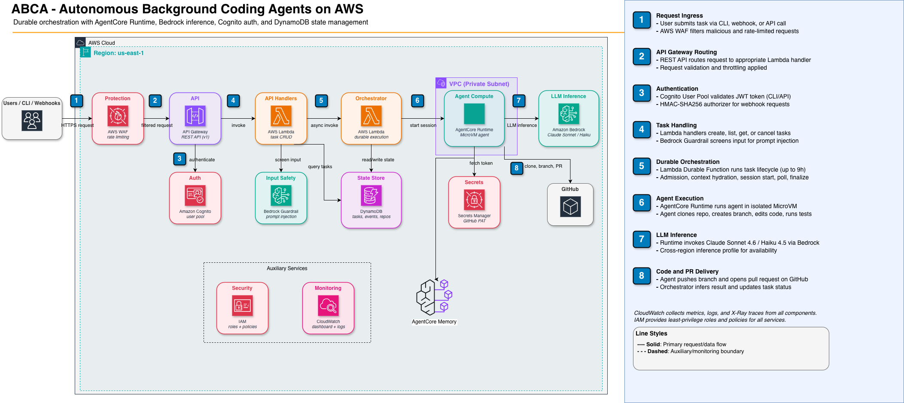
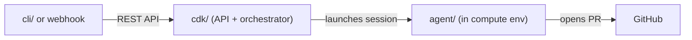

# Developer guide

ABCA uses [Yarn workspaces](https://classic.yarnpkg.com/lang/en/docs/workspaces/) for its TypeScript packages, [mise](https://mise.jdx.dev/) for tools and tasks, and AWS CDK for infrastructure. To build and test the project, [open the contributor dev container](#open-the-contributor-dev-container) or follow the [Quick Start](./QUICK_START.mdx) to set up your own machine.



The repository is organized around these main pieces:

- **Agent runtime code** in Python under `agent/`. It holds the runtime entrypoint, the task execution loop, memory writes, observability hooks, and local container tooling.
- **Infrastructure as code** in AWS CDK under `cdk/src/`. The stacks, constructs, and handlers define and deploy the platform on AWS.
- **Documentation site** under `docs/`. It holds the source guides and design docs, plus the generated Astro/Starlight documentation site.
- **CLI package** under `cli/`. It is the `bgagent` command-line client, which you use to authenticate, submit tasks, and inspect task status and events.
- **Operator console** under `web/`. It is a single-page React app for the people who run a deployment. It shows what agents are working on, what is stuck, and what is waiting for a human. It talks only to the REST API.
- **Claude Code plugin** under `docs/abca-plugin/`. It is a [Claude Code plugin](https://docs.anthropic.com/en/docs/claude-code/plugins) with guided skills and agents for setup, deployment, task submission, and troubleshooting. See the [plugin README](../abca-plugin/README.md) for details.

> **Tip:** If you use Claude Code, run `claude --plugin-dir docs/abca-plugin` from the repo root. The plugin's `/setup` skill guides you through the whole setup interactively.

## Where to make changes

Before you edit, decide which part of the monorepo owns the behavior, so that the API types, the CLI, and the docs stay in sync.

| Area | Paths | Notes |
|------|--------|--------|
| API & Lambdas | `cdk/src/handlers/`, `cdk/src/stacks/`, `cdk/src/constructs/` | Extend `cdk/test/` for the same feature. |
| API types | `cdk/src/handlers/shared/types.ts`, **`cli/src/types.ts`** and `web/src/core/api/types.ts` | Update the CLI mirror when request or response shapes change, and the web mirror where the console mirrors the type. `mise run check:types-sync` fails on drift. |
| CLI | `cli/src/`, `cli/test/` |  - |
| Agent runtime | `agent/` | Bundled into the image that CDK deploys. Run `mise run quality` in `agent/`, or the root build. |
| Docs (source) | `docs/guides/`, `docs/design/`, `docs/decisions/`, `CONTRIBUTING.md` | After edits, run **`mise //docs:sync`** or **`mise //docs:build`**. Do not edit `docs/src/content/docs/` directly. |

For a concise copy of this table, common pitfalls, and a CDK test file map, see **[AGENTS.md](../../AGENTS.md)** at the repo root. That file is written for automation-assisted contributors. Package-specific detail is in the **`AGENTS.md`** under each of `cdk/`, `cli/`, `web/`, `agent/`, and `docs/`.

## Repository preparation

The [Quick Start](./QUICK_START.mdx) covers the basic setup: forking a sample repo, creating a PAT, registering a Blueprint, and storing the token in Secrets Manager. This section covers what you need beyond that.

### Pre-flight checks

After deployment, the orchestrator calls the GitHub API before it starts each task, to verify that your token has enough privilege. The check catches common mistakes, such as a read-only PAT, before the task consumes compute. If the check fails, the task transitions to `FAILED` with a reason such as `INSUFFICIENT_GITHUB_REPO_PERMISSIONS`, instead of failing later inside the agent run.

Permission requirements vary by task type:

- `new_task` and `pr_iteration` require Contents (read/write) and Pull requests (read/write).
- `pr_review` needs only Triage or higher, because it does not push branches.

Classic PATs with the `repo` and `read:org` scopes also work. They are required when fine-grained tokens cannot reach the target repo (collaborator access, cross-org repos). See [agent/README.md](../../agent/README.md#github-pat--minimal-permissions) for when to use which token type.

### Quick setup (single repo)

To point the default Blueprint at your own repo without editing code, pass the repo as a CDK context variable or as an environment variable:

```bash
# Context variable (preferred)
mise //cdk:deploy -- -c blueprintRepo=your-org/your-repo

# Or environment variable
BLUEPRINT_REPO=your-org/your-repo mise //cdk:deploy
```

The default is `awslabs/agent-plugins`. For a quick end-to-end test, fork that repo and pass your fork (for example, `-c blueprintRepo=jane-doe/agent-plugins`).

### Multiple repositories

To onboard more repositories, add entries to `resolveBlueprintDefinitions` in `cdk/src/blueprints/definitions.ts`. The app resolves these plain inputs before it constructs either stack, so repository provisioning and the DNS egress policy use the same configuration:

```typescript
definitions.push({
  id: 'MyServiceBlueprint',
  repo: 'acme/my-service',
});
```

Each entry supports the per-repo overrides from `BlueprintProps` in `cdk/src/constructs/blueprint.ts`, without a table reference. Keep the `id` of each entry stable across releases:

```typescript
definitions.push({
  id: 'MyServiceBlueprint',
  repo: 'acme/my-service',
  compute: { runtimeArn: '...' },                    // override the default runtime ARN
  agent: {
    modelId: 'global.anthropic.claude-opus-5-5',     // foundation model override
    maxTurns: 150,                                    // default turn limit for this repo
    systemPromptOverrides: 'Extra instructions...',   // appended to the platform prompt
  },
  credentials: { githubTokenSecretArn: '...' },       // per-repo GitHub token secret
  pipeline: {
    pollIntervalMs: 5000,                             // poll interval awaiting completion
    buildCommand: 'npm run build && npm test',        // build/test verification (default: mise run build)
    lintCommand: 'npm run lint',                      // lint verification (default: mise run lint)
  },
});
```

If you use a custom `compute.runtimeArn` or `credentials.githubTokenSecretArn`, pass the ARNs to `TaskOrchestrator` through `additionalRuntimeArns` and `additionalSecretArns`, so that the Lambda has IAM permission. See [Repo onboarding](../design/REPO_ONBOARDING.md) for the full model.

#### Build-regression gating (important for non-mise repos)

Before it opens a PR, the agent runs a **build** command and a **lint** command in its cloud container. It runs them once on the clean clone, as the baseline, and again after its changes. If the build passed before and fails after, the task fails. That check is the build-**regression** gate. The gate is a compile and test verification, **not** a deployment. Your app's deploy stays in your own CI/CD after the PR merges.

The commands default to **`mise run build`** and **`mise run lint`**. A repo that uses [mise](https://mise.jdx.dev/) with `build` and `lint` tasks needs no configuration for the gate. A repo that uses another build tool, such as npm, gradle, cargo, or make, **must set `pipeline.buildCommand`** to its real command, and can also set `lintCommand`. Otherwise the default `mise run build` finds no task, **build-regression gating is silently OFF, and a change that breaks the build still reports success**. When that happens, the agent puts a `⚠️ Build-regression gating is OFF` warning on the PR so that the gap is visible, but the fix is to configure the command. The gap matters twice over for #247 orchestration. Dependent sub-issues stack onto the branch of a predecessor, so a broken predecessor that was not verified passes its breakage to every sub-issue that depends on it.

After you change Blueprints, redeploy with `mise //cdk:deploy`. A redeploy writes the overrides that a definition declares. It does not clear an override that was deleted from the definition. See [Removing a per-repo override](./USER_GUIDE.md#removing-a-per-repo-override).

### Stack decomposition and synthesis budgets

`networkTopology` defaults to `inline`. That value preserves existing network ownership. For a new installation, `split` puts AgentVpc and DnsFirewall in `${stackName}-network`, and the application consumes the VPC, subnet and security-group exports. The network has no application dependencies. `cdk/src/blueprints/definitions.ts` resolves the plain Blueprint definitions once, so DNS and repository provisioning use the same domains without cross-stack coupling. Task API routes, authorizers, permissions, CORS and deployment remain together in `AgentStack`.

The CDK build and offline census share 142 named profiles: the 40-cell single-backend/service/image product in both topologies, supplemental email/fork/consent cases, explicit three-AZ pins, expanded `bedrockModels` grants, every multi-backend set at default and widest settings, legacy additive selectors, and [deployment-profile](./DEPLOYMENT_GUIDE.md#deployment-profiles) cells (minimal, each optional feature alone, Linear+Jira, Linear+screenshots, all features). The feature cells also assert that disabled features leave no resources, outputs, routes or Lambda permissions, and that each feature's catalogued footprint stays within 15% of synthesis. The census ignores `abca.deployment.json` (`deploymentProfile=none`). Successful profiles check every parent and nested template against 490 resources, 800,000 bytes and 200 parameters/outputs. They also verify method-scoped API permissions, the absence of console test-invoke grants and of three synthesis warnings (template size, a custom resource left on CDK's default of downloading the latest SDK, a cdk-nag rule that could not be evaluated), backend membership, and two-zone auto-pin versus explicit pins. The model-expansion cases add synthetic IDs to the platform defaults and assert that CDK generates IAM overflow policies for the SessionRole and for each backend's compute role, and that those policies pass the audit. These fixtures test policy size, not model availability. Expected resource-budget failures must identify the application stack and the production ceiling. Unrelated errors cannot satisfy the gate.

```bash
mise //cdk:census -- --output /tmp/stack-census
```

Use `--list` to see the profiles and `--profile NAME` to select them. The census runs the production app with fixed account and AZ inputs, with CDK metadata enabled, and with bundling and staging disabled. It records template inventories, counts, bytes, dependencies and source provenance. The production app sets CDK's `@aws-cdk/core:stackResourceLimit` before it constructs any stack, so operator configurations outside the census also fail above 490. Context overrides can tighten the limit but cannot raise it. `--max-resources` can only tighten the census audit ceiling.

`--check-stability` runs each selected profile twice in independent processes and fails on differences. It does not normalize away timestamps, logical IDs or asset hashes. The existing Blueprint callbacks embed synthesis-time timestamps, so unchanged source can fail this optional diagnostic. The version of the input guardrail no longer differs between two syntheses, because its logical ID contains a hash of the guardrail's configuration ([#1079](https://github.com/aws-samples/sample-autonomous-cloud-coding-agents/issues/1079)). Deterministic Blueprint provisioning and Docker build-context changes are deferred. Passing the budget gate is not a claim of repeatable synthesis or live resource preservation.

Network tests compare the moved definitions, generated Name tags, endpoint security-group descriptions, exports, application service properties, shared API resources, solution attribution and provenance tags. Comparison tests fix the clock. The census does not, and it reports the Blueprint timestamps. The tests also map one immutable version ID that differs between the topologies. On ECS, the orchestrator's environment names the private subnets, by reference in the inline topology and by import in the split topology, and the logical ID of the orchestrator's function version hashes that environment. `networkReservedAzs` reserves unused address slots, so that removing a trailing AZ need not shift the remaining subnet CIDRs. Before you change the network, follow the [staged AZ reduction procedure](./DEPLOYMENT_GUIDE.md#reducing-azs-in-an-existing-split-network) to release old imports.

Migration of an existing inline deployment to split remains deferred under [#852](https://github.com/aws-samples/sample-autonomous-cloud-coding-agents/issues/852). A populated `cdk refactor`/import and rollback rehearsal is still required before a supported migration procedure can be published. Retention and the Blueprint ownership handoff must be reviewed and released separately. This change keeps the existing removal policies and the existing Blueprint provider. [ADR-023](../decisions/ADR-023-cloudformation-stack-boundaries.md#deferred-migration-work) records the concrete follow-up requirements. See [Network stack topology](./DEPLOYMENT_GUIDE.md#network-stack-topology) for fresh-install guidance and migration limits.

### Customizing the agent image

The default image (`agent/Dockerfile`) includes Python, Node 24 (LTS), `git`, `gh`, Claude Code CLI, and `mise`. If your repositories need more runtimes, such as Java, Go, or native libs, extend the Dockerfile. A normal `cdk deploy` rebuilds the image asset.

### Writing Cedar policies for the repo

A blueprint can declare its own `security.cedarPolicies` rules in addition to the built-in starter set of hard-deny and soft-deny rules. A hard-deny rule always blocks a tool call. A soft-deny rule pauses the agent and asks a human before the agent proceeds.

See the [Cedar policy guide](./CEDAR_POLICY_GUIDE.md) for the full authoring reference. It covers the vocabulary (`execute_bash`, `write_file`, `context.command`, `context.file_path`), the annotations (`@rule_id`, `@tier`, `@approval_timeout_s`, `@severity`, `@category`), worked examples, multi-match rules, and cross-engine parity testing with the [`contracts/cedar-parity/`](../../contracts/cedar-parity/) fixtures.

### Other options

- **Stack name.** The default is `backgroundagent-dev` (set in `cdk/src/main.ts`). If you rename it, update all `--stack-name` references.
- **Making repos agent-friendly.** Add `CLAUDE.md`, `.claude/rules/`, and clear build commands. See the [Prompt guide](./PROMPT_GUIDE.md#repo-level-instructions) for details.

## Model configuration

**This section is the canonical reference for which model the agent uses and where to change it.** The model ID is configured in five independent layers, in three languages, so read this section before you change a default. A mismatch between the layers fails every task on the stack at turn 0, not only an edge case.

### The five layers

| # | Layer | What it controls | Where | ID form |
|---|---|---|---|---|
| 1 | **IAM invoke allowlist** | Which models the agent's roles may invoke at all, and in which geography. The outer gate. Everything below fails without it. | `DEFAULT_BEDROCK_MODEL_IDS` (`cdk/src/constructs/bedrock-models.ts`). Override with CDK context `bedrockModels`. Geography via context `bedrockGeoRegion` (`global` in the shipped `cdk.json`, `us` if no context is supplied at all) | **Bare** (`anthropic.claude-…`) |
| 2 | **Platform default model** | The model used when nothing narrower is set. Injected by the stack as `ANTHROPIC_MODEL`, derived from `bedrockGeoRegion`. The Python literal is the fallback that a run with no env reaches. | `PLATFORM_DEFAULT_MODEL_ID` (`cdk/src/handlers/shared/bedrock-model-constants.ts`). It is the value that the stack injects, so it is the one to change. Then the no-env fallbacks `agent/src/config.py` and `agent/src/models.py:131` (`TaskConfig.anthropic_model`) | Prefixed (`<geo>.anthropic.…`) |
| 3 | **Auxiliary / fast model** | The small model that Claude Code uses for auxiliary work (WebFetch page summarization, the pre-flight safety check). | Stack env `ANTHROPIC_DEFAULT_HAIKU_MODEL` (`cdk/src/stacks/agent.ts`, the runtime environment block). Agent-side fallback at `agent/src/config.py` | Prefixed (`<geo>.anthropic.…`) |
| 4 | **Per-repo override** | One repository's model, with no agent redeploy. | Blueprint `agent.modelId` (`cdk/src/constructs/blueprint.ts`, `BlueprintProps.agent.modelId`) → RepoTable `model_id` (`cdk/src/handlers/shared/repo-config.ts`) → ECS injects `ANTHROPIC_MODEL` (`cdk/src/handlers/shared/strategies/ecs-strategy.ts`) | Prefixed (`<geo>.anthropic.…`) |
| 5 | **Per-task / local** | One task's model. Payload `model_id` is aliased to `anthropic_model` (`agent/src/pipeline.py`, `_PAYLOAD_KEY_ALIASES`). Local batch runs read `ANTHROPIC_MODEL` from the shell through `agent/run.sh`. | Task payload `model_id`, or shell `ANTHROPIC_MODEL` | Prefixed (`<geo>.anthropic.…`) |

### Environment variables

| Variable | Who sets it | ID form | Purpose |
|---|---|---|---|
| `ANTHROPIC_MODEL` | The ECS strategy, from the repo Blueprint (layer 4). You, in the shell, for local batch runs (layer 5) | Prefixed inference profile | The main coding model. When unset, the `agent/src/config.py` fallback applies. |
| `ANTHROPIC_DEFAULT_HAIKU_MODEL` | The CDK stack, hardcoded at `cdk/src/stacks/agent.ts` (the runtime environment block) | Prefixed inference profile | The small, fast auxiliary model. Must be a granted profile, or the pre-flight check times out with *"Pre-flight check is taking longer than expected"*. |
| `CLAUDE_CODE_USE_BEDROCK` | The CDK stack (`='1'`) and `agent/run.sh` | — | Routes Claude Code to Bedrock instead of the Anthropic API. ABCA always runs on Bedrock. |

### Precedence — narrowest wins

```text
per-task payload model_id            (layer 5)
  > blueprint agent.modelId          (layer 4, arrives as stack env ANTHROPIC_MODEL)
  > stack env ANTHROPIC_MODEL        (layer 3-adjacent / local shell)
  > agent/src/config.py fallback     (layer 2 — global.anthropic.claude-opus-5-5)
```

The **IAM invoke allowlist** (layer 1) gates every one of those, and **account-level Bedrock model access** gates the allowlist. Both gates are silent until invocation. A model that resolves through precedence still fails at turn 0 with `AccessDenied` if it is not in the grant list, and fails again if your account has not completed [Bedrock model access](https://docs.aws.amazon.com/bedrock/latest/userguide/model-access.html) for it.

### Bare vs. prefixed IDs — the one rule that bites

Layer 1 takes **bare foundation-model IDs**. Every other layer takes the **prefixed inference-profile ID**. This asymmetry is deliberate. Both grant sites derive the inference-profile ARN by *adding* the geo prefix themselves, so a prefixed entry in `bedrockModels` would produce an invalid `us.us.anthropic.…` ARN. The resolver rejects an entry that carries any modelled geo prefix, so the typo fails at synth and not at runtime.

In the other direction, a **bare** ID cannot be invoked on demand at all. Verified:

```console
$ aws bedrock-runtime invoke-model --model-id anthropic.claude-opus-5 ...
ValidationException: Invocation of model ID anthropic.claude-opus-5 with on-demand
throughput isn't supported. Retry your request with the ID or ARN of an inference
profile that contains this model.
```

So the `bedrockModels` context takes `anthropic.claude-opus-5-5`. Every other place takes `global.anthropic.claude-opus-5-5`, or the same ID with the prefix of the geo that you have configured, as the next section describes.

### Choosing the inference-profile geography

The geography that those prefixes name is configurable through the CDK context `bedrockGeoRegion`:

```console
$ cdk deploy -c bedrockGeoRegion=global
```

You can also set it as a `context` entry in `cdk/cdk.json`. The shipped `cdk.json` sets `global`. The code default, when no context is supplied, is `us`. The accepted values are the geographies that `@aws-cdk/aws-bedrock-alpha` models, currently `global`, `us`, `us-gov`, `eu`, `apac`, `jp`, `au`. An unrecognized value **fails at synth**, not at deploy. An invented geography produces a well-formed ARN for a profile that does not exist, so the grant would authorize nothing, and the agent would fail at turn 0 with `AccessDenied` and nothing to explain why.

One value applies to everything that needs a prefix: every grant site (AgentCore runtime, ECS task role, Lambda MicroVM) and both injected env vars, `ANTHROPIC_MODEL` and `ANTHROPIC_DEFAULT_HAIKU_MODEL`. The single value is deliberate. A deployment can never grant the profiles of one geography while it tells the agent to call the profiles of another.

**Which to choose.** A `global.` profile routes to any supported commercial Region. That routing gives better throughput and resilience under peak demand, which is worth having for tasks that run for hours and burst. A geo profile (`us.`, `eu.`, `apac.`, …) keeps inference within that geography, as a **data-residency requirement** demands. Pick the geo profile in that case. The throughput benefit is not worth a compliance breach.

Check two things when you change the geography. Both fail at runtime, not at synth:

- The models you use must have an active profile in the target geography. Not every model is published to every geo.
- Your account's [Bedrock model access](https://docs.aws.amazon.com/bedrock/latest/userguide/model-access.html) must cover the deployment Region's entitlements for that geography.

Changing the geography requires a **redeploy**, because the IAM grants are scoped to explicit profile ARNs that are resolved at synth. Switching among models that are already granted does not require a redeploy. See layer 4.

### Bumping the default model

1. Add the **bare** ID to `DEFAULT_BEDROCK_MODEL_IDS` (`cdk/src/handlers/shared/bedrock-model-constants.ts`) and deploy, so that the grant exists before anything tries to use it.
2. Confirm account-level Bedrock access for the model in the target Region.
3. Change `PLATFORM_DEFAULT_MODEL_ID` (`cdk/src/handlers/shared/bedrock-model-constants.ts`). **This step changes what deployed tasks run.** The stack injects the value as `ANTHROPIC_MODEL` on every substrate, so editing only the Python literals of step 4 has no effect on any deployed task.
4. Update the **prefixed** ID in `agent/src/config.py` and `agent/src/models.py` too. These literals are the fallback that a run with no env reaches (a local batch run), and the doc-drift test compares against them.
5. **Verify the SDK price table recognizes the model.** The `max_budget_usd` guardrail is computed from a price table bundled into the Claude Agent SDK at build time, so an unrecognized model silently degrades budget enforcement. Run `agent/scripts/diagnostics/test_sdk_smoke.py` with `ANTHROPIC_MODEL` set to the new ID, divide the reported cost by the input-token count, and confirm the implied rate matches [published Bedrock pricing](https://aws.amazon.com/bedrock/pricing/). A `$0.00` result, or one far from the published rate, means that the table does not know the model and that you cannot trust budgets.
6. The doc-drift test (`cdk/test/contracts/model-default-docs-parity.test.ts`) fails until the documented defaults here and in `agent/README.md` match `config.py`. That failure is your reminder to update both.
7. **Tell operators who override `bedrockModels`.** The override REPLACES the default list, and synth fails ("omits the platform default model") if it lacks either new default. A deployment that carries `-c bedrockModels=[...]` or a `cdk.json` `context` entry must add the new bare IDs before it pulls the bump. Say so in the release notes.

### Cost and model selection

Model choice is a **cost** decision, so you can adjust it per repo and per task without a code change.

**Per-token rate versus token volume.** These figures were measured on the pinned toolchain, with the same one-turn prompt and the same system prompt:

| Model | Input tokens | Reported `cost_usd` | Implied input rate |
|---|---|---|---|
| `us.anthropic.claude-opus-4-8` | 32,145 | $0.160850 | **$5.00/MTok** |
| `us.anthropic.claude-opus-5` | 37,584 | $0.188020 | **$5.00/MTok** |

The token ratio is 1.169 and the cost ratio is 1.169, so the two are identical. **The per-token rate is unchanged. The whole difference is token volume on an identical prompt.** Read the result that way. "Opus 5 costs ~17% more per task" suggests the wrong remedy, which is to switch models. "Same rate, more tokens" names the settings that reduce the cost: prompt size, prompt caching, and `max_turns`.

**Where can I set `max_budget_usd`?**

| Surface | How | Status |
|---|---|---|
| Per task, CLI | `bgagent submit --max-budget <dollars>` (`cli/src/commands/submit.ts`), range 0.01–100 | Works |
| Per task, REST | `max_budget_usd` in the `POST /v1/tasks` body | Works |
| Local batch only | `MAX_BUDGET_USD` shell env, when running `entrypoint.py` directly | Works locally. **Ignored** by the deployed AgentCore **server** mode, which reads the budget from the `/invocations` JSON body |
| Per repo, Blueprint | `agent.maxBudgetUsd` on the repo's `Blueprint` construct | Works. Persisted to `RepoTable.max_budget_usd`. Same `0.01`–`100` range as the CLI, validated at CDK synth so that an out-of-range value cannot deploy. See [Per-repo overrides](./USER_GUIDE.md#per-repo-overrides). |
| Platform default | — | None by design. **Unset means unlimited** |

**Per-task runtime budgets are unlimited by default.** Because no platform-wide per-task runtime ceiling applies, the documented mitigation for cost is to choose a lighter-token model, and not to rely only on a cap:

- **Per repo.** Set Blueprint `agent.modelId`. It needs no code change and no agent redeploy. Prefix the ID with the geography that the stack grants, which you read from the stack's `BedrockGeoRegion` output. Synth accepts only the `<geo>.<model>` ID form, with the deployment's geography and a granted model. A bare ID, an ARN, the prefix of another geography, or a model outside the grant list fails synth. For example, a `us.` prefix on a `global` deployment is granted nothing. `bgagent repo onboard --model` refuses the same values.
- **Per task.** Set `model_id` in the task payload.
- **Platform-wide.** Change `PLATFORM_DEFAULT_MODEL_ID` (what every substrate is told to invoke) and the `bedrockModels` context (what every substrate is granted). Change both, or the deploy fails at synth because they disagree.

The model must be in the IAM grant list (layer 1), or the task fails at turn 0 with `AccessDenied`. The grant is the gate, so a lighter model is reachable only if it is granted.

**Trust boundary on the number.** `cost_usd` is the Claude Agent SDK's **client-side estimate** from that bundled price table. It is not authoritative billing. The estimate drifts when Bedrock pricing changes, when the SDK version does not recognize a model, or when discounts and commitments apply. See the warning at line 6 of [Cost attribution](./COST_ATTRIBUTION.md). Authoritative cost comes from AWS Cost Explorer or CUR 2.0.

**Fleet monthly budgets are a separate admission control.** `bgagent budget set --user|--team --monthly-usd <amount> [--hard-stop]` stores a recurring user or Cognito-group limit. Terminal task costs roll up by UTC month from the TaskTable stream. The 80% and 100% crossings publish CloudWatch alarms. Hard-stop scopes reject new task creation at 100% and do not terminate in-flight work. See [Monthly user and team budgets](./USER_GUIDE.md#monthly-user-and-team-budgets).

## Installation

Follow the [Quick Start](./QUICK_START.mdx) to clone, install, deploy, and submit your first task. It covers prerequisites, toolchain setup, deployment, PAT configuration, Cognito user creation, and a smoke test.

### Open the contributor dev container

- **Local VS Code.** Start Docker and install the **Dev Containers** extension. Open a fresh clone of ABCA in VS Code, then choose **Dev Containers: Reopen in Container** from the Command Palette.
- **GitHub Codespaces.** On the repository page, select your branch, open **Code → Codespaces**, and create a codespace on that branch. GitHub opens the editor in your browser.

If you already have a **linked issue worktree** on your machine, its `.git` file points outside the folder that VS Code mounts. From that worktree, create a standalone copy of the issue branch for the container. Choose an unused sibling directory and open it in VS Code. The clone includes committed work only.

```bash
branch=$(git branch --show-current)
git clone --no-local --branch "$branch" . ../abca-dev
git -C ../abca-dev remote set-url origin "$(git remote get-url origin)"
```

The post-create hook installs the tools declared in the repo's mise configs, enables Yarn Classic, and runs `mise run install` for the workspace dependencies, the agent's Python environment, and Git hooks. Once setup finishes, run `mise run build` in the container terminal from the repository root. The build can run without AWS credentials.

After changing `.devcontainer/`, choose **Dev Containers: Rebuild Container** in local VS Code or **Codespaces: Rebuild Container** in a codespace.

#### Push commits from the dev container

The default container has no Docker engine connection. The pre-push hook needs Docker to build and scan the worker image during `mise run security`. The optional `mise run test:integration` suite also needs Docker. Commit your changes in the container, then push from a **separate host worktree** with Docker running and the [Quick Start toolchain](./QUICK_START.mdx) installed. That arrangement keeps the Linux `node_modules` and `agent/.venv` in the container checkout. See the [emulator guide](../../scripts/aws-emulator/README.md) for integration tests.

- **Local VS Code.** From your host checkout, run `git fetch ../abca-dev <issue-branch>`, substituting your branch name and the path to the container checkout.
- **Codespaces.** On the issue branch in the codespace, run `git bundle create abca-issue.bundle HEAD`. Right-click `abca-issue.bundle` in the browser editor's Explorer, select **Download**, then delete the untracked bundle from the codespace. From your host checkout, run `git fetch ~/Downloads/abca-issue.bundle HEAD`, adjusting the path to the downloaded file.

If you fetched from a host worktree already on the issue branch, run `git merge --ff-only FETCH_HEAD` there. If the issue branch exists only in the container, run `git worktree add -b <issue-branch> ../abca-host FETCH_HEAD` and `cd ../abca-host` to create its host worktree. Run `mise run install` in the host worktree to install native dependencies and Git hooks, then `git push -u origin HEAD` to run the pre-push checks and publish the commits.

### Troubleshooting mise

If `mise run install` fails or versions look wrong:

| Symptom | Fix |
|---------|-----|
| `yarn: command not found` | Activate mise in your shell (`eval "$(mise activate zsh)"`), then `corepack enable && corepack prepare yarn@1.22.22 --activate`. |
| `node` is not v22 | Activate mise in your shell, then `mise install` from the repo root. |
| Mise errors about untrusted config | `mise trust` from the repo root, then `mise install` again. |

Minimal recovery sequence:

```bash
eval "$(mise activate zsh)"   # or bash; add permanently to your shell rc file
cd /path/to/sample-autonomous-cloud-coding-agents
mise trust && mise install
corepack enable && corepack prepare yarn@1.22.22 --activate
mise run install
```

**When the `build` job fails in CI.** Start from the job summary. It names the mise task that failed and shows the last lines of that task's output. The JUnit reports of the cdk, cli and agent test suites are attached to the run as the `test-reports-agentcore` artifact. A lockfile that no longer matches its manifest fails early. `yarn.lock` fails right after the install, in the step `Fail on lockfile drift`. To fix it, run `mise run install` locally and commit the rewritten file. `agent/uv.lock` fails in the install itself, which runs `uv sync --locked`. To fix it, run `uv lock` in `agent/` and commit the file.

### Development workflow

Use this order to get fast feedback and to catch problems early:

1. **Test Python agent code first** (fast feedback):

   ```bash
   cd agent && mise run quality && cd ..
   ```

2. **Test through the local Docker runtime** with `./agent/run.sh` (see Local testing below).
3. **Deploy with CDK** once local checks pass.

### Local testing

Before you deploy, you can run the agent Docker container locally. The `agent/run.sh` script builds the image, resolves AWS credentials, and applies the resource constraints of AgentCore (2 vCPU, 8 GB RAM), so that the local environment matches production.

The script validates AWS credentials before it starts the Docker build, so a problem such as an expired SSO session shows before the build.

#### Setup

The `owner/repo` you pass must match an onboarded Blueprint and must be a repository that your `GITHUB_TOKEN` can push to and open PRs on.

```bash
export GITHUB_TOKEN="ghp_..."     # Fine-grained PAT
export AWS_REGION="us-east-1"     # Region where Bedrock models are enabled
```

The script resolves AWS credentials in priority order:

1. **Environment variables.** `AWS_ACCESS_KEY_ID`, `AWS_SECRET_ACCESS_KEY`, and optionally `AWS_SESSION_TOKEN` for temporary credentials.
2. **AWS CLI v2.** The script runs `aws configure export-credentials` from your active profile or SSO session. Set `AWS_PROFILE` to target a specific profile. AWS CLI v1 has no such command, so with v1 the script goes on to the mount.
3. **`~/.aws` mount.** The script bind-mounts the directory read-only. The mount works for static credentials but not for SSO tokens.

If none succeeds, the container starts without AWS credentials, and every AWS API call fails at runtime.

#### Running tasks

```bash
# Run against a GitHub issue
./agent/run.sh "owner/repo" 42

# Run with a text description
./agent/run.sh "owner/repo" "Add input validation to the /users POST endpoint"

# Issue + additional instructions
./agent/run.sh "owner/repo" 42 "Focus on the backend validation only"

# Dry run - validate config, fetch issue, print the length and hash of the prompts, then exit
DRY_RUN=1 ./agent/run.sh "owner/repo" 42
```

The script detects the type of the second argument. A numeric value is an issue number. Anything else is a task description.

#### Server mode

In production, the container runs as a FastAPI server. You can test that mode locally:

```bash
# Start the server
./agent/run.sh --server "owner/repo"

# In another terminal:
curl http://localhost:8080/ping

curl -X POST http://localhost:8080/invocations \
  -H "Content-Type: application/json" \
  -d '{"input":{"prompt":"Fix the login bug","repo_url":"owner/repo"}}'
```

#### Monitoring

The container runs with a fixed name (`bgagent-run`):

```bash
docker logs -f bgagent-run                        # live agent output
docker stats bgagent-run                          # CPU, memory usage
docker exec -it bgagent-run bash                  # shell into the container
```

#### Testing with progress events (DynamoDB Local)

By default, local runs silently skip progress events and task state writes, because the `TASK_EVENTS_TABLE_NAME` and `TASK_TABLE_NAME` env vars are not set. To enable them locally with DynamoDB Local:

```bash
# 1. Start DynamoDB Local and create tables
mise //agent:local:up

# 2. Run the agent with --local-events
./agent/run.sh --local-events "owner/repo" 42

# 3. In another terminal — query progress events
mise //agent:local:events          # table format
mise //agent:local:events:json     # JSON format

# 4. When done — tear down DynamoDB Local
mise //agent:local:down
```

The `--local-events` flag connects the agent container to DynamoDB Local on the `agent-local` Docker network and sets the env vars that the writes need. The agent code writes to DynamoDB Local through the same code path as production, with no mocks or alternate implementations.

#### Environment variables

| Variable | Default | Description |
|---|---|---|
| `ANTHROPIC_MODEL` | `global.anthropic.claude-opus-5-5` | Bedrock inference-profile ID for the main coding model |
| `MAX_TURNS` | `100` | Max agent turns before stopping |
| `MAX_BUDGET_USD` | | Cost ceiling for local batch runs only (production uses the API field) |
| `DRY_RUN` | | Set to `1` to validate and print the length and hash of the prompts without running the agent |

For the full list, see `agent/README.md`. For how the model default is layered, overridden, and priced, see [Model configuration](./DEVELOPER_GUIDE.md#model-configuration).

#### Troubleshooting

| Symptom | Fix |
|---|---|
| `ERROR: Failed to resolve AWS credentials via AWS CLI` | If you use SSO, run `aws sso login`. Otherwise export `AWS_ACCESS_KEY_ID` and `AWS_SECRET_ACCESS_KEY` directly. |
| `ERROR: GITHUB_TOKEN is not set` | Export `GITHUB_TOKEN` with the required scopes. |
| `WARNING: No AWS credentials detected` | Configure one of the three credential methods above. |
| `WARNING: Image exceeds AgentCore 2 GB limit!` | Reduce dependencies or use a multi-stage Docker build. |
| Bedrock or model errors in agent logs (for example, model not available on your deployment, or zero tokens) | IAM `grantInvoke` is not enough. The account must meet [Bedrock model access](https://docs.aws.amazon.com/bedrock/latest/userguide/model-access.html) and use a supported [inference profile](https://docs.aws.amazon.com/bedrock/latest/userguide/inference-profiles-use.html) ID in `ANTHROPIC_MODEL` or the task `model_id` where required. Complete the Anthropic FTU and Marketplace prerequisites that the Bedrock User Guide describes. Align the `cdk/src/stacks/agent.ts` grants with the chosen profile and Region. |

### Deployment

For a first deployment, follow steps 3-6 of the [Quick Start](./QUICK_START.mdx). For later deploys after code changes:

```bash
mise run build
mise //cdk:deploy
```

A full deploy takes about 10 minutes. The time varies by region and by whether container layers are cached.

Deleting a stack (`mise //cdk:destroy`) can end in `DELETE_FAILED` on the runtime's security group and the VPC's private subnets. AgentCore releases the runtime's network interfaces some time after the runtime is deleted. The delay is not fixed and can be hours. [Teardown blocked by AgentCore network interfaces](./DEPLOYMENT_GUIDE.md#teardown-blocked-by-agentcore-network-interfaces) in the deployment guide shows how to inspect the stack, when to retry, and how to finish the deletion by retaining the blocked resources.

### Stack outputs

After deployment, the stack emits the outputs below. Retrieve them with `aws cloudformation describe-stacks --stack-name backgroundagent-dev --query 'Stacks[0].Outputs' --output table`.

| Output | Description |
|---|---|
| `RuntimeArn` | AgentCore runtime ARN |
| `ApiUrl` | Task REST API base URL |
| `UserPoolId` / `AppClientId` | Cognito identifiers |
| `TaskTableName` | DynamoDB table for task state |
| `TaskEventsTableName` | DynamoDB table for audit events |
| `TaskNudgesTableName` | DynamoDB table for task nudges |
| `TaskApprovalsTableName` | DynamoDB table for Cedar HITL approval gates |
| `UserConcurrencyTableName` | DynamoDB table for per-user concurrency |
| `BudgetTableName` | DynamoDB table for recurring user/team limits and monthly estimated spend |
| `WebhookTableName` | DynamoDB table for webhook integrations |
| `RepoTableName` | DynamoDB table for per-repo Blueprint config |
| `CedarWasmLayerArn` | Lambda layer ARN for the Cedar WASM policy engine |
| `TraceArtifactsBucketName` | S3 bucket for agent trace artifacts (7-day lifecycle) |
| `GitHubTokenSecretArn` | Secrets Manager secret ARN for the GitHub PAT |
| `OperationalAlertsTopicArn` | ARN of the `OperationalAlerts` topic, the SNS topic that every CloudWatch alarm of the stack notifies (Lambda errors, DLQ depth, monthly budgets, webhook screening, XSS matches on the signed webhook routes) |

When the Slack or Linear integrations are enabled, the stack emits more outputs (for example, `Slack*` and `Linear*` secret ARNs and integration table names).

Use the same AWS Region as your deployment. If `--region` is omitted, the CLI uses your default from `aws configure`.

## Project structure

The repository is a monorepo with five packages. Each package owns a part of the platform and has its own build, tests, and mise tasks.

```
sample-autonomous-cloud-coding-agents/
├── cdk/          # Infrastructure and API (TypeScript, AWS CDK)
├── agent/        # Agent runtime (Python, Docker)
├── cli/          # CLI client (TypeScript, commander)
├── web/          # Operator console (TypeScript, React)
├── docs/         # Documentation site (Astro/Starlight)
├── mise.toml     # Monorepo task runner config
└── package.json  # Yarn workspace root
```

A task passes through these packages in order. The **CLI** (or a webhook) sends a request to the API that **CDK** deploys. The orchestrator Lambda prepares the task and launches an **agent** session in an isolated compute environment. The agent works autonomously until it opens a PR or the task ends. The **web** console uses the same REST API and is deployed only with the opt-in console stack. The **docs** package is independent and affects only the documentation site.



The sections below are a task-oriented guide to each package. Each one answers "I want to change X. Where do I look?" For the operator console, see [web/README.md](../../web/README.md).

### `cdk/` - Infrastructure and API (TypeScript)

This package holds everything that runs on AWS: the CDK stack, the Lambda handlers, and the DynamoDB table definitions. Most backend changes happen here.

| I want to... | Look at |
|---|---|
| Add or change an API endpoint | `cdk/src/handlers/` for the Lambda, `cdk/src/constructs/task-api.ts` for the API Gateway wiring |
| Change task validation or admission | `cdk/src/handlers/shared/validation.ts`, `cdk/src/handlers/shared/create-task-core.ts` |
| Modify the orchestration flow | `cdk/src/handlers/orchestrate-task.ts`, `cdk/src/handlers/shared/orchestrator.ts` |
| Change how context is assembled for the agent | `cdk/src/handlers/shared/context-hydration.ts` |
| Add a DynamoDB table or modify a schema | `cdk/src/constructs/` (one construct per table) |
| Onboard repos or change Blueprint behavior | `cdk/src/constructs/blueprint.ts`, `cdk/src/stacks/agent.ts` |
| Change webhook authentication | `cdk/src/handlers/webhook-authorizer.ts`, `cdk/src/handlers/webhook-create-task.ts` |
| Add or update tests | `cdk/test/` mirrors `cdk/src/`. Each handler and construct has a colocated test file |

One convention matters here. API request and response types are in `cdk/src/handlers/shared/types.ts`. If you change them, also update `cli/src/types.ts` to keep the CLI in sync, and `web/src/core/api/types.ts` where the console mirrors the type.

To build and test, run `mise //cdk:build`. It compiles, lints, type-checks, tests, and synthesizes.

### `agent/` - Agent runtime (Python)

This package is the code that runs inside the compute environment (AgentCore MicroVM). It is the agent itself: the execution loop, the system prompts, the tool configuration, the memory writes, and the Docker image.

| I want to... | Look at |
|---|---|
| Change what the agent does during a task | `agent/src/pipeline.py` (execution flow), `agent/src/runner.py` (CLI invocation) |
| Modify system prompts | `agent/src/prompts/`, with the base template and the per-workflow variants (`coding/new-task-v1`, `coding/pr-iteration-v1`, `coding/pr-review-v1`) |
| Change agent configuration or environment | `agent/src/config.py` |
| Add or modify hooks (pre/post execution) | `agent/src/hooks.py` |
| Change the Docker image (add runtimes, tools) | `agent/Dockerfile` |
| Run agent quality checks | `mise //agent:quality` (lint, format, type check, dead code, tests). When the lint or the format step has changed a file, the task fails once and says so (the lint step lists its fixes). Run the task again |

To build and test, run `mise //agent:quality`. The unit tests run with the AWS credential sources removed and refuse every request that botocore tries to send. A refused request fails the run and is listed in the `AWS send guard` section at the end of the output. [agent/AGENTS.md](../../agent/AGENTS.md) has the details. The CDK build bundles the agent image, so `mise run build` picks up agent changes.

### `cli/` - CLI client (TypeScript)

This package is the `bgagent` command-line tool. It authenticates through Cognito, calls the REST API, and formats output.

| I want to... | Look at |
|---|---|
| Add a new CLI command | `cli/src/commands/` (one file per command), `cli/src/bin/bgagent.ts` (program setup) |
| Change how the CLI calls the API | `cli/src/api-client.ts` |
| Modify authentication or token handling | `cli/src/auth.ts` |
| Update API types | `cli/src/types.ts`. It must match `cdk/src/handlers/shared/types.ts`. The console's subset mirror is `web/src/core/api/types.ts` |

To build and test, run `mise //cli:build`.

### `docs/` - Documentation site (Astro/Starlight)

Source docs are in `docs/guides/`, `docs/design/` and `docs/decisions/`. The root `CONTRIBUTING.md` is mirrored as well. The Starlight site under `docs/src/content/docs/` is generated. Do not edit it directly.

| I want to... | Look at |
|---|---|
| Update a user-facing guide | `docs/guides/` (USER_GUIDE.md, DEVELOPER_GUIDE.md, QUICK_START.mdx, PROMPT_GUIDE.md) |
| Update an architecture doc | `docs/design/` |
| Change the sidebar or site config | `docs/astro.config.mjs` |
| Change how docs are synced | `docs/scripts/sync-starlight.mjs` |

After you edit source docs, run `mise //docs:sync` or `mise //docs:build` to regenerate the site.

Two checks keep cross-references intact. Both run in CI on every pull request, as part of the required build:

- `mise //docs:link-check` checks the relative links of every Markdown file in the repository, tracked or new. It does not read a file that git ignores. The files are the sources in `docs/guides/`, `docs/design/` and `docs/decisions/`, and also package READMEs, `AGENTS.md` files, plugin skills and command files. The check confirms that the target file exists and that an anchor within the same file exists. It does not check an anchor that points into another file.
- `mise //docs:build` validates every internal link and anchor of the rendered site, anchors into other pages included, and fails with the page, line and link.

Neither check tests external `http(s)` URLs. That is deliberate, so that an unreliable network or a bot block cannot fail an unrelated PR.

A third check, also part of the required build, keeps the structure of the sources intact. `mise //docs:markdown-lint`, which `mise //docs:build` also runs, lints every tracked Markdown file with five rules: a table row whose cells do not match the header (renderers drop the extra cells), an image without alt text, a second top-level heading, a heading repeated under the same parent, and a skipped heading level. It reports the file, the line and the rule. [docs/AGENTS.md](../AGENTS.md) lists the fix for each rule. A `markdownlint-disable` comment does not silence the lint. With the git hooks installed, the same lint also runs at commit time when a Markdown file is staged, so a broken table fails the commit and not only the build.
