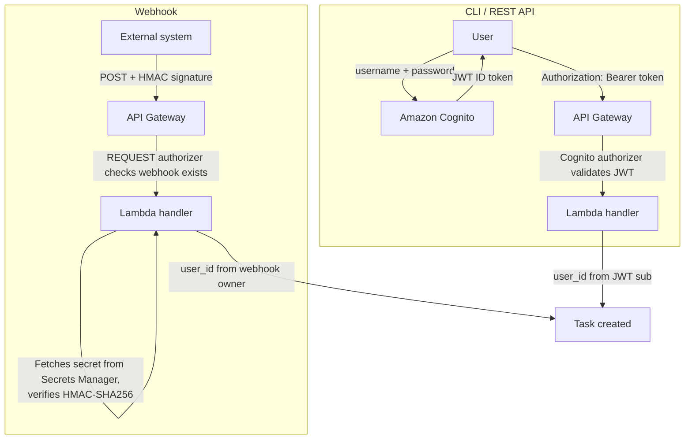
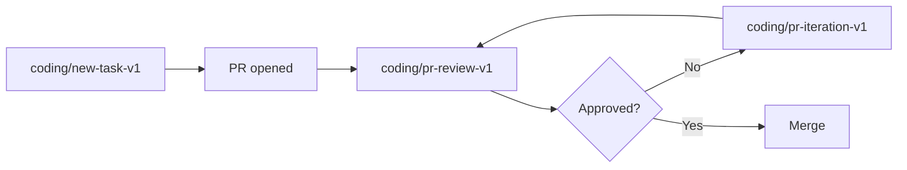
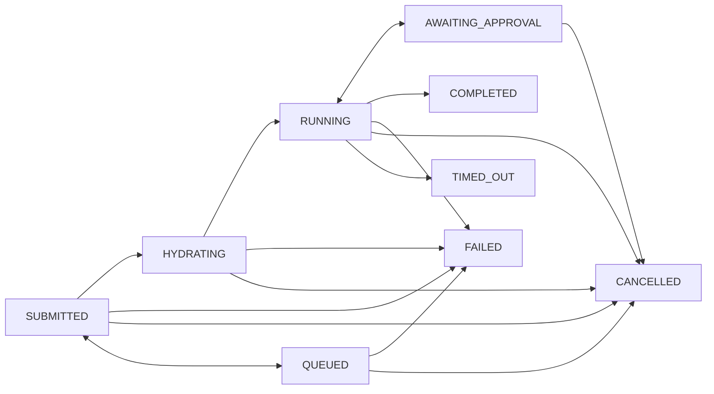

# User guide

## Overview

ABCA is a platform that runs autonomous background coding agents on AWS. A task is a GitHub repository with a task description or an issue number. You submit a task, an agent works on it autonomously in an isolated environment, and the agent delivers a pull request when it is done. This guide covers how to submit coding tasks, how to monitor their progress, and how to use the platform well.

There are six ways to interact with the platform. You can use each one alone or combine them:

1. **CLI (recommended).** The `bgagent` CLI authenticates through Cognito and calls the Task API. It is best for individual developers who submit tasks from the terminal. It handles login, token caching, and output formatting.
2. **REST API (direct).** Call the Task API endpoints directly with a JWT token. It is best for custom integrations, dashboards, or internal tools that you build on the platform. The API provides full validation, audit logging, and idempotency support.
3. **Webhook.** External systems such as CI pipelines and GitHub Actions can create tasks with HMAC-authenticated HTTP requests. It is best for automated workflows in which an event triggers a task, for example when a new issue is labeled or a PR needs review. A webhook needs no Cognito credentials. It uses one shared secret per integration.
4. **Slack.** Submit tasks by @mentioning the bot, and receive threaded progress notifications with reaction-based status. See the [Slack setup guide](./SLACK_SETUP_GUIDE.md).
5. **Linear.** Apply a label to a Linear issue to trigger a task. The platform posts progress comments and status reactions back on the issue as it works. The label has one variant. `bgagent` means do it, and `bgagent:help` means explain the labels. See [Trigger labels](./LINEAR_SETUP_GUIDE.md#trigger-labels) in the Linear setup guide.
6. **Jira.** Add a label to a Jira Cloud issue to trigger a task. A dedicated Forge `bgagent` app posts comments and transitions through Jira REST v3, and the human who triggered the task remains the task owner. See the [Jira setup guide](./JIRA_SETUP_GUIDE.md).

For example, a team might use the CLI for ad-hoc tasks and Slack for quick team-wide requests. The same team might use webhooks to trigger `coding/pr-review-v1` on every new PR through GitHub Actions, and Linear or Jira for tickets that are already in the project management tool. It might use the REST API to build a dashboard that tracks task status across repositories.

## Roles

ABCA is a **shared-stack-per-organization** platform. Everyone on the team uses one CDK deployment. As with a self-hosted GitLab or Linear instance, one company has one stack, and the stack has many users. You generally do **not** run your own deployment to use someone else's. You join theirs as a Cognito user.

There are four lifecycle roles. Early on, one person often holds all of them, but each role performs different operations:

| Role | What they do | Frequency |
|------|--------------|-----------|
| **Stack admin** | Runs `cdk deploy` for the stack, rotates platform-level secrets, and runs `bgagent admin invite-user` to onboard teammates | Once, then occasionally |
| **Integration admin** | Installs Linear/Slack OAuth apps or the Jira 3LO and Forge apps once per workspace or site | One time per workspace or site |
| **Repo onboarder** | Runs `bgagent linear onboard-project`, or registers a Blueprint through CDK, to connect a repo to the platform | As needed, by any authenticated user |
| **Teammate** | Runs `bgagent configure` once, then uses `bgagent submit`, a Linear or Jira label, or a Slack mention | Daily user |

If you're a teammate joining an existing deployment, go to [Joining an existing deployment](#joining-an-existing-deployment).

If you're creating a new deployment, read the [Developer guide](./DEVELOPER_GUIDE.md) first, then return here for the [admin onboarding flow](#get-stack-outputs).

## Prerequisites

You need the following:

- A deployed CDK stack (see the [Developer guide](./DEVELOPER_GUIDE.md))
- A Cognito user account (see [Authentication](#authentication))
- **Repositories must be onboarded** before tasks can target them (see [Repository onboarding](#repository-onboarding))
- For the CLI, Node.js installed, and the CLI built with `cd cli && mise run build`

## Authentication

The platform uses two authentication mechanisms, depending on the channel:

- **CLI and REST API.** These use an Amazon Cognito User Pool with JWT tokens. Self-signup is disabled, so an administrator must create your account.
- **Webhooks.** These use HMAC-SHA256 signatures with per-integration shared secrets that are stored in AWS Secrets Manager.

AWS WAF protects both channels at the API Gateway edge with rate limiting and common exploit protection. Downstream services never see raw tokens or secrets. The gateway extracts the user identity and attaches it to internal messages.



**CLI and REST API flow:**

1. **Authenticate.** The user sends a username and password to Amazon Cognito through the CLI (`bgagent login`) or the AWS SDK (`initiate-auth`).
2. **Receive token.** Cognito validates the credentials and returns a JWT ID token. The CLI caches the token locally (`~/.bgagent/credentials.json`) and refreshes it automatically on expiry.
3. **Call the API.** Every request includes the raw ID token (no `Bearer` prefix) in the `Authorization: <token>` header.
4. **Validate.** The Cognito authorizer of API Gateway verifies the JWT signature, expiration, and audience. It rejects invalid tokens with `401`.
5. **Extract identity.** The Lambda handler reads the `sub` claim from the validated JWT and uses it as the `user_id` for task ownership and audit.

**Webhook flow:**

1. **Send request.** The external system, such as a CI pipeline or GitHub Actions, sends a `POST` to `/v1/webhooks/tasks` with two headers. `X-Webhook-Id` identifies the integration, and `X-Webhook-Signature` carries `sha256=<hex>`.
2. **Check webhook exists.** A Lambda REQUEST authorizer verifies that the webhook ID exists and is active in DynamoDB. It rejects revoked or unknown webhooks with `403`.
3. **Verify signature.** The handler fetches the shared secret of the webhook from AWS Secrets Manager and computes `HMAC-SHA256(secret, raw_request_body)`. It compares the result to the provided signature with a constant-time comparison (`crypto.timingSafeEqual`). It rejects mismatches with `403`.
4. **Extract identity.** The `user_id` is the Cognito user who originally created the webhook integration. That user owns the tasks that the webhook creates.

### Joining an existing deployment

Follow this section if your team already has ABCA deployed and someone, the "stack admin", has invited you. You do **not** run `cdk deploy`, you do **not** run `bgagent linear setup`, and you do not need AWS credentials. You are a tenant on a shared deployment.

There are three steps:

1. **Get a config bundle from your admin.** The admin runs `bgagent admin invite-user your-email@example.com` and sends you the output through Slack, 1Password, or email. The output looks like this:

   ```
   ✓ Created Cognito user your-email@example.com
   ✓ Set temporary password (teammate is prompted to set a permanent one on first login)

   Share with the new teammate:
   ────────────────────────────────────────────────────────────────
     email:         your-email@example.com
     temp password: K9$mPq2nL!vXf3Hb
     bundle:        eyJhcGlfdXJsIjoiaHR0cHM6Ly9hYmMxMjM…
   ────────────────────────────────────────────────────────────────
   ```

   The `bundle` is a base64 string that carries the four config fields (API URL, region, user pool ID, and app client ID), so you don't have to type them as separate flags. The **temp password is a one-time credential**. You replace it on first login in step 3, and after that the string the admin shared is no longer valid.

2. **Configure your CLI from the bundle:**

   ```bash
   bgagent configure --from-bundle <paste the base64 string>
   ```

3. **Log in and set your permanent password:**

   ```bash
   bgagent login --username your-email@example.com
   # paste the temp password when prompted for "Password:"
   # then, because this is your first login, you'll be prompted to set a
   # new (permanent) password and confirm it
   ```

   On first login, Cognito requires you to rotate the admin-generated temp password. The CLI prompts `New password:` and `Confirm new password:`, sets the new password, and caches your tokens in `~/.bgagent/credentials.json`. The CLI refreshes the tokens automatically after that. Later logins use your permanent password. Log in interactively. Omit `--password` so that the CLI can prompt you.

You now have access. `bgagent submit`, `bgagent list`, and `bgagent status` work against the shared stack. The platform attributes the tasks you submit to your Cognito user, and it scopes concurrency caps and budgets to you.

To rotate your password later, run `bgagent change-password`. It prompts for your current password, then for the new one twice. Cognito enforces the password policy of the pool, which is a minimum of 12 characters with an uppercase letter, a lowercase letter, a digit, and a symbol.

**You do not run** `bgagent linear setup`, `bgagent jira setup`, `bgagent jira app-setup`, or `bgagent slack setup`. Those are workspace-level operations that the stack admin or workspace admin performs once. If you want the platform to attribute Linear-triggered or Jira-triggered tasks to *you* instead of dropping them, the admin must map your Linear identity or Jira account to your Cognito user. Ask the admin about [Linear user linking](./LINEAR_SETUP_GUIDE.md#inviting-teammates) or [Jira user linking](./JIRA_SETUP_GUIDE.md#6-link-your-jira-identity).

If commands fail with `Not configured` or `401 Unauthorized`, paste the bundle again and run `bgagent login` again. The bundle holds no secrets. Your password is separate from the bundle and is the credential.

### Get stack outputs

After deployment, retrieve the API URL and the Cognito identifiers. Set `REGION` to the AWS region where you deployed the stack, for example `us-east-1`. Use the same value for all `aws` and `bgagent configure` commands below. A mismatch often produces a confusing Cognito "app client does not exist" error.

```bash
REGION=<your-deployment-region>

API_URL=$(aws cloudformation describe-stacks --stack-name backgroundagent-dev \
  --region "$REGION" \
  --query 'Stacks[0].Outputs[?OutputKey==`ApiUrl`].OutputValue' --output text)
USER_POOL_ID=$(aws cloudformation describe-stacks --stack-name backgroundagent-dev \
  --region "$REGION" \
  --query 'Stacks[0].Outputs[?OutputKey==`UserPoolId`].OutputValue' --output text)
APP_CLIENT_ID=$(aws cloudformation describe-stacks --stack-name backgroundagent-dev \
  --region "$REGION" \
  --query 'Stacks[0].Outputs[?OutputKey==`AppClientId`].OutputValue' --output text)
```

### Invite a teammate (admin)

```bash
bgagent admin invite-user teammate@example.com
```

The command wraps Cognito `admin-create-user` with these defaults: email-verified, so that the account is usable immediately, and suppress-email, so that SES isn't required. It prints a shareable config bundle and an auto-generated strong **temporary** password. Send the bundle and the temp password to the teammate. The teammate uses them with `bgagent configure --from-bundle <bundle>` and `bgagent login --username <email>`. On that first login, Cognito prompts the teammate to set a permanent password that only the teammate knows. Because of that first-login rotation, the credential you shared over Slack or email stops being valid once the teammate has logged in. The admin-generated string is temporary by design.

The CLI command requires that the shell has AWS credentials with `cognito-idp:AdminCreateUser` on the configured user pool. You act as the stack admin, not as a Cognito-authenticated end user. An invite does not call `AdminSetUserPassword`, because the teammate rotates the password on first login. `bgagent admin reset-password` still uses `AdminSetUserPassword` to set a permanent password when an admin must recover an account.

**Pool constraints.** The pool enforces these server-side. The CLI handles them, but they are useful to know if you ever need to bypass the CLI with the raw AWS CLI:

- **Username MUST be an email address.** The pool is configured with email as the sign-in alias.
- **Password policy.** A password has at least 12 characters, with at least one uppercase letter, one lowercase letter, one digit, and one symbol.
- **`email_verified=true` attribute is required.** An invited user is in the `FORCE_CHANGE_PASSWORD` state by design, because the user rotates the temp password on first login. With `email_verified` set, `initiate-auth` returns the `NEW_PASSWORD_REQUIRED` challenge and login proceeds through it. Without `email_verified`, `initiate-auth` fails with `User is not confirmed`.
- **`--message-action SUPPRESS`** stops Cognito from trying to email the temp password. It is required unless you've set up SES verified identities.

#### Raw AWS CLI fallback

If you can't run `bgagent admin invite-user`, for example because you script the invite from CI without the CLI installed, use the underlying call:

```bash
aws cognito-idp admin-create-user \
  --region "$REGION" \
  --user-pool-id $USER_POOL_ID \
  --username user@example.com \
  --user-attributes Name=email,Value=user@example.com Name=email_verified,Value=true \
  --temporary-password 'TempPass123!@' \
  --message-action SUPPRESS
```

The call creates the user with a **temporary** password (state `FORCE_CHANGE_PASSWORD`) and pre-verifies the email, as `bgagent admin invite-user` does. The teammate rotates the temp password on the first `bgagent login`. Give the teammate the temp password and the four config fields by hand, or build the bundle with `echo '{"api_url":"…","region":"…","user_pool_id":"…","client_id":"…"}' | base64`.

> For human teammates, prefer the rotate-on-first-login default above. If you deliberately want a login-ready **permanent** password with no first-login prompt, for example for a service account, add a second call:
>
> ```bash
> aws cognito-idp admin-set-user-password \
>   --region "$REGION" \
>   --user-pool-id $USER_POOL_ID \
>   --username user@example.com \
>   --password 'YourPerm@nent1Pass!' \
>   --permanent
> ```

### Obtain a JWT token

```bash
TOKEN=$(aws cognito-idp initiate-auth \
  --region "$REGION" \
  --client-id $APP_CLIENT_ID \
  --auth-flow USER_PASSWORD_AUTH \
  --auth-parameters USERNAME=user@example.com,PASSWORD='YourPerm@nent1Pass!' \
  --query 'AuthenticationResult.IdToken' --output text)
```

Use this token in the `Authorization` header for all API requests.

## Repository onboarding

Before you submit tasks against a repository, the repository must be **onboarded** to the platform. The platform administrator manages onboarding through CDK. The administrator registers each repository as a `Blueprint` construct in the CDK stack, and the construct writes a configuration record to the `RepoTable` DynamoDB table.

If you submit a task against a repository that has not been onboarded, the API returns a `422` error with code `REPO_NOT_ONBOARDED`:

```json
{
  "error": {
    "code": "REPO_NOT_ONBOARDED",
    "message": "Repository 'owner/repo' is not onboarded. Register it with a Blueprint before submitting tasks."
  }
}
```

To onboard a new repository, contact your platform administrator. For details on how administrators register repositories, see the [Developer guide](./DEVELOPER_GUIDE.md#repository-preparation).

## Per-repo overrides

Blueprints can configure per-repository settings that override platform defaults. [Model configuration](./DEVELOPER_GUIDE.md#model-configuration) explains how `model_id` is layered against the platform default, per-task overrides, and the IAM invoke allowlist. It also covers the cost tradeoffs of picking a different model.

| Setting | Description | Default |
|---|---|---|
| `compute_type` | Compute strategy (`agentcore`, `ecs`, or `lambda-microvm`) | `agentcore` |
| `runtime_arn` | AgentCore runtime ARN override | Platform default |
| `model_id` | Bedrock inference-profile ID (geo-prefixed, matching the deployment's `bedrockGeoRegion`) | `global.anthropic.claude-opus-5-5` |
| `max_turns` | Default turn limit for tasks | 100 |
| `max_budget_usd` | Default cost budget in USD per task, `0.01` to `100` (Blueprint `agent.maxBudgetUsd`) | None (unlimited) |
| `memory_token_budget` | Token budget for the memory context (repository knowledge and past task episodes) loaded into the agent's prompt. A positive integer (Blueprint `agent.memoryTokenBudget`) | 2000 |
| `system_prompt_overrides` | Additional system prompt instructions | None |
| `github_token_secret_arn` | Per-repo GitHub token (Secrets Manager ARN) | Platform default |
| `poll_interval_ms` | Poll interval for awaiting completion (5000 to 300000) | 30000 |

> `lambda-microvm` is **experimental** and requires operator setup (a re-bootstrap to policy bundle ≥ 1.9.0 and a supported Region) before a repo can select it. Keep production repos on `agentcore` or `ecs`. See the [Deployment guide](./DEPLOYMENT_GUIDE.md#lambda-microvms-backend-experimental).

When you specify `--max-turns` (CLI) or `max_turns` (API) on a task, your value takes precedence over the Blueprint default. If neither is specified, the platform default (100) applies. The same override pattern applies to `--max-budget` and `max_budget_usd`, except that there is no platform default. If neither the task nor the Blueprint specifies a budget, the platform applies no cost limit.

`memory_token_budget` has no per-task override. The value in the repository's record applies to every task on the repository, and the platform default (2000) applies to a repository whose record has none. The budget trims what context hydration retrieves from memory (at most five knowledge records and three episodes). It does not retrieve more. A value that is not a positive integer fails at CDK synth. `bgagent repo show <owner/repo>` prints the value in effect.

### Removing a per-repo override

If you delete an override from the Blueprint and redeploy, the override stays. A redeploy writes the settings the Blueprint declares and leaves the rest of the repository's record in `RepoTable` as it is, so the repository keeps the last value. A deleted `agent.maxBudgetUsd` is still the default budget of its tasks, and a deleted `agent.modelId` still selects the old model. An empty string or an empty list does not clear a setting either. Only the registry asset lists (`assets.mcpServers`, `assets.cedarPolicyModules`, `assets.skills`) are removed from the record when the Blueprint stops declaring them.

`bgagent repo onboard` has no option that removes a setting. When you run it again for an onboarded repository, it keeps the stored value of every option you leave out, and a stored `max_budget_usd` or `memory_token_budget`.

To change an override, set the new value in the Blueprint and redeploy. To remove one, so that the platform default applies again:

1. Delete the setting from the Blueprint. Otherwise the next deploy writes it back.
2. Remove the attribute from the repository's record. The table is the `RepoTableName` stack output (`bgagent platform outputs` prints it), and the attribute has the name of the setting in the table above. The design document linked below names the attributes that are not in that table. The condition makes a mistyped repository name fail instead of writing a new, empty record:

   ```bash
   aws dynamodb update-item \
     --table-name <RepoTableName> \
     --key '{"repo": {"S": "owner/repo"}}' \
     --update-expression "REMOVE max_budget_usd" \
     --condition-expression "attribute_exists(repo)" \
     --return-values UPDATED_OLD
   ```

   The command prints the value it removed. No output means that the record had no attribute of that name.

3. Run `bgagent repo show <owner/repo>`. The setting is no longer marked `(per-blueprint override)`. `bgagent repo show` does not list `build_command` or `lint_command`. For these two, the output of step 2 is the check.

The change applies to tasks submitted after it. A task that is already running keeps the values it started with. [Repository onboarding](../design/REPO_ONBOARDING.md#blueprint-construct) lists every attribute that behaves this way and explains why a redeploy leaves them alone.

### Where can I set `max_budget_usd`?

These are all the places a per-task runtime budget can come from:

| Source | How | Scope | Notes |
|---|---|---|---|
| Per task, CLI | `bgagent submit --max-budget <dollars>` | One task | Range `0.01` to `100`. An out-of-range value is rejected client-side before the request is sent |
| Per task, REST | `max_budget_usd` in the `POST /v1/tasks` body | One task | Same `0.01` to `100` range, validated server-side |
| Per repo, Blueprint | `agent.maxBudgetUsd` on the repo's `Blueprint` construct | Every task on that repo | Persisted to `RepoTable.max_budget_usd`. Same `0.01` to `100` range, enforced at CDK synth, so an out-of-range value cannot deploy |
| Local batch runs | `MAX_BUDGET_USD` shell env | One local run | **Local `entrypoint.py` batch mode only.** The deployed AgentCore **server** mode ignores this variable. It reads the budget from the `/invocations` request body, so setting the variable on the runtime has no effect |
| Platform-wide per-task default | — | — | **None exists.** Unset means unlimited (see below) |

The two that apply to a deployed task resolve in this order: **the per-task value wins, then the repo's Blueprint default, then no budget at all.** A Blueprint edit during a task does not change the budget of the running task.

Administrators set the Blueprint default in the CDK stack:

```typescript
new Blueprint(this, 'MyRepo', {
  repo: 'my-org/my-repo',
  repoTable,
  agent: { maxBudgetUsd: 5.0 },  // every task on this repo caps at $5 unless overridden
});
```

Run `bgagent repo show <owner/repo>` to see which value is in effect. The `max_budget_usd` line reads `(per-blueprint override)` when the repo sets one and `(platform default) unlimited` when it does not. Deleting `agent.maxBudgetUsd` from the Blueprint does not remove the budget. See [Removing a per-repo override](#removing-a-per-repo-override).

### Per-task budgets are unlimited by default

By design, there is no platform-wide **per-task runtime** ceiling. A hard runtime cap stops a long-running task in the middle of a change, and the result is a half-finished branch and no PR. The intended runtime controls are the per-repo Blueprint default above, the per-task flag, and `max_turns`. Separately, administrators can configure the monthly user and team admission budgets described below. Those budgets reject new work instead of interrupting work already in progress.

The documented way to reduce cost is to **choose a lighter-token model** instead of relying on a cap:

- **Per repo.** Set Blueprint `agent.modelId`. This needs no code change and no agent redeploy.
- **Per task.** Set `model_id` in the task payload.

The model you pick must be in the platform's Bedrock IAM grant list, or the task fails at turn 0 with `AccessDenied`. You can use a lighter model only if the grant list includes it. For how the model layers resolve, the grant list, and the measured cost comparison, see [Model configuration](./DEVELOPER_GUIDE.md#model-configuration).

The reported `cost_usd` is a client-side estimate, not authoritative billing. See [Cost attribution](./COST_ATTRIBUTION.md).

### Monthly user and team budgets

Operators can set recurring monthly USD limits for a Cognito user or team. Team IDs are Cognito group names, and every configured group budget applies to each member. Standard users can inspect their personal limit but cannot change it or view other users' budgets.

For the lowest-overhead organization-wide control, create one Cognito group such as `Everyone`, add every existing user, and make group assignment part of the new-user onboarding process. The budget command validates that the group exists. It does not create the group or manage membership.

```bash
# One shared organization pool. Every member contributes to the same limit.
bgagent budget set --team Everyone --monthly-usd 10000 --hard-stop

# Alert at 80% and 100%, but continue admitting tasks.
bgagent budget set --user alice@example.com --monthly-usd 100

# Reject new tasks after the Platform group reaches 100%.
bgagent budget set --team Platform --monthly-usd 1000 --hard-stop

# Show every configured scope, or select one scope. JSON is also available.
bgagent budget status
bgagent budget status --user alice@example.com
bgagent budget status --team Platform --output json

# Cognito-authenticated users can inspect only their own personal scope.
bgagent budget status --me
bgagent budget status --me --output json
```

`budget set` and operator-scoped `budget status` use AWS credentials and discover `BudgetTableName` and `UserPoolId` from the deployed CloudFormation stack. You can identify a user by email, Cognito username, or Cognito subject. A team must already exist as a Cognito group. Running `budget set` again replaces the recurring limit and enables or disables the hard stop for that scope.

`budget status --me` is different. It uses the caller's cached Cognito login and the authenticated REST API, requires no operator AWS credentials, and never permits a change. It reports personal estimated spend even when no personal limit is configured. This view does not show team and organization budgets, and those budgets may still block new work.

Monthly accounting uses the `cost_usd` estimates of terminal tasks and UTC calendar months. A task is attributed to the user who submitted it and to that user's Cognito groups as captured when the task was created. Failed tasks count when they report a positive cost. Running tasks do not count until they finish, so concurrent or long-running work can overshoot a limit.

At 80% and 100%, each scope claims a CloudWatch threshold metric for the UTC month. The platform emits the metric before it persists the claim, so a crash cannot permanently suppress an alert. In rare cases, a concurrent retry or a retry after a crash can emit a harmless duplicate. The aggregate threshold alarms notify the shared `OperationalAlerts` SNS topic. Simultaneous scope crossings may be coalesced into one alarm notification, so inspect the `OrchestrationReconciler` Lambda logs for the exact scope and spend. `--hard-stop` rejects new task creation at 100% with `429 BUDGET_EXCEEDED`. It does not interrupt existing tasks, same-user idempotent replays, or tasks that already await upload confirmation.

Like `max_budget_usd`, monthly spend is based on the Claude Agent SDK's estimated `cost_usd`, not the AWS invoice. Use AWS Cost Explorer or CUR 2.0 for authoritative financial controls.

Administrative overhead is one budget command per controlled scope. A single `Everyone` group needs one initial bulk membership pass and one group assignment for each new user. The recurring limit and UTC-month reset require no monthly maintenance. See [Cost attribution](./COST_ATTRIBUTION.md#setting-up-cost-controls) for the setup checklist and incremental AWS cost.

## Workflows

Every task runs a **workflow**. A workflow is a named, versioned definition that decides whether to clone a repo, which tools the agent may use, and how the result is delivered. You select a workflow with `workflow_ref` (REST or webhook) or `--workflow` (CLI). The `--pr` and `--review-pr` flags select the coding PR workflows for you. A REST or webhook request without `workflow_ref` falls back to the conservative `default/agent-v1`. `bgagent submit` with `--repo` and none of these flags sends `coding/new-task-v1`. Workflows replace the old `task_type` field. See [Workflows](../design/WORKFLOWS.md) for the full design and for how to author your own.

These shipped workflows cover the full lifecycle of a code change:

| Workflow | Description | Outcome |
|---|---|---|
| `coding/new-task-v1` | Create a new branch, implement changes, and open a new PR. | New pull request |
| `coding/pr-iteration-v1` | Check out an existing PR's branch, read review feedback, address it, and push updates. | Updated pull request |
| `coding/pr-review-v1` | Check out an existing PR's branch, analyze the changes read-only, and post a structured review. | Review comments on the PR |
| `knowledge/web-research-v1` | Research a question from the task description and attachments, with no repo required, and deliver a written result. | Research artifact |
| `default/agent-v1` | The conservative fallback when nothing else is selected: run the request through a read-leaning agent and deliver the result. No repo, build, or PR assumptions. | Artifact |

### When to use each coding workflow

**`coding/new-task-v1`** (the mapping target for the old `new_task`). You have a feature request, a bug report, or a task description, and you want the agent to implement it. The agent creates a new branch, writes code, runs tests, and opens a new PR. Use this workflow for new work: adding features, fixing bugs, writing tests, refactoring, or updating documentation. Submit it from the CLI with `--issue` or `--task` and no PR flag.

**`coding/pr-iteration-v1`** (CLI `--pr`). A reviewer left feedback on an existing PR, and you want the agent to address it. The agent reads the review comments, makes targeted changes, and pushes to the same branch. Use this workflow to shorten the cycle of review, fix, and push without leaving your current work.

**`coding/pr-review-v1`** (CLI `--review-pr`). You want a structured code review of an existing PR before a human reviewer looks at it. The agent reads the changes and posts review comments without modifying code. Use this workflow as a first-pass review to catch issues early, especially for large PRs or when reviewers are busy.

### Combining coding workflows

The three coding workflows form a development loop:



1. Submit a `coding/new-task-v1` task. The agent implements the change and opens a PR.
2. Submit a `coding/pr-review-v1` task on the new PR. The agent posts structured review comments.
3. Submit a `coding/pr-iteration-v1` task. The agent addresses the review feedback and pushes updates.
4. Repeat steps 2 and 3 until the PR is ready to merge.

You can automate this loop with webhooks. Trigger `coding/pr-review-v1` automatically when a PR is opened, and `coding/pr-iteration-v1` when review comments are posted.

## Using the REST API

The Task API exposes 5 endpoints under the base URL from the `ApiUrl` stack output. All endpoints require Cognito JWT authentication (`Authorization: Bearer <token>`).

| Method | Endpoint | Description |
|---|---|---|
| `POST` | `/tasks` | Create a new task (selects a workflow with `workflow_ref`, or resolves a default) |
| `GET` | `/tasks` | List your tasks with optional filters (status, repo, pagination) |
| `GET` | `/tasks/{task_id}` | Get full detail for a specific task |
| `DELETE` | `/tasks/{task_id}` | Cancel a running or queued task |
| `GET` | `/tasks/{task_id}/events` | Get the chronological audit log for a task |

### Create a task

```bash
curl -X POST "$API_URL/tasks" \
  -H "Authorization: $TOKEN" \
  -H "Content-Type: application/json" \
  -d '{
    "repo": "owner/repo",
    "workflow_ref": "coding/new-task-v1",
    "task_description": "Add input validation to the /users POST endpoint"
  }'
```

**Example response** right after submit. `status` is `SUBMITTED`, and `branch_name` is reserved up front. `session_id`, `pr_url`, cost, and timing stay `null` until the orchestrator and the agent progress:

```bash
curl -X POST "$API_URL/tasks" \
  -H "Authorization: $TOKEN" \
  -H "Content-Type: application/json" \
  -d '{"repo": "awslabs/agent-plugins", "workflow_ref": "coding/new-task-v1", "task_description": "add codeowners field to RFC issue template"}'
```

```json
{"data":{"task_id":"01KN36YGQV6BEPDD7CVMKP1PF3","status":"SUBMITTED","repo":"awslabs/agent-plugins","issue_number":null,"task_description":"add codeowners field to RFC issue template","branch_name":"bgagent/01KN36YGQV6BEPDD7CVMKP1PF3/add-codeowners-field-to-rfc-issue-template","session_id":null,"pr_url":null,"error_message":null,"error_classification":null,"created_at":"2026-04-01T00:26:30.011Z","updated_at":"2026-04-01T00:26:30.011Z","started_at":null,"completed_at":null,"duration_s":null,"cost_usd":null,"build_passed":null,"max_turns":null,"max_budget_usd":null,"prompt_version":null}}
```

To create a task from a GitHub issue:

```bash
curl -X POST "$API_URL/tasks" \
  -H "Authorization: $TOKEN" \
  -H "Content-Type: application/json" \
  -d '{"repo": "owner/repo", "workflow_ref": "coding/new-task-v1", "issue_number": 42}'
```

To iterate on an existing pull request and address review feedback:

```bash
curl -X POST "$API_URL/tasks" \
  -H "Authorization: $TOKEN" \
  -H "Content-Type: application/json" \
  -d '{"repo": "owner/repo", "workflow_ref": "coding/pr-iteration-v1", "pr_number": 42}'
```

With `coding/pr-iteration-v1`, you can include `task_description` to give instructions in addition to the review feedback:

```bash
curl -X POST "$API_URL/tasks" \
  -H "Authorization: $TOKEN" \
  -H "Content-Type: application/json" \
  -d '{"repo": "owner/repo", "workflow_ref": "coding/pr-iteration-v1", "pr_number": 42, "task_description": "Focus on the null check Alice flagged in the auth module"}'
```

To request a read-only review of an existing pull request:

```bash
curl -X POST "$API_URL/tasks" \
  -H "Authorization: $TOKEN" \
  -H "Content-Type: application/json" \
  -d '{"repo": "owner/repo", "workflow_ref": "coding/pr-review-v1", "pr_number": 55}'
```

With `coding/pr-review-v1`, you can include `task_description` to focus the review on specific areas:

```bash
curl -X POST "$API_URL/tasks" \
  -H "Authorization: $TOKEN" \
  -H "Content-Type: application/json" \
  -d '{"repo": "owner/repo", "workflow_ref": "coding/pr-review-v1", "pr_number": 55, "task_description": "Focus on security implications and error handling"}'
```

> **Selecting a workflow.** `workflow_ref` chooses which workflow runs the task, in the form `<id>[@<constraint>]`, for example `coding/new-task-v1`. It replaced the old `task_type` field (see [Workflows](../design/WORKFLOWS.md)). If you omit it, the platform falls back to the conservative `default/agent-v1`. The one-to-one mapping from the retired `task_type` values is `new_task → coding/new-task-v1`, `pr_iteration → coding/pr-iteration-v1`, and `pr_review → coding/pr-review-v1`.

**Request body fields:**

| Field | Type | Required | Description |
|---|---|---|---|
| `repo` | string | Yes | GitHub repository in `owner/repo` format |
| `issue_number` | number | One of these | GitHub issue number |
| `task_description` | string | is required | Free-text task description |
| `pr_number` | number | | PR number to iterate on or review (required for `coding/pr-iteration-v1` and `coding/pr-review-v1`) |
| `workflow_ref` | string | No | Workflow selector `<id>[@<constraint>]` (for example `coding/new-task-v1`). Replaces the retired `task_type`. When omitted, the platform uses `default/agent-v1`, which requires `task_description` (an `issue_number` alone is answered `400`). For a task that changes the repository and opens a pull request, send `coding/new-task-v1`. |
| `max_turns` | number | No | Maximum agent turns (1 to 500). Overrides the per-repo Blueprint default. Platform default: 100. |
| `max_budget_usd` | number | No | Maximum cost budget in USD (0.01 to 100). When the budget is reached, the agent stops regardless of remaining turns. Overrides the per-repo Blueprint default. If omitted, no budget limit is applied. |

**Content screening.** Amazon Bedrock Guardrails screens each task description for prompt injection before the task is created. If the content is blocked, you receive a `400 VALIDATION_ERROR` ("Task description was blocked by content policy."). Revise the description and retry. If the screening service is temporarily unavailable, you receive a `503` error. Retry after a short delay. For the PR workflows (`coding/pr-iteration-v1` and `coding/pr-review-v1`), the PR content (title, body, branch names, comment authors and bodies, rendered review paths, and diff) is also screened during context hydration. If the PR content is blocked, the task transitions to `FAILED`.

**Idempotency.** To prevent duplicate task creation on retries, include an `Idempotency-Key` header (alphanumeric characters, dashes, and underscores, at most 128 characters):

```bash
curl -X POST "$API_URL/tasks" \
  -H "Authorization: $TOKEN" \
  -H "Content-Type: application/json" \
  -H "Idempotency-Key: my-unique-key-123" \
  -d '{"repo": "owner/repo", "workflow_ref": "coding/new-task-v1", "task_description": "Fix bug"}'
```

### List tasks

```bash
curl "$API_URL/tasks" -H "Authorization: $TOKEN"
```

**Query parameters:**

| Parameter | Description |
|---|---|
| `status` | Filter by status (for example `RUNNING` or `RUNNING,SUBMITTED`) |
| `repo` | Filter by repository |
| `limit` | Max results per page (default: 20, max: 100) |
| `next_token` | Pagination token from a previous response |

Example with filters:

```bash
curl "$API_URL/tasks?status=RUNNING,SUBMITTED&limit=10" -H "Authorization: $TOKEN"
```

### Get task detail

```bash
curl "$API_URL/tasks/<TASK_ID>" -H "Authorization: $TOKEN"
curl "$API_URL/tasks/01KJDSS94G3VA55CW1M534EC7Q" -H "Authorization: $TOKEN"
```

The response is the full task record, with status, timestamps, PR URL, cost, and error details.

**Example** after a successful run. `status` is `COMPLETED` and `pr_url` is populated:

```bash
curl "$API_URL/tasks/01KN36YGQV6BEPDD7CVMKP1PF3" -H "Authorization: $TOKEN"
```

```json
{"data":{"task_id":"01KN36YGQV6BEPDD7CVMKP1PF3","status":"COMPLETED","repo":"awslabs/agent-plugins","issue_number":null,"task_description":"add codeowners field to RFC issue template","branch_name":"bgagent/01KN36YGQV6BEPDD7CVMKP1PF3/add-codeowners-field-to-rfc-issue-template","session_id":"3eb8f3fb-808d-47d6-8557-309fb9369ea7","pr_url":"https://github.com/awslabs/agent-plugins/pull/42","error_message":null,"error_classification":null,"created_at":"2026-04-01T00:26:30.011Z","updated_at":"2026-04-01T00:30:32Z","started_at":"2026-04-01T00:26:35.350Z","completed_at":"2026-04-01T00:30:32Z","duration_s":125.9,"cost_usd":0.15938219999999997,"build_passed":null,"max_turns":null,"max_budget_usd":null,"prompt_version":"1c9c10e027a2"}}
```

### Cancel a task

```bash
curl -X DELETE "$API_URL/tasks/<TASK_ID>" -H "Authorization: $TOKEN"
```

The call transitions the task to `CANCELLED` and records a cancellation event. You can cancel only tasks in non-terminal states.

### Get task events (audit log)

```bash
curl "$API_URL/tasks/<TASK_ID>/events" -H "Authorization: $TOKEN"
```

The response is the chronological event log for a task, for example `task_created`, `preflight_failed`, `session_started`, and `task_completed`. The endpoint supports the `limit` and `next_token` pagination parameters. If the task failed before the agent ran, inspect the `preflight_failed` entries for `reason` and `detail` (see **Task events** under **Task lifecycle**).

## Using the CLI

The `bgagent` CLI is the recommended way to interact with the platform. It authenticates through Cognito, manages token caching, and provides formatted output.

This repository builds the CLI under `cli/`. After the compile, run the entrypoint as `node lib/bin/bgagent.js` from the `cli` directory. That entrypoint is the path `package.json` exposes as `bin`. If you install a published package or link `bgagent` onto your `PATH`, you can call `bgagent` directly. The subcommands are the same.

### Setup

```bash
cd cli
mise run build

# Configure with your stack outputs (run from cli/)
node lib/bin/bgagent.js configure \
  --api-url $API_URL \
  --region "$REGION" \
  --user-pool-id $USER_POOL_ID \
  --client-id $APP_CLIENT_ID

# Log in
node lib/bin/bgagent.js login --username user@example.com
```

### Operator commands (stack admin)

Stack admins can inspect deployment state and run smoke checks **without Cognito login**. These commands use operator AWS credentials (IAM profile / `AWS_REGION`):

```bash
# Print stack outputs (ApiUrl, UserPoolId, AppClientId, GitHubTokenSecretArn, …)
bgagent platform outputs --stack-name backgroundagent-dev

# Smoke-check API, Cognito, GitHub token, Bedrock model, onboarded repos
bgagent platform doctor --stack-name backgroundagent-dev

# List onboarded repositories
bgagent repo list

# Show RepoConfig for one repo (secret ARNs redacted)
bgagent repo show owner/repo

# Store the platform GitHub PAT (or a per-blueprint secret via --repo)
bgagent github set-token
bgagent github set-token --repo owner/repo
```

The read-only operator commands (`platform`, `repo`, `runtime`, `ops`, `webhook test`, and `admin list-users`) accept `--output json`. The credential-writing `github` and `admin invite-user`/`delete-user`/`reset-password` commands do not. The region defaults to `bgagent configure --region` or `AWS_REGION`.

### Submitting a task

```bash
# From cli/  - from a GitHub issue
node lib/bin/bgagent.js submit --repo owner/repo --issue 42

# From a text description
node lib/bin/bgagent.js submit --repo owner/repo --task "Add input validation to the /users POST endpoint"

# Iterate on an existing pull request (address review feedback)
node lib/bin/bgagent.js submit --repo owner/repo --pr 42

# Iterate on a PR with additional instructions
node lib/bin/bgagent.js submit --repo owner/repo --pr 42 --task "Focus on the null check Alice flagged"

# Review an existing pull request (read-only  - posts structured review comments)
node lib/bin/bgagent.js submit --repo owner/repo --review-pr 55

# Review a PR with a specific focus area
node lib/bin/bgagent.js submit --repo owner/repo --review-pr 55 --task "Focus on security and error handling"

# Select an explicit workflow (overrides the one --pr/--review-pr would imply)
node lib/bin/bgagent.js submit --repo owner/repo --task "Research the tradeoffs" --workflow knowledge/web-research-v1

# Submit with attachments (local files)
node lib/bin/bgagent.js submit --repo owner/repo --task "Fix this bug" \
  --attachment screenshot.png \
  --attachment error.log

# Submit with a URL attachment
node lib/bin/bgagent.js submit --repo owner/repo --task "Implement this design" \
  --attachment https://figma.com/file/abc123/export.png

# Submit and wait for completion
node lib/bin/bgagent.js submit --repo owner/repo --issue 42 --wait
```

**Example** of the default `text` output immediately after a successful submit. The task is `SUBMITTED` and the branch name is reserved:

```bash
node lib/bin/bgagent.js submit --repo awslabs/agent-plugins --task "add codeowners field to RFC issue template"
```

```text
Task:        01KN37PZ77P1W19D71DTZ15X6X
Status:      SUBMITTED
Repo:        awslabs/agent-plugins
Description: add codeowners field to RFC issue template
Branch:      bgagent/01KN37PZ77P1W19D71DTZ15X6X/add-codeowners-field-to-rfc-issue-template
Created:     2026-04-01T00:39:51.271Z
```

**Options:**

| Flag | Description |
|---|---|
| `--repo` | GitHub repository (`owner/repo`). Required. |
| `--issue` | GitHub issue number. |
| `--task` | Task description text. |
| `--pr` | PR number to iterate on. Selects the `coding/pr-iteration-v1` workflow. The agent checks out the PR's branch, reads review feedback, and pushes updates. |
| `--review-pr` | PR number to review. Selects the `coding/pr-review-v1` workflow. The agent checks out the PR's branch, analyzes changes read-only, and posts structured review comments. |
| `--workflow` | Workflow to run, as `<id>[@<constraint>]` (for example `coding/new-task-v1`). Overrides the workflow implied by `--pr` or `--review-pr`. Without any of the three flags, the CLI sends `coding/new-task-v1`. |
| `--attachment` | Attach a local file or URL (repeatable). Local files ≤ 500 KB are sent inline, up to 3 MB in total. The other files use presigned upload. URLs are fetched during hydration. See [Attachments](#attachments) below. |
| `--max-turns` | Maximum agent turns (1 to 500). Overrides per-repo Blueprint default. Platform default: 100. |
| `--max-budget` | Maximum cost budget in USD (0.01 to 100). Overrides per-repo Blueprint default. No default limit. |
| `--idempotency-key` | Idempotency key for deduplication. |
| `--trace` | Enable detailed tracing. Raises the progress preview cap to 4 KB and uploads the full NDJSON trajectory to S3 on completion. Download with `bgagent trace download`. |
| `--approval-timeout` | Cedar HITL per-task approval timeout in seconds (default 300). A matching rule with its own `@approval_timeout_s` annotation still takes the minimum. See [Approval gates](#approval-gates-cedar-hitl). |
| `--microvm-sleep-after` | Seconds to wait for approval before putting a Lambda MicroVM to sleep (default 60, 0 to 3600 accepted). Use `off` to keep it awake. Requires the deployment's automatic-sleep feature to be enabled. Does not change approval deadlines or affect other compute backends. |
| `--pre-approve` | Cedar HITL scope to approve up-front (repeatable). Scope forms: `all_session`, `tool_type:<name>`, `tool_group:<name>`, `bash_pattern:<glob>`, `write_path:<glob>`, `rule:<rule_id>`. Hard-deny rules are always enforced. |
| `--wait` | Poll until the task reaches a terminal status. |
| `--output` | Output format: `text` (default) or `json`. |

At least one of `--issue`, `--task`, `--pr`, or `--review-pr` is required. The `--pr` and `--review-pr` flags are mutually exclusive.

### Attachments

Attachments let you give the agent non-text context, such as screenshots of bugs, design mockups, CSV data, log files, or URLs to external resources. Every attachment goes through security screening before it reaches the agent.

**Supported file types:**

| Category | Types | Extensions |
|---|---|---|
| Images | PNG, JPEG | `.png`, `.jpg` |
| Text files | Plain text, CSV, Markdown, JSON, PDF, Log | `.txt`, `.csv`, `.md`, `.json`, `.pdf`, `.log` |

**Limits:**

| Limit | Value |
|---|---|
| Max attachments per task | 10 |
| Max size per attachment | 10 MB |
| Max total size per task | 50 MB |
| URL attachments | HTTPS only |

**Usage:**

```bash
# Local file (the MIME type comes from the file extension)
node lib/bin/bgagent.js submit --repo owner/repo --task "Fix this layout" \
  --attachment screenshot.png

# Multiple attachments
node lib/bin/bgagent.js submit --repo owner/repo --task "Analyze these logs" \
  --attachment error.log \
  --attachment metrics.csv

# URL attachment (fetched during task hydration)
node lib/bin/bgagent.js submit --repo owner/repo --task "Implement this design" \
  --attachment https://example.com/mockup.png
```

The CLI chooses the upload path for each attachment:

- **Files ≤ 500 KB** are sent inline (base64-encoded in the request body), up to 3 MB in total.
- **Files > 500 KB**, and smaller files once 3 MB are sent inline, use presigned upload. The CLI uploads them directly to S3 and then confirms the upload.
- **URLs** are validated at submission and fetched during context hydration with SSRF protection.

**Security screening:**

All attachments are screened before they reach the agent:

- **Images.** Magic bytes validation, dimension checks (at most 8000px per side), and Bedrock Guardrail content screening for prompt attacks. Only PNG and JPEG are accepted.
- **Text files.** Magic bytes validation and Bedrock Guardrail text content screening. The text of a PDF is extracted (at most 50 pages) before screening.
- **URLs.** HTTPS-only enforcement, DNS resolution pinning (which prevents DNS rebinding and SSRF), private IP blocking, redirect validation, and size and timeout limits.

If any attachment fails screening, the platform rejects the entire task with an error that identifies the file. Submit the task again without the flagged attachment.

### Checking task status

Run these commands from the `cli/` directory, as in **Setup**.

#### Single task

```bash
node lib/bin/bgagent.js status <TASK_ID>

# Poll until completion
node lib/bin/bgagent.js status <TASK_ID> --wait
```

**Example** of the default `text` output once the task has finished. The status is `COMPLETED`, and the output has the session id, PR link, duration, and cost:

```bash
node lib/bin/bgagent.js status 01KN37PZ77P1W19D71DTZ15X6X
```

```text
Task:        01KN37PZ77P1W19D71DTZ15X6X
Status:      COMPLETED
Repo:        awslabs/agent-plugins
Description: add codeowners field to RFC issue template
Branch:      bgagent/01KN37PZ77P1W19D71DTZ15X6X/add-codeowners-field-to-rfc-issue-template
Session:     9891af91-bfc6-488f-bfe6-ce8f8c9a63cf
PR:          https://github.com/awslabs/agent-plugins/pull/43
Created:     2026-04-01T00:39:51.271Z
Started:     2026-04-01T00:39:56.647Z
Completed:   2026-04-01T00:43:49Z
Duration:    148.6s
Cost:        $0.1751
```

#### All tasks

```bash
node lib/bin/bgagent.js list
node lib/bin/bgagent.js list --status RUNNING,SUBMITTED
node lib/bin/bgagent.js list --repo owner/repo --limit 10
```

The columns of the table are `TASK ID`, `STATUS`, `REPO`, `CREATED`, `HEARTBEAT`, and `DESCRIPTION`.

#### Is a running task actually alive? (`HEARTBEAT`)

While a task is `RUNNING`, the agent writes a liveness beat every 45 seconds. `bgagent status` shows the beat as a `Heartbeat:` line, and `bgagent list` shows it as a `HEARTBEAT` column. Both show an **age**, not a timestamp, because the age tells you whether the agent is alive:

```text
  Heartbeat:     12s ago
```

- **Under about 1 minute.** Healthy. The agent is working.
- **Several minutes and rising.** The agent is hung, is deadlocked, or was OOM-killed inside an otherwise healthy compute environment. The platform detects this state itself and fails the task instead of letting it run to its full timeout, so you do not need to act. The failure message names the compute substrate.
- **`—`.** Nothing to report. The CLI shows it for terminal tasks, because the last beat means nothing next to a final status. The CLI also shows it before the first beat arrives, and on the `ecs` backend, where the agent runs the pipeline directly instead of serving HTTP and so beats only once, at the start.

### Viewing task events

```bash
node lib/bin/bgagent.js events <TASK_ID>
node lib/bin/bgagent.js events <TASK_ID> --limit 20
node lib/bin/bgagent.js events <TASK_ID> --output json
```

Use `--output json` to see the full payload of `preflight_failed` (`reason`, `detail`, and per-check metadata). See **Task events** under **Task lifecycle** for how to interpret common `reason` values.

### Watching a task in real time

`bgagent watch` streams progress events (turns, tool calls, tool results, milestones, and cost updates) from a running task and exits automatically when the task reaches a terminal state.

```bash
node lib/bin/bgagent.js watch <TASK_ID>

# JSON output (one event per line) — useful for scripting
node lib/bin/bgagent.js watch <TASK_ID> --output json
```

The exit code is `0` on `COMPLETED`, `1` on `FAILED`, `CANCELLED`, or `TIMED_OUT`, and `2` when the CLI gives up because the API kept failing. After exit code `2`, the task may still be running. Run the command again to resume. Press Ctrl+C to exit early without affecting the task.

### Steering a running task (nudge)

Send a message to the agent while it is working. The agent emits a `nudge_acknowledged` milestone before it uses your guidance in its next turn.

```bash
node lib/bin/bgagent.js nudge <TASK_ID> "Focus on the auth module first"

# Example: redirect scope mid-task
node lib/bin/bgagent.js nudge <TASK_ID> "Skip the docs update, just fix the handler"
```

Nudges are delivered between turns. The agent finishes its current tool call before it reads the message. You can send multiple nudges. The agent acknowledges them in order.

### Tracing a task

Submit a task with `--trace` to enable detailed tracing. Tracing raises the progress-writer preview cap from 200 characters to 4 KB and uploads a full gzipped NDJSON trajectory to S3 when the task finishes.

```bash
# Submit with tracing enabled
node lib/bin/bgagent.js submit --repo owner/repo --issue 42 --trace

# Download the trace after the task completes
node lib/bin/bgagent.js trace download <TASK_ID>

# Pipe to jq for analysis
node lib/bin/bgagent.js trace download <TASK_ID> | jq -s .

# Save raw gzip to a file
node lib/bin/bgagent.js trace download <TASK_ID> -o trace.ndjson.gz

# Overwrite existing file
node lib/bin/bgagent.js trace download <TASK_ID> -o trace.ndjson.gz --force
```

### Debug output

Add `--verbose` to any `bgagent` command to print the full HTTP request and response cycle on stderr. Use it to diagnose auth, network, or API contract issues.

```bash
node lib/bin/bgagent.js --verbose status <TASK_ID>
node lib/bin/bgagent.js --verbose submit --repo owner/repo --task "Fix the bug"
```

### Cancelling a task

```bash
node lib/bin/bgagent.js cancel <TASK_ID>
```

### Reading your scoreboard (stats)

`bgagent stats` prints the scoreboard of your own finished tasks: how long the work you handed to agents took, how often it ended in a verified and then a merged pull request, how much of your attention and money it needed, and whether it stayed inside the rules.

```bash
# Your tasks of the last 30 days
node lib/bin/bgagent.js stats

# The last 7 days, in one repository
node lib/bin/bgagent.js stats --range 7d --repo owner/repo

# The same numbers as JSON
node lib/bin/bgagent.js stats --output json
```

**Options:**

| Flag | Description |
|---|---|
| `--range` | Period the numbers cover: `7d` or `30d` (default). It ends at the moment of the request. |
| `--repo` | Count the tasks of one repository only (`owner/repo`, in any letter case). |
| `--output` | Output format: `text` (default) or `json`. `json` prints the scoreboard as the API returns it (see [API_CONTRACT.md](../design/API_CONTRACT.md#list-tasks)). |

The numbers stand under four headings, Speed, Quality, Leverage and Trust, and the finished tasks per outcome follow them. Under a number stand the counts it rests on and, for some, the same number for the period of that length before. A number with nothing to compute it from shows `-`, and the line under it says why. The **Scoreboard** page of the operator console shows the same numbers under the same labels.

One document, the observability design, defines what a number counts. [The numbers](../design/OBSERVABILITY.md#the-numbers) has a row for every number, under the label the command prints. [Words](../design/OBSERVABILITY.md#words) defines the terms those rows use and the six outcomes. [Not counted and not measured](../design/OBSERVABILITY.md#not-counted-and-not-measured) lists what the scoreboard does not see.

**Limits:**

- **Your own tasks only.** No option shows another user's numbers or a team's. Every user's numbers are on the CloudWatch dashboard, in the "Factory scoreboard" row.
- **7 or 30 days.** The numbers cover the last 7 or 30 days, beside the period of the same length before, and no option reaches further back.
- **`--repo` filters after the read.** A request reads a bounded number of your task records and then counts those of the repository, so the notice that the numbers cover part of the range can appear for a repository with few tasks.

## Approval gates (Cedar HITL)

The platform evaluates every tool call the agent is about to make (Bash, Write, Edit, WebFetch, and others) against a Cedar policy set. Most calls resolve to a plain **Allow** or **Deny** with no human involvement. For a small, explicitly marked set of rules, the decision is **require-approval**. The agent pauses, the task transitions to `AWAITING_APPROVAL`, and the platform asks you to decide.

The mechanism is called Cedar HITL gates. HITL stands for "Human-In-The-Loop". The gates use the same policy language that you can already author at the blueprint level, with one added annotation, `@tier("soft")`, that changes a rule from hard-deny to require-approval.

For the full design and its guarantees (atomicity, fail-closed posture, timeout semantics, and late-approval handling), see the [Cedar HITL gates design doc](../design/CEDAR_HITL_GATES.md). To write policies, see the [Cedar policy guide](./CEDAR_POLICY_GUIDE.md).

### When a gate fires

When a rule marked `@tier("soft")` matches a tool call:

1. The agent stops before invoking the tool.
2. A row is written atomically to the approvals table, and the task status changes to `AWAITING_APPROVAL`.
3. A progress event (`approval_requested`) is emitted, so that `bgagent watch` shows the gate in real time.
4. The task waits for your decision up to the rule's timeout (default 300 s, configurable per rule and per task).
5. On approval, the agent proceeds. On denial, the deny reason is injected back into the agent's context on a best-effort basis, so that the agent can adapt. On timeout, the gate is treated as a denial with `timed_out` as the reason.

A decision is recorded at most once per request. A repeated approve or deny on the same `(task_id, request_id)` is idempotent.

### Listing pending approvals

```bash
node lib/bin/bgagent.js pending
```

The command lists every approval across your tasks that currently awaits your decision. The default text output gives you the `request_id`, the tool, the severity, the reason the rule matched, the tool-input preview, the expiry time, and ready-to-run `approve` and `deny` command lines. Use `--output json` for scripting.

```text
1 pending approval(s):

  task_id:    01KN37PZ77P1W19D71DTZ15X6X
  request_id: 01R...
  tool:       Bash    severity: high
  reason:     Bash command matches force-push pattern
  rules:      force_push_any
  preview:    git push --force origin feature/xyz
  created:    2026-05-13T12:04:12Z
  expires:    2026-05-13T12:09:12Z (timeout_s=300)
  approve:    bgagent approve 01KN37PZ77P1W19D71DTZ15X6X 01R...
  deny:       bgagent deny 01KN37PZ77P1W19D71DTZ15X6X 01R... --reason "..."
```

### Approving a gate

```bash
node lib/bin/bgagent.js approve <TASK_ID> <REQUEST_ID>
node lib/bin/bgagent.js approve <TASK_ID> <REQUEST_ID> --scope tool_type:Bash
node lib/bin/bgagent.js approve <TASK_ID> <REQUEST_ID> --scope rule:force_push_any
node lib/bin/bgagent.js approve <TASK_ID> <REQUEST_ID> --scope all_session --yes
```

The `--scope` flag controls how far the approval extends within the running task:

| Scope | Effect |
|---|---|
| `this_call` | Default. Approves only the exact tool call that is waiting. The next matching gate will ask again. |
| `tool_type_session` | Approves every call to the same tool type (for example `Bash`) for the rest of this task. |
| `tool_type:<name>` | Same as `tool_type_session`, but pinned to a specific tool (`tool_type:Bash`). |
| `tool_group_session` / `tool_group:<name>` | Same pattern by tool group (`tool_group:file_write` covers `Edit` and `Write`). For a tool that is in no group, `tool_group_session` covers that call only. |
| `bash_pattern:<glob>` | Approves Bash commands matching a glob (for example `bash_pattern:pytest*`). |
| `write_path:<glob>` | Approves Write and Edit calls whose target path matches the glob (for example `write_path:tests/**`). |
| `rule:<rule_id>` | Approves every future gate fired by a specific rule. |
| `all_session` | The broadest scope. Approves every subsequent gate in the task. Requires `--yes`. |

Approvals affect only the current task. They do not persist across tasks.

### Denying a gate

```bash
node lib/bin/bgagent.js deny <TASK_ID> <REQUEST_ID>
node lib/bin/bgagent.js deny <TASK_ID> <REQUEST_ID> --reason "run the migration dry-run first"
node lib/bin/bgagent.js deny <TASK_ID> <REQUEST_ID> --reason-file deny.txt
```

The optional `--reason` text is sanitized and truncated server-side, then injected into the agent's Stop-hook context on a best-effort basis. With the reason, the agent can adapt (try a different approach, ask you a question, or stop cleanly) instead of retrying without guidance. Use `--reason-file` when the reason has several lines and would otherwise need careful shell quoting.

A deny tells the agent to stop trying that kind of action, not only that one call. With the refused call the agent gets your reason, the name of the rule that gated the call, and an instruction not to retry the action with variations. It has to find another way to do the task, or report why it is blocked.

Put what matters most first. With the refused call the agent sees only about the first 200 characters of a long reason (that message is limited to 500 characters). The full text is in the Stop-hook injection described above.

For the next 60 seconds, any other call of the same tool that the same rule gates is refused at once, without a new approval request. `bgagent watch` shows each such refusal as a `policy_decision` milestone. After that window a new attempt opens a new request. A gate that times out does less. The agent then gets no such instruction, and only the identical call is refused for 60 seconds.

If you want the action to go through this time and be asked again the next time, approve it with the default scope `this_call` instead of denying. To stop being asked about a rule for the rest of the task, approve with `--scope rule:<rule_id>`.

### Discovering repo policies

Before submitting a task you can list the rules that apply to the target repository:

```bash
node lib/bin/bgagent.js policies list --repo owner/repo
node lib/bin/bgagent.js policies list --repo owner/repo --tier soft
node lib/bin/bgagent.js policies show --repo owner/repo --rule force_push_any
```

`policies list` prints both tiers. **Hard-deny** rules are absolute, and even `--pre-approve` cannot bypass them. **Soft-deny** rules are the rules you can approve. `policies show` prints the full detail of a specific rule (severity, timeout, category, and summary).

### Pre-approving scopes at submit time

If you trust a task to make a certain class of changes without interactive confirmation, pre-approve that class when you submit:

```bash
node lib/bin/bgagent.js submit --repo owner/repo --issue 42 \
  --pre-approve tool_type:Bash \
  --pre-approve 'write_path:tests/**'

# Per-task timeout override (platform default is 300s)
node lib/bin/bgagent.js submit --repo owner/repo --issue 42 --approval-timeout 600
```

`--pre-approve` can be repeated up to 20 times. Valid scope forms are `all_session` and those of the `approve --scope` table above that name their target: `tool_type:<name>`, `tool_group:<name>`, `bash_pattern:<glob>`, `write_path:<glob>` and `rule:<rule_id>`. `this_call`, `tool_type_session` and `tool_group_session` stand for a call that is waiting for approval and are rejected. Hard-deny rules are still enforced. `--pre-approve` bypasses only soft-deny rules.

`--approval-timeout` sets the task-wide default. A rule with its own `@approval_timeout_s` annotation still takes the minimum of the two.

For Lambda MicroVM tasks, a waiting approval can put the worker to sleep so it
stops billing compute. With the defaults (a 300-second approval window and a
60-second sleep delay) the worker sleeps after one minute and wakes when you
answer, or 60 seconds before the deadline so a timeout is still recorded
normally. `--microvm-sleep-after 120` selects two minutes and
`--microvm-sleep-after off` keeps the worker awake. The delay starts when each
approval request is created. Sleep never extends the approval deadline. The API
equivalent is `microvm_sleep_after_s` (zero means off), and task details return
the saved setting. Automatic sleep is disabled by default for new deployments.
An operator enables it after [verifying the deployed image and
coordinator](../verification/README.md#live-acceptance-for-an-installation).

## Webhook integration

Webhooks let external systems, such as CI pipelines, GitHub Actions, and custom automation, create tasks without Cognito credentials. Each webhook integration has its own HMAC-SHA256 shared secret.

### Managing webhooks (CLI)

The `bgagent webhook` commands manage webhook integrations from the terminal:

```bash
# Create a webhook — returns the secret (shown once)
node lib/bin/bgagent.js webhook create --name "My CI Pipeline"

# List active webhooks
node lib/bin/bgagent.js webhook list

# Revoke a webhook (soft delete — 7-day secret recovery window)
node lib/bin/bgagent.js webhook revoke <WEBHOOK_ID>
```

### Managing webhooks (REST API)

Webhook management requires Cognito authentication, as the REST API does.

#### Create a webhook

```bash
curl -X POST "$API_URL/webhooks" \
  -H "Authorization: $TOKEN" \
  -H "Content-Type: application/json" \
  -d '{"name": "My CI Pipeline"}'
```

**Store the secret securely. It is shown only once.** The response includes it in the `secret` field:

```json
{
  "data": {
    "webhook_id": "01HYX...",
    "name": "My CI Pipeline",
    "secret": "<webhook-secret-64-hex-characters>",
    "webhook_url": "https://<api-id>.execute-api.<region>.amazonaws.com/v1/webhooks/tasks",
    "created_at": "2025-03-15T10:30:00Z"
  }
}
```

`webhook_url` is the endpoint to enter in the external system. It is the URL that [Submitting tasks via webhook](#submitting-tasks-via-webhook) posts to. It belongs to the deployment, not to the webhook, so every webhook gets the same one. `bgagent webhook create` prints it as `URL:`.

A webhook name must have 1 to 64 characters. It can contain only alphanumeric characters, spaces, hyphens, and underscores, and it must start and end with an alphanumeric character.

#### List webhooks

```bash
curl "$API_URL/webhooks" -H "Authorization: $TOKEN"
```

By default, revoked webhooks are excluded. To include them:

```bash
curl "$API_URL/webhooks?include_revoked=true" -H "Authorization: $TOKEN"
```

The endpoint supports the `limit` and `next_token` pagination parameters.

#### Revoke a webhook

```bash
curl -X DELETE "$API_URL/webhooks/<WEBHOOK_ID>" -H "Authorization: $TOKEN"
```

Revocation is a soft delete. The webhook record is marked `revoked`, and the secret is scheduled for deletion with a 7-day recovery window. Revoked webhooks can no longer authenticate requests. Revoked webhook records are deleted from DynamoDB automatically after 30 days (configurable with `webhookRetentionDays`).

### Submitting tasks via webhook

Use the webhook endpoint with HMAC-SHA256 authentication instead of a JWT:

```bash
WEBHOOK_ID="01HYX..."
WEBHOOK_SECRET="a1b2c3d4..."
BODY='{"repo": "owner/repo", "workflow_ref": "coding/new-task-v1", "task_description": "Fix the login bug"}'

# Compute HMAC-SHA256 signature
SIGNATURE=$(echo -n "$BODY" | openssl dgst -sha256 -hmac "$WEBHOOK_SECRET" | cut -d' ' -f2)

curl -X POST "$API_URL/webhooks/tasks" \
  -H "Content-Type: application/json" \
  -H "X-Webhook-Id: $WEBHOOK_ID" \
  -H "X-Webhook-Signature: sha256=$SIGNATURE" \
  -d "$BODY"
```

The request body is identical to that of `POST /v1/tasks`, with the same `repo`, `issue_number`, `task_description`, `workflow_ref`, `pr_number`, `max_turns`, and `max_budget_usd` fields. The `Idempotency-Key` header is also supported. You can submit `coding/pr-iteration-v1` tasks through a webhook to automate PR feedback loops, or `coding/pr-review-v1` tasks to trigger automated code reviews.

**Example response**, with the same shape as a successful `POST /tasks`. `status` is `SUBMITTED`. The session, PR, and cost fields are `null` until the run progresses:

```json
{"data":{"task_id":"01KN38AB1SE79QA4MBNAHFBQAN","status":"SUBMITTED","repo":"awslabs/agent-plugins","issue_number":null,"task_description":"add codeowners field to RFC issue template","branch_name":"bgagent/01KN38AB1SE79QA4MBNAHFBQAN/add-codeowners-field-to-rfc-issue-template","session_id":null,"pr_url":null,"error_message":null,"error_classification":null,"created_at":"2026-04-01T00:50:25.977Z","updated_at":"2026-04-01T00:50:25.977Z","started_at":null,"completed_at":null,"duration_s":null,"cost_usd":null,"build_passed":null,"max_turns":null,"max_budget_usd":null,"prompt_version":null}}
```

**Required headers:**

| Header | Description |
|---|---|
| `X-Webhook-Id` | The webhook integration ID |
| `X-Webhook-Signature` | `sha256=` followed by the hex-encoded HMAC-SHA256 of the raw request body using the webhook secret |

The Cognito user who created the webhook integration owns the tasks that the webhook creates. The tasks appear in that user's task list, and the user can manage them (status, cancel, events) through the normal REST API or CLI.

### Webhook authentication flow

1. The caller sends `POST /v1/webhooks/tasks` with `X-Webhook-Id` and `X-Webhook-Signature` headers.
2. A Lambda REQUEST authorizer extracts the `X-Webhook-Id` header, looks up the webhook record in DynamoDB, and verifies `status: active`. On success, it returns an Allow policy with `context: { userId, webhookId }`.
3. The webhook handler fetches the shared secret from Secrets Manager (cached in memory with a 5-minute TTL).
4. The handler computes `HMAC-SHA256(secret, request_body)` and compares it with the provided signature in constant time.
5. On success, the handler creates the task under the webhook owner's identity. On failure, the handler returns a `401 Unauthorized` response.

**Note:** The handler, not the authorizer, performs HMAC verification, because API Gateway REST API v1 does not pass the request body to Lambda REQUEST authorizers. Authorizer result caching is disabled (`resultsCacheTtl: 0`) because each request has a unique signature.

## Task lifecycle

When you create a task, the platform moves it through these states:



The orchestrator uses Lambda Durable Functions to manage the lifecycle durably. Long-running tasks (up to 9 hours) survive transient failures and Lambda timeouts. The agent commits work regularly, so partial progress is never lost.

| Status | Meaning |
|---|---|
| `PENDING_UPLOADS` | Initial state while presigned attachment uploads are pending confirmation |
| `SUBMITTED` | Task accepted. Orchestrator invoked asynchronously |
| `QUEUED` | You are at your concurrency limit. The task waits for a free slot and starts automatically. See [Concurrency limits](#concurrency-limits). |
| `HYDRATING` | Orchestrator passed admission control and is assembling the agent payload |
| `RUNNING` | Agent session started and actively working on the task |
| `AWAITING_APPROVAL` | Agent paused at a Cedar HITL gate and is waiting for your `approve` or `deny` decision. See [Approval gates](#approval-gates-cedar-hitl). |
| `FINALIZING` | Agent session ended. Task is finishing (post-session hooks / PR finalization) before it reaches a terminal state |
| `COMPLETED` | Agent finished and the task succeeded. Depending on the [workflow](#workflows), the result is a new pull request, an update or a review of an existing one, an artifact, or an answer or a question from the agent with no change to the code |
| `FAILED` | A pre-flight check failed, a guardrail blocked the content, the task stayed queued for more than 24 hours, or the agent encountered an error |
| `CANCELLED` | Task was cancelled by the user |
| `TIMED_OUT` | Task exceeded the maximum allowed duration of about 8 hours, the AgentCore max session duration. The orchestrator safety-net timer is slightly longer |

A task that is expected to open a new pull request ends as `FAILED`, not `COMPLETED`, when its agent reports success but leaves no commit on the task's branch, no pull request and no question. The platform expects a new pull request from every `coding/new-task-v1` task, and from a `default/agent-v1` or `knowledge/web-research-v1` task whose request names a repository. The agent of the last two is told to answer in its final message, so such a task ends this way each time the agent changes no file.

The error is "No change was delivered" (`deliverable=lost` in the `error_message`). Either the agent made no change, for example because the repository already had what you asked for, or its changes were lost before they reached the branch. The platform cannot tell which. Check the repository before you retry. If it has what you asked for, a retry ends the same way. [#751](https://github.com/aws-samples/sample-autonomous-cloud-coding-agents/issues/751) tracks a way for the agent to report that no change was needed.

The terminal states are `COMPLETED`, `FAILED`, `CANCELLED`, and `TIMED_OUT`. `AWAITING_APPROVAL` is not terminal. A decision or an approval timeout always moves the task back to `RUNNING` or on to a terminal state.

Task records in terminal states are automatically deleted after 90 days (configurable with `taskRetentionDays`).

### Concurrency limits

Each user can run up to 10 tasks concurrently. If you exceed the limit, the task is queued (`QUEUED`) instead of failing. A queued task starts automatically, oldest first, as your active tasks finish or are cancelled. It fails only if it is still queued 24 hours after submission. A task with an uploaded file attachment (a file over 500 KB, or a smaller one once 3 MB are sent inline) is checked when you confirm its uploads. If your slots are all in use at that moment, the confirmation is refused with `429 RATE_LIMIT_EXCEEDED`. Through the API, confirm again once a slot is free, within 30 minutes of submitting. After that, the unconfirmed task is cancelled. `bgagent submit` does not retry the confirmation, so submit the task again.

There is no system-wide cap. The theoretical maximum is `number_of_users * per_user_limit`. The hard limit is the AgentCore concurrent sessions quota for your AWS account. Check the [AWS Service Quotas console](https://console.aws.amazon.com/servicequotas/) for Bedrock AgentCore in your region.

### Task events

Each lifecycle transition is recorded as an audit event. Query the events with:

```bash
curl "$API_URL/tasks/<TASK_ID>/events" -H "Authorization: $TOKEN"
```

Available events:

- **Lifecycle.** `task_created`, `session_started`, `task_completed`, `task_failed`, `task_cancelled`, `task_timed_out`.
- **Orchestration.** `admission_queued`, `queue_pickup`, `hydration_started`, `hydration_complete`.
- **Checks.** `preflight_failed`, `guardrail_blocked`.
- **Interactive.** `nudge_acknowledged`, `agent_milestone`.
- **Approvals (Cedar HITL).** `approval_decision_recorded`, written when a request is approved or denied, and milestones of `agent_milestone`, among them `approval_requested`, `approval_granted`, `approval_denied`, `approval_timed_out` and `approval_stranded`.
- **Output.** `pr_created`, `pr_updated`.
- **After the task.** `pr_outcome_recorded` means that ABCA read on GitHub that the pull request the task opened was merged or closed. That can be days after the task finished. ABCA reads about once an hour, and the event comes with the read that records it.

**Error classifiers** on terminal failure events provide a specific reason:

| Classifier | Meaning |
|---|---|
| `error_max_turns` | Agent exhausted its turn limit without completing |
| `error_max_budget_usd` | Agent hit the cost budget ceiling |
| `error_during_execution` | Agent encountered a runtime error during execution |

Event records follow the same 90-day retention as task records.

### Troubleshooting preflight failures

If a task fails with a `preflight_failed` event, the platform rejected the run before the agent started, and no compute was consumed. Check the event's `reason` field for the cause:

- `GITHUB_UNREACHABLE`. The platform could not reach the GitHub API. Check network connectivity and GitHub status.
- `REPO_NOT_FOUND_OR_NO_ACCESS`. The GitHub PAT does not have access to the target repository, or the repo does not exist.
- `INSUFFICIENT_GITHUB_REPO_PERMISSIONS`. The PAT lacks the required permissions for the workflow. For `coding/new-task-v1` and `coding/pr-iteration-v1`, you need Contents (read and write) and Pull requests (read and write). For `coding/pr-review-v1`, Triage or higher is enough.
- `PR_NOT_FOUND_OR_CLOSED`. The specified PR does not exist or is already closed.
- `PR_FROM_FORK`. The specified PR comes from a fork. The agent works on branches of the onboarded repository, and the branch of this PR is in the fork. Push the branch to the repository itself, open the PR from there, and submit the task for that PR.

To fix permission issues, update the GitHub PAT in AWS Secrets Manager and submit a new task. See [Repository preparation](./DEVELOPER_GUIDE.md#repository-preparation) in the Developer guide for the full permissions table.

### Viewing logs

The application logs are in the CloudWatch log group:

```
/aws/vendedlogs/bedrock-agentcore/runtime/APPLICATION_LOGS/jean_cloude
```

Filter by task ID to find logs for a specific task.

### Notifications (GitHub edit-in-place)

When a task targets a pull request (`coding/pr-iteration-v1` or `coding/pr-review-v1`) or was submitted for a GitHub issue (`--issue`, or `issue_number` through the API), the platform automatically posts a status comment on that pull request or issue and edits the comment in place as the task progresses. Collaborators can follow the agent's work in the comment without polling the CLI or API.

The notification plane uses DynamoDB Streams to fan out task events to channel-specific dispatchers: this GitHub comment for every task with a pull request or issue target, and the Slack, Linear and Jira notifications for tasks that came from those channels. Email notifications are not sent yet.

The status comment shows the task ID, the repository, the status, the last event and, once the agent has opened one, a link to the pull request. A task that the agent finished itself, successfully or not, also shows the duration and the cost of the run. A task that was cancelled or timed out shows neither. The agent records both when it ends the run itself. The comment is posted or updated when the agent opens the pull request and when the task ends, whether it completed, failed, was cancelled or timed out.

### Preview-deploy screenshots (optional)

If your repo is connected to a deploy provider that publishes GitHub `deployment_status` events, such as Vercel, Amplify Hosting, Netlify, or GitHub Actions custom CD, ABCA can capture a full-page screenshot of each preview URL and post it as an image comment on the open PR. If Linear is configured, ABCA also posts it on the linked Linear issue.

The capture runs independently of the agent. No LLM is involved. A Lambda drives a headless browser through AgentCore Browser. End-to-end latency is typically 10 to 15 seconds after the deploy provider reports success.

Setup is opt-in and per repo. See the [Deploy preview screenshots guide](./DEPLOY_PREVIEW_SCREENSHOTS_GUIDE.md) for the setup steps (one webhook on the repo and one secret pasted into AWS).

## What the agent does

The agent is the part of the platform that writes code. When the orchestrator finishes preparing a task (admission, context hydration, and pre-flight checks), it hands the task to an agent that runs inside an isolated compute environment. Today the platform supports **Amazon Bedrock AgentCore Runtime** as the default compute backend. Each agent session runs in a Firecracker MicroVM with session-scoped storage and automatic cleanup. The architecture is designed to support additional compute backends (ECS on Fargate and ECS on EC2) for repositories that need more resources or custom toolchains beyond the AgentCore 2 GB image limit. See the [Compute design](../design/COMPUTE.md) for the full comparison.

Inside the compute environment, the agent has access to the repository, a foundation model (Claude), and a set of developer tools (file editing, terminal, and GitHub CLI). It works autonomously until the task is done or a limit is reached. It reads code, makes changes, runs builds, and interacts with GitHub.

Every agent session starts the same way. The agent clones the repo, installs dependencies, loads project configuration (`CLAUDE.md`, `.claude/` settings, agents, and rules), and reads the codebase to understand it. What happens next depends on the task type.

### New task

The agent creates a branch (`bgagent/<task-id>/<short-description>`), reads the codebase to understand the project structure, and implements the requested changes. It runs the build and tests throughout, commits incrementally so progress is never lost, and opens a pull request when done. The PR includes a summary of changes, build results, and key decisions.

### PR iteration

The agent checks out the existing PR branch and reads all review feedback. The feedback is the inline comments, the conversation comments, and the current diff. The agent makes focused changes to address the feedback, runs the build and tests, and pushes to the same branch. It does not create a new PR. It updates the existing one and posts a comment that summarizes what it addressed.

### PR review

The agent checks out the PR branch in read-only mode. File editing and writing tools are disabled. The agent analyzes the diff, the description, and the existing comments, and can use repository memory (codebase patterns from past tasks) for additional context. It composes structured findings, each with a severity level (minor, medium, major, or critical), and posts them as a single batch review through the GitHub Reviews API, followed by a summary comment.

## Tips for being a good citizen

The platform is a shared resource. Compute, model tokens, and GitHub API calls cost money and consume quotas. These practices improve your results and keep the platform available for everyone.

### Set up your repository for success

The quality of the agent's work depends on the context it receives. A well-prepared repository leads to faster, higher-quality results.

- **Onboard first.** Repositories must be registered through a Blueprint construct before tasks can target them. If you get a `REPO_NOT_ONBOARDED` error, contact your platform administrator.
- **Add a CLAUDE.md.** This step has the largest effect on results. The agent loads project configuration from `CLAUDE.md`, `.claude/rules/*.md`, `.claude/settings.json`, and `.mcp.json` in your repository. Use these files to document build commands, coding conventions, architecture decisions, and constraints. A good `CLAUDE.md` prevents the agent from guessing and reduces wasted turns. See the [Prompt guide](./PROMPT_GUIDE.md#repo-level-instructions) for examples.
- **Keep your PAT aligned.** If tasks fail with `preflight_failed`, the GitHub PAT likely lacks the permissions the task type needs. Check the event's `reason` field and update the secret in Secrets Manager. A task whose error starts `PushCapabilityError:` (not `Pre-flight check failed:`) passed that check, but GitHub refused the token a push when the agent tested it right after cloning, before any work was done. The error names the cause and the fix, such as the token type and the permission to add. See [Repository preparation](./DEVELOPER_GUIDE.md#repository-preparation) for the full permissions table.

### Write effective task descriptions

The quality of your task description affects the quality of the output. A vague description means more agent turns, so a higher cost, and less predictable results.

- **Prefer issues over free text.** When you use `--issue` (CLI) or `issue_number` (API), the agent fetches the full issue body including labels, comments, and linked context. An issue is usually richer than a short text description and gives the agent more to work with.
- **Be specific about scope.** "Fix the auth bug" is expensive because the agent has to explore. "Fix the null pointer in `src/auth/validate.ts` when the token is expired" is cheap because the agent knows exactly where to look.
- **Mention acceptance criteria.** If you know what "done" looks like (tests pass, specific behavior changes, a file gets created), say so. The agent uses these criteria as exit conditions.

### Control cost and resource usage

Every task consumes model tokens, compute time, and GitHub API calls. Set limits up front to prevent runaway costs and to keep the platform available for your teammates.

- **Set turn limits.** Use `--max-turns` (CLI) or `max_turns` (API) to cap the number of agent iterations (1 to 500). If you specify neither, the per-repo Blueprint default applies, and if the Blueprint has none, the platform default of 100 applies. Start low for simple tasks and increase if needed.
- **Set cost budgets.** Use `--max-budget` (CLI) or `max_budget_usd` (API) to set a hard cost limit in USD ($0.01 to $100). When the budget is reached, the agent stops regardless of remaining turns. If neither the task nor the Blueprint specifies a budget, no cost limit is applied. Make that a deliberate choice.
- **Check cost after completion.** The task status includes the reported cost. Use it to calibrate your limits for similar tasks in the future.
- **Don't waste compute on tasks that cannot succeed.** If your PAT is wrong, the repo isn't onboarded, or the PR is closed, the task fails at pre-flight. Fix the setup before you retry.

### Handle edge cases gracefully

- **Content screening.** Bedrock Guardrails screens task descriptions and PR context for prompt injection. If your task is unexpectedly blocked, check the task events for a `guardrail_blocked` entry and revise your description.
- **Idempotency.** If you create tasks through the API and might retry on network errors, include an `Idempotency-Key` header to prevent duplicate tasks.
- **Concurrency.** You share a per-user concurrency limit (default: 10 tasks). If you reach the limit, new tasks are queued and start as active tasks finish. To free a slot, cancel a task you no longer need.
