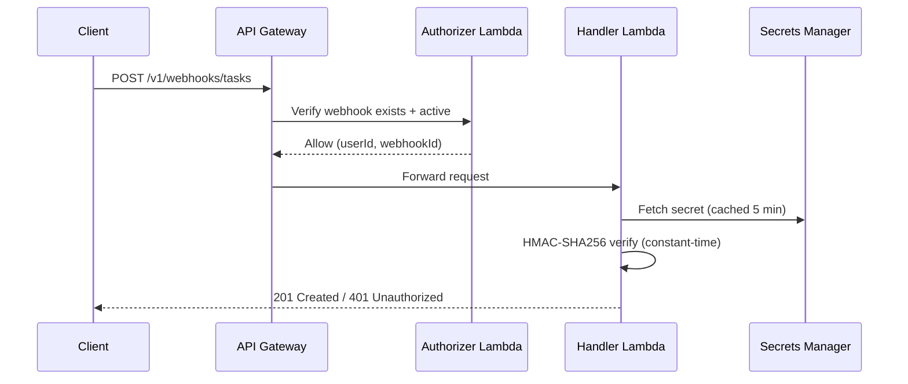

The REST API is the single entry point for all platform interactions. The CLI, webhook integrations, and any future clients use this API to submit tasks, check status, and manage integrations. This is a design-level specification; the source of truth for types is `cdk/src/handlers/shared/types.ts`.

- **Use this doc for:** endpoint paths, payload shapes, auth requirements, and error codes.
- **Related docs:** [INPUT_GATEWAY.md](/sample-autonomous-cloud-coding-agents/architecture/input-gateway) for the gateway's role, [ORCHESTRATOR.md](/sample-autonomous-cloud-coding-agents/architecture/orchestrator) for the task state machine, [SECURITY.md](/sample-autonomous-cloud-coding-agents/architecture/security) for the authentication model.

## Base URL

| Environment | Base URL |
|---|---|
| Production | `https://{api-id}.execute-api.{region}.amazonaws.com/v1` |
| Custom domain | `https://api.{customer-domain}/v1` |

Versioning uses a path prefix (`/v1`). Breaking changes increment the version. New optional fields and endpoints do not require a version bump.

## Authentication

All endpoints require authentication. Two methods are supported:

| Channel | Method | Header |
|---------|--------|--------|
| CLI / REST | Cognito JWT | `Authorization: Bearer <token>` |
| Webhook | HMAC-SHA256 | `X-Webhook-Id` + `X-Webhook-Signature: sha256=<hex>` |

The gateway extracts `user_id` from the authenticated identity and attaches it to all internal messages. Downstream services never see raw tokens.

## Conventions

**Requests:** `application/json`, UTF-8, max 1 MB body. Clients may include an `Idempotency-Key` header on `POST` requests. Deduplication is backed by a sparse `IdempotencyIndex` on the task record, so the key remains bound for the lifetime of that record (its DynamoDB TTL, default 90 days), not a fixed 24-hour window.

**Successful responses:**

```json
{ "data": { ... } }
```

**List responses** include pagination:

```json
{ "data": [ ... ], "pagination": { "next_token": "...", "has_more": true } }
```

**Error responses:**

```json
{ "error": { "code": "TASK_NOT_FOUND", "message": "Task abc-123 not found.", "request_id": "req-uuid" } }
```

**Standard headers:** `X-Request-Id` (ULID, set on all responses). Idempotent replays additionally carry `Idempotent-Replay: true`. (No `X-RateLimit-*` headers are emitted.)

## Endpoints

### Endpoint summary

| Method | Path | Auth | Description |
|--------|------|------|-------------|
| `POST` | `/v1/tasks` | Cognito | Create a task |
| `POST` | `/v1/tasks/{task_id}/confirm-uploads` | Cognito | Confirm presigned uploads and trigger screening |
| `GET` | `/v1/tasks` | Cognito | List tasks (paginated) |
| `GET` | `/v1/tasks/{task_id}` | Cognito | Get task details |
| `DELETE` | `/v1/tasks/{task_id}` | Cognito | Cancel a task |
| `GET` | `/v1/tasks/{task_id}/events` | Cognito | Get task audit trail |
| `POST` | `/v1/tasks/{task_id}/approve` | Cognito | Approve a paused Cedar HITL gate (returns `202`) |
| `POST` | `/v1/tasks/{task_id}/deny` | Cognito | Deny a paused Cedar HITL gate (returns `202`) |
| `POST` | `/v1/tasks/{task_id}/nudge` | Cognito | Send a mid-run nudge message to a running agent (returns `202`) |
| `GET` | `/v1/tasks/{task_id}/trace` | Cognito | Get a presigned download URL for the task's `--trace` artifact |
| `GET` | `/v1/tasks/{task_id}/replay` | Cognito | Get an aggregated operator replay bundle for a task |
| `GET` | `/v1/pending` | Cognito | List the caller's pending approval requests |
| `GET` | `/v1/repos/{repo_id}/policies` | Cognito | List the repo's Cedar hard/soft policy rules |
| `POST` | `/v1/webhooks` | Cognito | Create webhook integration |
| `GET` | `/v1/webhooks` | Cognito | List webhooks (paginated) |
| `DELETE` | `/v1/webhooks/{webhook_id}` | Cognito | Revoke webhook |
| `POST` | `/v1/webhooks/tasks` | HMAC | Create task via webhook |

### Create task

```
POST /v1/tasks
```

Creates a new task. The orchestrator runs admission control, context hydration, and starts the agent session.

**Request body:**

| Field | Type | Required | Description |
|---|---|---|---|
| `repo` | String | Yes | GitHub repository (`owner/repo`) |
| `issue_number` | Number | No | GitHub issue number. Title, body, and comments are fetched during hydration. |
| `task_description` | String | No | Free-text description (max 10,000 chars). At least one of `issue_number`, `task_description`, or `pr_number` required (per the resolved workflow's `required_inputs`). |
| `workflow_ref` | String | No | Workflow selector `<id>[@<constraint>]` (e.g. `coding/new-task-v1`). Replaces `task_type` (#248). Omitted ⇒ the platform default workflow (`default/agent-v1`) is resolved. |
| `pr_number` | Number | No | PR to iterate on or review. Required when the resolved workflow is a pull-request workflow (`coding/pr-iteration-v1`, `coding/pr-review-v1`). |
| `max_turns` | Number | No | Max agent turns (1-500, default 100) |
| `max_budget_usd` | Number | No | Cost ceiling in USD (0.01-100). If omitted, no budget limit. |
| `attachments` | Array | No | Multi-modal attachments (see below) |

**Migration from `task_type` (#248):** `task_type` was removed (no alias). Map
callers one-to-one to `workflow_ref`:

| Old `task_type` | New `workflow_ref` |
|---|---|
| `new_task` | `coding/new-task-v1` |
| `pr_iteration` | `coding/pr-iteration-v1` |
| `pr_review` | `coding/pr-review-v1` |

Responses now carry `resolved_workflow: { id, version }` (the pinned workflow)
in place of `task_type`.

**Attachments:**

| Field | Type | Required | Description |
|---|---|---|---|
| `type` | String | Yes | `image`, `file`, or `url` |
| `content_type` | String | Conditional | MIME type. Required for presigned uploads and URL attachments; auto-detected from magic bytes for inline data. |
| `data` | String | No | Base64-encoded content (max 500 KB decoded per attachment; max 3 MB total inline per request). Mutually exclusive with `url`. |
| `url` | String | No | HTTPS URL to fetch during hydration (max 10 MB, 10s timeout per request, 30s for all URL attachments of a task). Required when `type` is `url`, and refused for the other types. |
| `filename` | String | No | Original filename. Auto-generated if absent. Must not contain path separators or start with `.`. |
| `expected_size_bytes` | Number | Conditional | Declared file size in bytes. Required for presigned uploads (no `data`, no `url`). Used for early budget validation. |

**Supported MIME types:**

| Category | MIME types | Extensions |
|---|---|---|
| Images | `image/png`, `image/jpeg` | `.png`, `.jpg` |
| Text files | `text/plain`, `text/csv`, `text/markdown`, `application/json`, `application/pdf`, `text/x-log` | `.txt`, `.csv`, `.md`, `.json`, `.pdf`, `.log` |

**Attachment limits:**

| Limit | Value |
|---|---|
| Max attachments per task | 10 |
| Max inline data per attachment | 500 KB (decoded) |
| Max total inline data per request | 3 MB (decoded) |
| Max size per attachment (presigned/URL) | 10 MB |
| Max total size per task | 50 MB |
| URL scheme | HTTPS only |
| URL fetch timeout | 10 seconds |
| URL attachments, total time per task | 30 seconds (no request for a URL attachment starts or runs after this time; name lookups and screening are counted but not cut off) |

**Upload paths:**

- **Inline** (≤ 500 KB): Include base64-encoded `data` in the request body. Task is created in `SUBMITTED` status.
- **Presigned** (> 500 KB, up to 10 MB): Omit `data` and `url`, include `expected_size_bytes`. Task is created in `PENDING_UPLOADS` status with presigned POST URLs returned in the response. Upload directly to S3, then call `POST /v1/tasks/{task_id}/confirm-uploads`.
- **URL** (deferred): Include `url`. Content is fetched and screened during context hydration.

**Response (inline / URL / no-attachment tasks): `201 Created`**

```json
{
  "data": {
    "task_id": "01HYX...",
    "status": "SUBMITTED",
    "repo": "org/myapp",
    "resolved_workflow": { "id": "coding/new-task-v1", "version": "1.0.0" },
    "issue_number": 42,
    "branch_name": "bgagent/01HYX.../fix-auth-bug",
    "created_at": "2025-03-15T10:30:00Z"
  }
}
```

For PR tasks, `branch_name` is initially `pending:pr_resolution` and resolved to the PR's `head_ref` during hydration.

**Response for presigned upload tasks: `202 Accepted`**

```json
{
  "data": {
    "task_id": "01HYX...",
    "status": "PENDING_UPLOADS",
    "task_expires_at": "2025-03-15T11:00:00Z",
    "upload_instructions": [
      {
        "attachment_id": "01HYX...",
        "filename": "screenshot.png",
        "upload_url": "https://s3.amazonaws.com/...",
        "upload_fields": { "key": "...", "policy": "...", "x-amz-signature": "..." },
        "upload_expires_at": "2025-03-15T10:40:00Z"
      }
    ]
  }
}
```

**Idempotency:** Clients may send `Idempotency-Key` (see [Conventions](#conventions)). The first successful create returns **`201 Created`** (or `202` for presigned tasks). A subsequent request with the same key and the **same authenticated user** returns **`200 OK`** with the full `TaskDetail` reflecting **current** task state, plus response header `Idempotent-Replay: true`. While that task is still in `PENDING_UPLOADS`, the replay also carries new `upload_instructions` for the uploads that are not yet confirmed and the task's `task_expires_at`, so a client whose upload or confirmation failed can upload again and call `confirm-uploads`. No duplicate task is created and the orchestrator is not invoked again for that replay. If the key is already bound to a task owned by **another** user, the API returns **`409 DUPLICATE_TASK`** without exposing that task (extremely unlikely for high-entropy keys).

**Errors:** `400 VALIDATION_ERROR` (invalid body/parameters, or task description blocked by content screening), `400 ATTACHMENT_INVALID_CONTENT` (content does not match declared MIME type or could not be sanitized), `400 ATTACHMENT_BLOCKED` (inline attachment failed content screening), `400 ATTACHMENT_INLINE_TOO_LARGE` (single inline attachment > 500 KB; total inline > 3 MB surfaces as `VALIDATION_ERROR`), `400 ATTACHMENTS_TOTAL_TOO_LARGE` (aggregate declared size > 50 MB), `401 UNAUTHORIZED`, `409 DUPLICATE_TASK` (idempotency key collision across users only), `422 REPO_NOT_ONBOARDED`, `429 BUDGET_EXCEEDED` (a user or Cognito-team monthly hard-stop budget is exhausted), `503 SERVICE_UNAVAILABLE`, `503 ATTACHMENT_SCREENING_UNAVAILABLE`.

> Task-description content screening (Bedrock Guardrails) that intervenes returns `400 VALIDATION_ERROR` with message "Task description was blocked by content policy." — there is no separate `GUARDRAIL_BLOCKED` code.

### Confirm uploads

```
POST /v1/tasks/{task_id}/confirm-uploads
```

Triggers security screening for presigned-upload attachments and transitions the task from `PENDING_UPLOADS` to `SUBMITTED`. No request body required. The call is idempotent: if the task has already advanced past `PENDING_UPLOADS` (e.g. `SUBMITTED`/`HYDRATING`/`RUNNING`), it returns `200 OK` with the current task detail.

**Response: `200 OK`** — Task detail with `status: "SUBMITTED"`.

```json
{
  "data": {
    "task_id": "01HYX...",
    "status": "SUBMITTED",
    "repo": "org/myapp",
    "resolved_workflow": { "id": "coding/new-task-v1", "version": "1.0.0" },
    "issue_number": 42,
    "branch_name": "bgagent/01HYX.../fix-auth-bug",
    "created_at": "2025-03-15T10:30:00Z",
    "updated_at": "2025-03-15T10:36:00Z"
  }
}
```

If the orchestrator dispatch fails after the task is submitted, the response body additionally carries a `warning` field; the task is still picked up by the background reconciler.

**Errors:** `400 VALIDATION_ERROR` (no attachments to confirm; or the uploads together exceed the 50 MB task limit, and the task transitions to `FAILED`), `400 ATTACHMENT_UPLOAD_MISSING` (a declared upload is not present in S3), `400 ATTACHMENT_BLOCKED` (an attachment failed content screening or does not match its declared type, and the task transitions to `FAILED`; or its upload is no longer in storage because the task has failed or expired in the meantime), `404 TASK_NOT_FOUND`, `409 UPLOADS_NOT_PENDING` (task is in a state that cannot accept upload confirmations), `429 RATE_LIMIT_EXCEEDED` (user concurrency limit reached), `503 ATTACHMENT_SCREENING_UNAVAILABLE`, `503 SCREENING_DEADLINE_EXCEEDED` (screening did not finish within the time limit; retry — already-screened attachments are skipped).

### Get task

```
GET /v1/tasks/{task_id}
```

Returns full details of a task. Users can only access their own tasks.

**Response: `200 OK`**

```json
{
  "data": {
    "task_id": "01HYX...",
    "status": "RUNNING",
    "repo": "org/myapp",
    "resolved_workflow": { "id": "coding/new-task-v1", "version": "1.0.0" },
    "issue_number": 42,
    "issue_title": "Login fails after password reset",
    "task_description": "Fix the authentication bug in the login flow",
    "branch_name": "bgagent/01HYX.../fix-auth-bug",
    "session_id": "sess-uuid",
    "pr_url": null,
    "error_message": null,
    "error_classification": null,
    "max_turns": 100,
    "max_budget_usd": null,
    "cost_usd": null,
    "duration_s": null,
    "build_passed": null,
    "created_at": "2025-03-15T10:30:00Z",
    "updated_at": "2025-03-15T10:31:15Z",
    "started_at": "2025-03-15T10:31:10Z",
    "completed_at": null,
    "agent_heartbeat_at": "2025-03-15T10:36:02Z",
    "compute_type": "agentcore"
  }
}
```

`issue_title` is the GitHub issue's title, stored when the issue is read at hydration (at most 256 characters). It is `null` until then, for tasks without an issue, and on records written before the field existed. It is for display only.

`agent_heartbeat_at` is the agent's last in-guest liveness beat, or `null`. The agent writes it every 45 s on the `agentcore` and `lambda-microvm` backends; on `ecs` it is written once at start, because that backend runs the pipeline directly instead of serving HTTP. The orchestrator reads the same field to detect a hung agent inside a healthy compute environment ([ORCHESTRATOR.md](/sample-autonomous-cloud-coding-agents/architecture/orchestrator#liveness-monitoring)), so a value that is minutes old on a `RUNNING` task is the signal, not the timestamp itself. `null` on records written before the field existed.

`compute_type` is the compute backend the task's session was started on: `agentcore`, `ecs` or `lambda-microvm`. It is `null` before a session starts and on records written before the field existed. It stands beside `agent_heartbeat_at` because what a heartbeat says differs by backend: on `ecs` an old value is the normal case.

`error_classification` is a derived field computed at response time from `error_message`, of which the first 1,000 characters are classified. When `error_message` is `null`, `error_classification` is `null`. When present, it contains:

| Field | Type | Description |
|---|---|---|
| `category` | String | One of: `auth`, `network`, `concurrency`, `compute`, `agent`, `guardrail`, `config`, `timeout`, `blocked`, `unknown` |
| `title` | String | Human-readable error title |
| `description` | String | Detailed explanation of what went wrong |
| `remedy` | String | Suggested action to resolve the error |
| `retryable` | Boolean | Whether retrying may succeed |

Example for a failed task:

```json
{
  "error_message": "Pre-flight check failed: REPO_NOT_FOUND_OR_NO_ACCESS — GitHub API returned HTTP 404 for acme/widgets",
  "error_classification": {
    "category": "auth",
    "title": "Repository not found or inaccessible",
    "description": "The GitHub token cannot access the target repository. It may not exist or the token lacks visibility.",
    "remedy": "Check that the repository name is correct and the configured PAT has access to it.",
    "retryable": false
  }
}
```

**Errors:** `401 UNAUTHORIZED`, `403 FORBIDDEN`, `404 TASK_NOT_FOUND`.

### List tasks

```
GET /v1/tasks
```

Returns the authenticated user's tasks, newest first. Paginated.

**Query parameters:**

| Parameter | Type | Default | Description |
|---|---|---|---|
| `status` | String | all | Filter by status (comma-separated: `RUNNING,HYDRATING`) |
| `repo` | String | all | Filter the list by repository (`owner/repo`): the name as the task holds it, letter for letter. With `view=scoreboard` the parameter follows other rules, given with that view below |
| `limit` | Number | 20 | Page size (1-100) |
| `next_token` | String | - | Pagination token from previous response |
| `view` | String | — | Omit for a task page; `budget` returns the authenticated caller's personal monthly budget instead, `scoreboard` their factory scoreboard |
| `range` | String | 30d | With `view=scoreboard`: the period the scoreboard covers, `7d` or `30d` |

Returns a summary subset of fields. Use `GET /v1/tasks/{task_id}` for full details.

The summary includes `agent_heartbeat_at` and `compute_type` (same semantics as on the task detail above). They are on the summary as well as the detail because liveness is a list-level question — "is anything still alive?" is asked across tasks, and answering it one task at a time is how a hung task goes unnoticed.

With `view=budget`, the Cognito-authenticated caller receives only their personal estimated-spend scope:

```json
{
  "data": {
    "period": "2026-08",
    "resets_at": "2026-09-01T00:00:00.000Z",
    "configured": true,
    "spend_usd": 25,
    "monthly_limit_usd": 100,
    "remaining_usd": 75,
    "utilization_percent": 25,
    "hard_stop": true,
    "hard_stop_active": false
  }
}
```

When no personal limit exists, `configured` is false, the limit/remaining/utilization fields are null, and `spend_usd` still reports the caller's current estimated spend. Team budgets are not returned. This read-only view backs `bgagent budget status --me`; budget mutation remains an operator-AWS-credential workflow.

With `view=scoreboard`, the caller receives the factory scoreboard of their own finished tasks: how the work they handed to agents turned into pull requests during the last `range` and during the period of the same length before it, and what became on GitHub of the pull requests ABCA follows. A `range` of `7d` or `30d` is that many days of 24 hours up to the time of the request. With `repo=owner/name`, every number counts the caller's tasks in that repository only, whatever the letter case of the name. [OBSERVABILITY.md](/sample-autonomous-cloud-coding-agents/architecture/observability#factory-scoreboard) defines every number. The view backs the **Scoreboard** page of the operator console and `bgagent stats`.

```json
{
  "data": {
    "range": "30d",
    "truncated": false,
    "current": {
      "from": "2026-10-20T12:00:00.000Z",
      "to": "2026-11-19T12:00:00.000Z",
      "finished": 8,
      "outcomes": { "verified_pr": 2, "unverified_pr": 1, "no_new_pr": 2, "failed": 1, "cancelled": 1, "timed_out": 1 },
      "time_to_verified_pr_s": { "p50": 1440, "p90": 3600, "count": 2 },
      "wait_p50_s": 41,
      "queued": { "count": 1, "total": 7 },
      "verified": { "count": 2, "total": 7 },
      "not_reworked": { "count": 2, "total": 3 },
      "untouched": { "count": 1, "total": 7 },
      "touchpoints": { "approve": 2, "clarify": 1, "follow_up": 1, "cancel": 1 },
      "spend_usd": 14.5,
      "uncosted": 2,
      "guardrail_stops": { "count": 1, "task_ids": ["01M6P..."] },
      "blanket_approvals": { "count": 1, "task_ids": ["01M7F..."] },
      "gated": { "count": 1, "total": 7 },
      "pull_requests": { "merged": 1, "closed": 0, "open": 1, "unread": 1 },
      "merged_clean": { "count": 1, "total": 1 },
      "time_to_merge_s": { "p50": 93600, "p90": 93600, "count": 1 },
      "first_review_s": { "p50": 21600, "p90": 21600, "count": 1 }
    },
    "previous": {
      "from": "2026-09-20T12:00:00.000Z",
      "to": "2026-10-20T12:00:00.000Z",
      "finished": 2,
      "outcomes": { "verified_pr": 1, "unverified_pr": 0, "no_new_pr": 0, "failed": 1, "cancelled": 0, "timed_out": 0 },
      "time_to_verified_pr_s": { "p50": 1800, "p90": 1800, "count": 1 },
      "wait_p50_s": 60,
      "queued": { "count": 0, "total": 2 },
      "verified": { "count": 1, "total": 2 },
      "not_reworked": { "count": 1, "total": 1 },
      "untouched": { "count": 1, "total": 2 },
      "touchpoints": { "approve": 0, "clarify": 0, "follow_up": 0, "cancel": 0 },
      "spend_usd": 3.5,
      "uncosted": 0,
      "guardrail_stops": { "count": 0, "task_ids": [] },
      "blanket_approvals": { "count": 0, "task_ids": [] },
      "gated": { "count": 0, "total": 2 },
      "pull_requests": { "merged": 1, "closed": 0, "open": 0, "unread": 0 },
      "merged_clean": { "count": 1, "total": 1 },
      "time_to_merge_s": { "p50": 172800, "p90": 172800, "count": 1 },
      "first_review_s": { "p50": 7200, "p90": 7200, "count": 1 }
    },
    "open_over_7d": { "count": 1, "task_ids": ["01M4C..."] }
  }
}
```

`range` is the range served. `current` holds the numbers of the tasks that finished in it, `previous` those of the period before it, or `null` (see below). `open_over_7d` belongs to neither: it is described under the table. Both periods have these fields:

| Field | Type | Description |
|---|---|---|
| `from`, `to` | String | ISO 8601 bounds: the tasks that finished at or after `from` and before `to`. `current` has no upper test: a finish time ahead of the clock belongs to it. `current.to` is the time of the request |
| `finished` | Number | Tasks that reached a terminal state |
| `outcomes` | Object | `finished` by outcome. `failed`, `cancelled` and `timed_out` are the statuses of those names; `verified_pr`, `unverified_pr` and `no_new_pr` split the completed tasks. All six keys are always present |
| `time_to_verified_pr_s` | Object or null | Seconds from task creation to a verified pull request: `p50`, `p90`, and the `count` of tasks measured. With fewer than 10 values, `p90` is the largest or close to it. `null` when there is none |
| `wait_p50_s` | Number or null | Median seconds from creation to the start of the session, time in the admission queue included, over the verified pull requests above whose start is known. `null` when there is none |
| `queued` | Fraction | Tasks that waited in the admission queue, of the tasks that waited or ran |
| `verified` | Fraction | Verified pull requests, of the tasks that asked for a new pull request |
| `not_reworked` | Fraction | New pull requests with no follow-up task before the period's end (a follow-up known to have changed no code is not one), of the new pull requests whose number is known |
| `untouched` | Fraction | Verified pull requests whose task never stopped for a person, of the tasks that asked for a new pull request |
| `touchpoints` | Object | Human touchpoints on coding tasks, by kind. `approve` counts approval requests, whatever the answer. All four keys are always present |
| `spend_usd` | Number | Recorded spend of coding tasks, whatever their outcome, to the micro-dollar |
| `uncosted` | Number | Coding tasks that ran and recorded no cost: `spend_usd` is short by them |
| `guardrail_stops` | Flagged | Finished tasks of any kind, not only coding tasks, that a guardrail stopped; newest first. Each is also one of `outcomes.failed` |
| `blanket_approvals` | Flagged | Finished tasks of any kind that were submitted with every approval granted in advance; newest first |
| `gated` | Fraction | Coding tasks that stopped for at least one approval request, of the coding tasks that ran |
| `pull_requests` | Object | The new pull requests of the period that ABCA follows, by their state at the period's end: `merged`, `closed`, `open`, or `unread`. `unread`: no read has recorded one yet, or a read found no pull request of the task under the recorded number and does not ask again. The four add up to those pull requests. A pull request opened by a task of an orchestration is not followed, and is in none of them. All four keys are always present |
| `merged_clean` | Fraction | Merged pull requests nobody sent back first (no change request by a reviewer with write access, no reworking follow-up before the merge), of the merged ones |
| `time_to_merge_s` | Object or null | Seconds from task creation to the merge, over the pull requests merged before the period's end: `p50`, `p90` and `count`. `null` when none was merged |
| `first_review_s` | Object or null | Seconds from the end of the task to the first review of its pull request by a person with write access to the repository, other than the pull request's author, over the merged ones that had one: `p50`, `p90` and `count`. A review before that end counts as 0. `null` when none had |

A Fraction is `count` of `total`: the rate is `count / total`; with a `total` of 0 there is none. A Flagged is a `count` with the ids (`task_ids`) of up to 10 of the tasks behind it. Durations are whole seconds. The figures per pull request are left to the client: divide the sum of `touchpoints`, or `spend_usd`, by `outcomes.verified_pr`, or by `pull_requests.merged` for the figures per merged pull request. So is the merged share: `merged` of `merged` + `closed` + `open`, with `unread` outside it.

`open_over_7d` is one number of the whole response, a Flagged or `null`: the new pull requests that ABCA follows and that were open at its last read more than 7 days after their task finished, oldest first, over the tasks of both periods. Those are the tasks that finished 7 to 14 days ago with `range=7d`, and 7 to 60 days ago with `range=30d`. It is `null` when the count is not known: the read did not cover the earlier period (`previous` is `null` then too), or some pull requests are that old and ABCA has read none of them on GitHub. With no pull request that old, the count is 0.

The state of a pull request comes from a read of GitHub that ABCA makes about once an hour, with the platform's GitHub token: a pull request is `unread` until a read records a state, and stays so in a repository that token cannot read and when GitHub has no pull request of the task under the recorded number. [Pull-request outcomes](/sample-autonomous-cloud-coding-agents/architecture/observability#pull-request-outcomes) has the rules and the limits.

The scoreboard counts the caller's own tasks and nothing else: no variant returns a team's numbers or every user's. Every user's are CloudWatch metrics in the `ABCA/Factory` namespace; there are none per team. A `view` response is not paginated, and `status`, `limit` and `next_token` do not apply to it. Nor does the list's `repo` filter: `view=scoreboard` reads `repo` by its own rules, and `view=budget` does not read it.

With `repo`, the request reads the same task records as without it and then counts the ones of that repository, in `current`, in `previous` and in `open_over_7d`. So `truncated` and a `null` `previous` mean what they mean without it: they describe the read. `open_over_7d` is `null` for its two reasons as well, and the second is judged within the repository: some of its pull requests are that old and ABCA has read none of them. A task record without a repository belongs to none, and a repository in which the caller has no finished task answers with zeros.

A request reads a bounded number of task records, newest first: at most six pages of up to 1 MB for each terminal status. When the caller's finished tasks since the start of the previous period exceed that, the scoreboard covers the time from which every status was read in full, and no number is computed over a span in which one was not:

- The read stopped inside the previous period: `previous` and `open_over_7d` are `null`. `truncated` is `false`, because `current` is whole.
- The read stopped inside the range: `truncated` is `true`, `previous` and `open_over_7d` are `null`, and `current.from` is the time from which every finished task was read, later than the start of the range. With `range=30d`, `7d` may fit.

Any other `view` is refused with `400 VALIDATION_ERROR` and the message `Invalid view value. Expected "budget" or "scoreboard".`. With `view=scoreboard`, any other `range` is refused with the message `Invalid range value. Expected "7d" or "30d".`, and a `repo` that is not a repository name, the empty value included, with `Invalid repo value. Expected "owner/name".`; `range` is checked first, and a refused request reads nothing.

**Errors:** `400 VALIDATION_ERROR`, `401 UNAUTHORIZED`.

### Cancel task

```
DELETE /v1/tasks/{task_id}
```

Cancels a task. See [ORCHESTRATOR.md](/sample-autonomous-cloud-coding-agents/architecture/orchestrator) for cancellation behavior by state.

**Response: `200 OK`** — a compact confirmation body (not a full `TaskDetail`):

```json
{ "data": { "task_id": "01HYX...", "status": "CANCELLED", "cancelled_at": "2025-03-15T10:35:00Z" } }
```

**Errors:** `401 UNAUTHORIZED`, `403 FORBIDDEN`, `404 TASK_NOT_FOUND`, `409 TASK_ALREADY_TERMINAL`.

### Get task events

```
GET /v1/tasks/{task_id}/events
```

Returns the audit trail for a task: state transitions, hydration events, session events, and custom step events.

**Query parameters:** `limit` (default 50, max 100), `next_token`.

**Event types:** `task_created`, `uploads_confirmed`, `attachment_blocked`, `admission_queued`, `queue_pickup`, `preflight_failed`, `hydration_started`, `hydration_complete`, `session_started`, `pr_created`, `task_completed`, `task_failed`, `task_cancelled`, `task_timed_out`. Custom blueprint steps emit `{step_name}_started`, `{step_name}_completed`, `{step_name}_failed`. (There is no `admission_passed` or `session_ended` event — admission success is implicit in the subsequent `hydration_started`, and session end is captured by the terminal event.)

`pr_outcome_recorded` comes after the terminal event, when the hourly read of GitHub records that the task's pull request was merged or closed. Its `metadata` holds `pr_state` (`merged` or `closed`), `pr_closed_at`, `pr_changes_requested` and, when a review counted, `pr_first_review_at`; its `timestamp` is the time of the read, not of the merge. It is written at most once and can be missing for a pull request whose outcome is recorded (see [Pull-request outcomes](/sample-autonomous-cloud-coding-agents/architecture/observability#pull-request-outcomes)).

**Correlation envelope (#245):** each event optionally carries top-level `user_id`, `repo`, and `trace_id` (the agent's OTEL trace id) so the event stream joins to structured logs and X-Ray. Each field is present only when the event's source stamped it — `task_created` predates the envelope and carries none; events from `hydration_started` onward carry `user_id`/`repo`, and agent-emitted events additionally carry `trace_id`. Fields are omitted (not `null`) when absent. See [OBSERVABILITY.md](/sample-autonomous-cloud-coding-agents/architecture/observability#correlation-envelope).

**Errors:** `401 UNAUTHORIZED`, `403 FORBIDDEN`, `404 TASK_NOT_FOUND`.

### Approve / deny a Cedar HITL gate

```
POST /v1/tasks/{task_id}/approve
POST /v1/tasks/{task_id}/deny
```

When a task pauses in `AWAITING_APPROVAL` (Cedar soft-deny gate), the owner approves or denies the pending request to resume the agent. Both endpoints accept a request body with the pending `request_id`. `approve` may include an optional `scope` (defaults to `this_call`); `deny` may include an optional `reason` (redacted and truncated to 2,000 chars; the redaction reads the first 20,000 characters of the reason).

**Response: `202 Accepted`**

`approve`:

```json
{ "data": { "task_id": "01HYX...", "request_id": "...", "status": "APPROVED", "scope": "this_call", "decided_at": "2025-03-15T10:35:00Z" } }
```

`deny`:

```json
{ "data": { "task_id": "01HYX...", "request_id": "...", "status": "DENIED", "decided_at": "2025-03-15T10:35:00Z" } }
```

**Errors:** `400 VALIDATION_ERROR`, `401 UNAUTHORIZED`, `404 REQUEST_NOT_FOUND` (collapses "row missing" and "wrong caller"), `409 REQUEST_ALREADY_DECIDED`, `409 TASK_NOT_AWAITING_APPROVAL`.

### List pending approvals

```
GET /v1/pending
```

Returns the caller's pending Cedar HITL approval requests across all their tasks.

- A request whose approval window has passed is not listed. The window ends at `created_at` plus `timeout_s`, which each entry also carries as `expires_at`. The stored record of such a request can stay pending for days, when the agent was gone at the end of the window and could not close it.
- At most 100 requests are returned, and the endpoint has no pagination.
- One call reads the caller's pending records in at most 20 pages of 100 (2,000 records). When it stops there with fewer than 100 requests to list and records are left unread, the requests among them are not listed, and a warning is written to the function's log.
- The response has no field that says the list is incomplete, for either limit.
- Rate limit: 60 requests per user per minute, counted by clock minute. A request above it is answered `429 RATE_LIMIT_EXCEEDED`.

**Response: `200 OK`** — `{ "data": { "pending": [ ... ] } }`.

**Errors:** `401 UNAUTHORIZED`, `429 RATE_LIMIT_EXCEEDED`.

### Get repo policies

```
GET /v1/repos/{repo_id}/policies
```

Returns the repository's Cedar policy rules grouped into `hard` and `soft` lists (rule id, category, severity, per-rule `approval_timeout_s`, and a human-readable summary).

**Response: `200 OK`** — `{ "data": { "repo_id": "...", "policies": { "hard": [ ... ], "soft": [ ... ] } } }`.

### Nudge a running task

```
POST /v1/tasks/{task_id}/nudge
```

Queues a free-text message for delivery to a running agent. Rate-limited per task (default 10/min).

**Response: `202 Accepted`** — `{ "data": { "task_id": "01HYX...", "nudge_id": "...", "submitted_at": "2025-03-15T10:35:00Z" } }`.

### Get trace URL

```
GET /v1/tasks/{task_id}/trace
```

Issues a short-lived presigned download URL for the task's `--trace` trajectory artifact (only present when the task was submitted with `trace: true`).

**Response: `200 OK`** — `{ "data": { "url": "https://s3...", "expires_at": "2025-03-15T10:40:00Z" } }`.

**Errors:** `401 UNAUTHORIZED`, `403 FORBIDDEN`, `404 TASK_NOT_FOUND`, `404 TRACE_NOT_AVAILABLE`.

### Get replay bundle

```
GET /v1/tasks/{task_id}/replay
```

Returns a single operator-facing **replay bundle** that aggregates a task's existing telemetry — chronological `events`, verification verdict, `--trace` S3 URI, `prompt_version` / `workflow_ref`, OTEL correlation id, and cost — so a task can be post-mortem'd or fed to the eval harness without manually correlating CloudWatch, DynamoDB, and S3. It introduces no new persistence: every field is read from stores that already exist.

Auth is identical to `GET /v1/tasks/{task_id}` — Cognito-authenticated and owner-scoped (the caller must own the task).

Fields sourced from stores that may not have run for a given task are returned as `null`/empty rather than omitted, so consumers see a stable schema:

- `trace_uri` is `null` when the task ran without `--trace` (or the upload had not completed).
- `otel_trace_id` is `null` on tasks created before the field existed or that ran with tracing unavailable; `session_id` is the available correlation id in that case.
- `verification` is `null` when no gate result was persisted (e.g. a repo-less workflow has no build/lint step).
- The embedded `events` list is capped both by count (`MAX_REPLAY_EVENTS`) and by total size (`MAX_REPLAY_EVENT_BYTES`, to stay under Lambda's 6 MB response limit — relevant for `--trace` tasks whose events carry large previews); whichever cap trips first truncates the tail. When that happens, `events_truncation` is non-null (`{ reason: "max_events" | "max_bytes", returned_events }`) so a consumer can detect a partial list; it is `null` when the full list fit. Use `GET /v1/tasks/{task_id}/events` for the full paginated feed.
- Each embedded event has the same shape as the `/events` feed — `event_id`, `event_type`, `timestamp`, `metadata` (always present, `{}` when the event stored none), and the optional correlation envelope (`user_id`, `repo`, `trace_id`) when the source stamped it; the internal `task_id`/`ttl` are stripped.

**Response: `200 OK`**

```json
{
  "data": {
    "task_id": "01HZX...",
    "workflow_ref": "coding/new-task-v1",
    "resolved_workflow": { "id": "coding/new-task-v1", "version": "1" },
    "prompt_version": "coding/new-task-v1@1",
    "events": [
      { "event_id": "01HZX...A", "event_type": "task_started", "timestamp": "2026-06-30T17:00:00.000Z", "metadata": {} }
    ],
    "events_truncation": null,
    "verification": { "build_passed": true, "lint_passed": true },
    "trace_uri": "s3://<trace-bucket>/traces/<user_id>/01HZX....jsonl.gz",
    "otel_trace_id": "1a2b3c4d5e6f70819293a4b5c6d7e8f9",
    "session_id": "sess-01HZX...",
    "cost_usd": 0.0421,
    "collected_at": "2026-06-30T17:05:00.000Z"
  }
}
```

A complete example is checked in at `cdk/test/fixtures/replay-bundle.example.json` (validated against the `ReplayBundle` type in the handler test). CLI: `bgagent replay <task-id> [--json] [--output <file>]`.

**Errors:** `401 UNAUTHORIZED`, `400 VALIDATION_ERROR`, `403 FORBIDDEN`, `404 TASK_NOT_FOUND`, `500 INTERNAL_ERROR`.

## Webhook integration

External systems (CI pipelines, GitHub Actions, custom automation) can create tasks via HMAC-authenticated requests. Webhook integrations are managed through Cognito-authenticated endpoints; task submission uses HMAC.

### Create webhook

```
POST /v1/webhooks
```

Creates a webhook and returns the shared secret (shown only once) and the URL to post tasks to.

**Request:** `{ "name": "My CI Pipeline" }` (1-64 chars, alphanumeric + spaces/hyphens/underscores).

**Response: `201 Created`**

```json
{
  "data": {
    "webhook_id": "01HYX...",
    "name": "My CI Pipeline",
    "secret": "<64-hex-characters>",
    "webhook_url": "https://{api-id}.execute-api.{region}.amazonaws.com/v1/webhooks/tasks",
    "created_at": "2025-03-15T10:30:00Z"
  }
}
```

Store the `secret` securely. It cannot be retrieved again.

`webhook_url` is the address of [Create task via webhook](#create-task-via-webhook), built from the host and stage that served the request. It belongs to the API deployment, not to the webhook: every webhook of a deployment gets the same URL, so the list and revoke responses do not repeat it.

**Errors:** `400 VALIDATION_ERROR`, `401 UNAUTHORIZED`.

### List webhooks

```
GET /v1/webhooks
```

Returns the authenticated user's webhooks. Paginated.

**Query parameters:** `include_revoked` (default `false`), `limit` (default 20), `next_token`.

**Errors:** `401 UNAUTHORIZED`.

### Revoke webhook

```
DELETE /v1/webhooks/{webhook_id}
```

Soft-revokes a webhook. The secret is scheduled for deletion with a 7-day recovery window. The revoked record is auto-deleted after 30 days.

**Errors:** `401 UNAUTHORIZED`, `404 WEBHOOK_NOT_FOUND`, `409 WEBHOOK_ALREADY_REVOKED`.

### Create task via webhook

```
POST /v1/webhooks/tasks
```

Same request body as `POST /v1/tasks`. Requires `X-Webhook-Id` and `X-Webhook-Signature` headers instead of Cognito JWT.

**Authentication flow:**



HMAC verification runs in the handler (not the authorizer) because API Gateway REST API v1 does not pass the request body to Lambda REQUEST authorizers. Authorizer caching is disabled since each request has a unique signature.

Tasks created via webhook record `channel_source: 'webhook'` with audit metadata (`webhook_id`, `source_ip`, `user_agent`).

**Errors:** `400 VALIDATION_ERROR` (includes task descriptions blocked by content screening), `401 UNAUTHORIZED`, `409 DUPLICATE_TASK`, `422 REPO_NOT_ONBOARDED`, `429 BUDGET_EXCEEDED`, `503 SERVICE_UNAVAILABLE`.

## Rate limiting and throttling

There is no per-user request-rate or "tasks-per-hour" limiter on task creation. The protections that actually exist are:

| Mechanism | Value | Scope | Response |
|---|---|---|---|
| API Gateway stage throttling | `throttlingRateLimit` 60 req/s, burst 100 | Account/stage-wide (not per user) | `429 Too Many Requests` (API Gateway, no body envelope) |
| WAF rate-based rule | 1,000 requests / 5 min | Per source IP | `403` (blocked by WAF) |
| Per-task nudge limit | Default 10/min | Per task (`POST /tasks/{id}/nudge`) | `429 RATE_LIMIT_EXCEEDED` |
| Application rate limiter (`shared/rate-limit`) | Per-endpoint | Used by `approve`, `deny`, `pending`, `nudge`, `policies` and Linear webhook/fan-out paths — **not** task creation | `429 RATE_LIMIT_EXCEEDED` |

**Concurrency (not a rate limit).** Per-user concurrent task count is bounded (configurable, default 10). This is enforced by admission control, not by the create-task endpoint:

- `POST /v1/tasks/{task_id}/confirm-uploads` rejects with `429 RATE_LIMIT_EXCEEDED` when the user is already at their concurrency limit.
- For the orchestrator admission path (the `SUBMITTED → HYDRATING` transition), exceeding the limit does not return an HTTP error — the task is already created. The orchestrator parks the task as `QUEUED` and emits an `admission_queued` event. The task is admitted, oldest first, as the user's slots free up (`queue_pickup`), and fails if it is still queued 24 hours after submission.

**Monthly budget admission.** Task creation checks the current UTC-month estimated spend for the authenticated user and every Cognito group captured as a team. A configured hard-stop scope at or above 100% returns `429 BUDGET_EXCEEDED` before creating a new task. Alerts-only scopes continue. Same-user idempotent replays return their existing task before this check.

## Error codes

| Code | Status | Description |
|---|---|---|
| `VALIDATION_ERROR` | 400 | Invalid request body or parameters (also returned when a task description is blocked by content screening) |
| `UNAUTHORIZED` | 401 | Missing, expired, or invalid authentication |
| `FORBIDDEN` | 403 | Not authorized (e.g. accessing another user's task) |
| `TASK_NOT_FOUND` | 404 | Task ID does not exist |
| `TRACE_NOT_AVAILABLE` | 404 | Trace artifact does not exist for this task |
| `WEBHOOK_NOT_FOUND` | 404 | Webhook does not exist or belongs to another user |
| `DUPLICATE_TASK` | 409 | Idempotency key already used by another user (`POST /v1/tasks` / webhook create); same-user replays return `200` with the existing task instead |
| `TASK_ALREADY_TERMINAL` | 409 | Cannot cancel a terminal task |
| `WEBHOOK_ALREADY_REVOKED` | 409 | Webhook is already revoked |
| `REPO_NOT_ONBOARDED` | 422 | Repository not registered (onboard via CDK, not runtime API) |
| `REPO_NOT_FOUND_OR_NO_ACCESS` | 422 | Repo onboarded but credentials cannot reach it |
| `PR_NOT_FOUND_OR_CLOSED` | 422 | PR does not exist, is closed, or is inaccessible |
| `PR_FROM_FORK` | 422 | PR comes from a fork: its branch is not in the onboarded repository |
| `INSUFFICIENT_GITHUB_REPO_PERMISSIONS` | 422 | GitHub token lacks required permissions for the task type |
| `ATTACHMENT_BLOCKED` | 400 | Attachment content blocked by security screening |
| `ATTACHMENT_TOO_LARGE` | 400 | Individual attachment exceeds 10 MB size limit |
| `ATTACHMENT_INLINE_TOO_LARGE` | 400 | Inline attachment exceeds 500 KB limit (use presigned upload) |
| `ATTACHMENTS_TOTAL_TOO_LARGE` | 400 | Total attachment size exceeds 50 MB limit |
| `ATTACHMENT_INVALID_TYPE` | 400 | MIME type not in allowlist |
| `ATTACHMENT_INVALID_CONTENT` | 400 | Content does not match declared MIME type (magic bytes mismatch) or could not be sanitized |
| `ATTACHMENT_INVALID_FILENAME` | 400 | Filename contains invalid characters or path traversal |
| `ATTACHMENT_SIZE_MISMATCH` | 400 | Uploaded file size does not match declared `expected_size_bytes` |
| `ATTACHMENT_UPLOAD_MISSING` | 400 | A declared presigned upload was not found in S3 at confirm-uploads time |
| `UPLOADS_NOT_PENDING` | 409 | Task is in a state that cannot accept upload confirmations (not `PENDING_UPLOADS`, and not already advanced) |
| `ATTACHMENT_SCREENING_UNAVAILABLE` | 503 | Screening service unavailable after retries |
| `SCREENING_DEADLINE_EXCEEDED` | 503 | Attachment screening did not complete within the time limit (retry; already-screened attachments are skipped) |
| `GITHUB_UNREACHABLE` | 502 | GitHub API unreachable during pre-flight (transient) |
| `RATE_LIMIT_EXCEEDED` | 429 | Rate/concurrency gate exceeded — per-task nudge limit, the application rate limiter on approval endpoints, or the user concurrency limit on confirm-uploads |
| `BUDGET_EXCEEDED` | 429 | A configured user or Cognito-team monthly budget reached 100% with hard stop enabled |
| `REQUEST_NOT_FOUND` | 404 | Cedar HITL approval request not found (also returned when the caller does not own it) |
| `REQUEST_ALREADY_DECIDED` | 409 | Cedar HITL approval request was already approved or denied |
| `TASK_NOT_AWAITING_APPROVAL` | 409 | Task is not in `AWAITING_APPROVAL`, so the approval decision does not apply |
| `INTERNAL_ERROR` | 500 | Unexpected server error |
| `SERVICE_UNAVAILABLE` | 503 | Downstream dependency unavailable (retry with backoff) |

`REPO_NOT_FOUND_OR_NO_ACCESS`, `PR_NOT_FOUND_OR_CLOSED`, `PR_FROM_FORK`, `INSUFFICIENT_GITHUB_REPO_PERMISSIONS` and `GITHUB_UNREACHABLE` are reasons of the pre-flight step, which runs after the task is created. No request is answered with them: the task goes to `FAILED`, the code is the `reason` of its `preflight_failed` event, and its `error_message` starts with `Pre-flight check failed: <code>`. The step has two more reasons, which this table does not list: `GITHUB_TOKEN_SECRET_MISSING` and `GITHUB_TOKEN_SECRET_UNREADABLE`, for a GitHub token secret that is missing or cannot be read.

## Pagination

List endpoints use token-based pagination (consistent with DynamoDB's `ExclusiveStartKey`).

- `pagination.next_token` (opaque string) and `pagination.has_more` (boolean) in responses
- Pass `next_token` as query parameter for the next page; a token that cannot be decoded is refused with `400 VALIDATION_ERROR`
- Tokens are short-lived and should not be stored
- Results ordered by `created_at` descending (newest first)
- A page can hold fewer items than `limit`, or none, while `has_more` is `true`: a list that filters (tasks by `status` or `repo`, webhooks and API keys without the revoked ones) reads a bounded number of rows per request. Follow `next_token` until `has_more` is `false`
