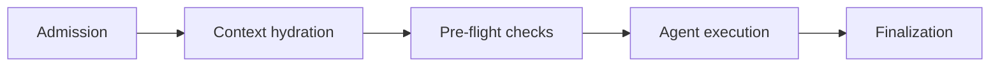

This document describes the architecture of the platform. Each component has its own design document in this folder.

## Design principles

For long-term direction and review tenets, see [VISION.md](/sample-autonomous-cloud-coding-agents/architecture/vision).

- **Extensibility.** Extend the system without modifying core code. The platform reaches critical components through internal interfaces (ComputeStrategy, MemoryStore), so implementations can be swapped.
- **Flexibility.** This field changes fast. Components should be replaceable as better options emerge.
- **Reliability.** Long-running agents will fail. The platform must bring every task to a terminal state, whatever happens to the agent.
- **Cost efficiency.** Agents consume hours of compute and inference tokens. Cost must be a primary concern of the design, not something to handle later.
- **Security by default.** Agents execute code with repo access. Isolated sandboxed environments, fine-grained access control, and least-privilege access are mandatory.
- **Observability.** Task lifecycle, agent reasoning, tool use, and outcomes should all be visible for monitoring, debugging, and improvement.

## How a task runs

Each task follows a **blueprint**. A blueprint is a hybrid workflow that mixes deterministic steps (no LLM, predictable, cheap) with one agentic step (LLM-driven, flexible, expensive).

1. **Admission** (deterministic). The orchestrator validates the request, checks concurrency limits, and loads the repository's Blueprint configuration.
2. **Context hydration** (deterministic). The platform fetches external data (GitHub issue body, PR diff, review comments), loads memory from past tasks, resolves attachments (URL fetch with SSRF protection, screening, upload to S3), and assembles the full prompt. For PR tasks, the platform screens the prompt through Bedrock Guardrails.
3. **Pre-flight checks** (deterministic). The platform verifies GitHub API reachability and repository access. A task that cannot succeed fails early, with a clear reason, before it consumes compute.
4. **Agent execution** (agentic). The agent runs in an isolated compute environment. It clones the repo, creates a branch, edits code, commits, runs tests, and creates a PR. The orchestrator polls for completion without blocking.
5. **Finalization** (deterministic). The orchestrator infers the result (PR created or not), writes memory, updates task status, and releases concurrency.

The orchestrator and the agent are separate by design. The orchestrator handles everything deterministic, in cheap Lambda invocations. The agent handles everything that needs LLM reasoning, with expensive compute and tokens. The separation provides reliability (crashed agents don't leave orphaned state), cost efficiency (bookkeeping doesn't consume tokens), security (the agent can't bypass platform invariants), and testability (deterministic steps are unit-tested without LLM calls).

For the full orchestrator design, see [ORCHESTRATOR.md](/sample-autonomous-cloud-coding-agents/architecture/orchestrator). For the API contract, see [API_CONTRACT.md](/sample-autonomous-cloud-coding-agents/architecture/api-contract).

## Deployment boundaries

`AgentStack` keeps the shared Task API, its route integrations, data stores and selected compute backends together. Registry, RegistryApi and the hosted Linear consent page retain their existing nested boundaries. `networkTopology` selects the network ownership:

| Topology | Network ownership | Stack dependencies |
|---|---|---|
| `inline` (default) | AgentVpc and DnsFirewall inside the application stack | Existing parent/nested structure |
| `split` | Separate `${stackName}-network` stack | Application imports network references. Network has no application references |

The split gives networking an independent deployment lifecycle and reduces the application template's resource count. It preserves AZ selection, DNS observation mode and security rules. All stacks receive solution attribution and provenance tags, and existing removal policies remain in effect. The split is available for new installations. Migration of an existing installation from inline to split is deferred pending a populated rehearsal. See [deployment guidance](/sample-autonomous-cloud-coding-agents/getting-started/deployment-guide#network-stack-topology) and [ADR-023](/sample-autonomous-cloud-coding-agents/decisions/adr-023-cloudformation-stack-boundaries). Live migration has not been validated.

One validated `DeploymentFeatures` value selects the optional modules (Slack, Linear, Jira, deploy-preview screenshots, Agent Registry, Tool Gateway). The value is resolved from `abca.deployment.json` and the context switches. A disabled module is omitted rather than moved to another stack, because the integrations attach routes to the shared Task API. Synthesis rejects modules that the target Region does not support. See [deployment profiles](/sample-autonomous-cloud-coding-agents/getting-started/deployment-guide#deployment-profiles) and [ADR-024](/sample-autonomous-cloud-coding-agents/decisions/adr-024-deployment-profiles).

## Repository onboarding

Onboarding is CDK-based. Plain repository definitions in `cdk/src/blueprints/definitions.ts` are the input to both the network egress policy and the `Blueprint` constructs in the application stack. Each construct writes a `RepoConfig` record to DynamoDB, and the orchestrator reads the record at task time. Because configuration is resolved before stack construction, the optional network stack stays independent of repository resources.

Blueprints configure how the orchestrator executes steps for each repo: compute strategy, model selection, turn limits, GitHub token, and optional custom steps. See [REPO_ONBOARDING.md](/sample-autonomous-cloud-coding-agents/architecture/repo-onboarding) for the full design.

## Model selection

Different tasks and repos may benefit from different models. The `model_id` field in the Blueprint config allows per-repo overrides:

| Workflow | Suggested model | Model ID (as wired in `cdk/src/stacks/agent.ts`) | Rationale |
|---|---|---|---|
| `coding/new-task-v1` | Claude Sonnet 4 | `anthropic.claude-sonnet-4-6` | Good balance of quality and cost |
| `coding/pr-iteration-v1` | Claude Sonnet 4 | `anthropic.claude-sonnet-4-6` | Needs to understand review feedback and make code changes |
| `coding/pr-review-v1` | Claude Haiku 5.5 | `anthropic.claude-haiku-5-5` | Fast and cheap. Review is read-only analysis |
| Complex/critical repos | Claude Opus 5.5 | `anthropic.claude-opus-5-5` | Highest quality. Also the platform default when a repo pins nothing |

## Cost model

The dominant cost is Bedrock inference and compute, not infrastructure. Memory, Lambda, DynamoDB, and API Gateway are a small fraction of total cost.

| Scale | Tasks/month | Estimated monthly cost |
|---|---|---|
| Low (1 developer) | 30-60 | $150-500 |
| Medium (small team) | 200-500 | $500-3,000 |
| High (org-wide) | 2,000-5,000 | $5,000-30,000 |

For the full breakdown, see [COST_MODEL.md](/sample-autonomous-cloud-coding-agents/architecture/cost-model).

## Known architectural risks

An external review (March 2026) identified these risks. Repository issues track them.

| Risk | Severity | Status |
|---|---|---|
| Agent vs. orchestrator DynamoDB race. Agent writes terminal status without conditional expressions | High | Resolved. `ConditionExpression` guards added to agent state writes |
| No DLQ on orchestrator async invocation | High | Resolved. Durable execution manages retries. CloudWatch alarm added |
| Concurrency counter drift on orchestrator crash | Medium | Resolved. `ConcurrencyReconciler` Lambda runs every 15 minutes |
| Single NAT Gateway (single AZ failure blocks egress) | Medium | Mitigated. Configurable via `natGateways` prop |
| Dual-language prompt assembly (TypeScript + Python) | Medium | Mitigated. Python path retained only for local/dry-run mode |

## What ABCA is not

ABCA is not a construct library. There is no jsii compilation, no npm publishing, and no stable public API for external consumers. ABCA is a deployable CDK application and a reference architecture for building agent platforms on AWS.

| Audience | How to use ABCA |
|---|---|
| **Operators** | Deploy the CDK app, onboard repos via Blueprint, submit tasks through the CLI, the API, or webhooks. |
| **Platform developers** | Extend by implementing internal interfaces (ComputeStrategy, custom step Lambdas). |
| **Teams building their own platforms** | Study the architecture and design docs. Fork and adapt the patterns. |
