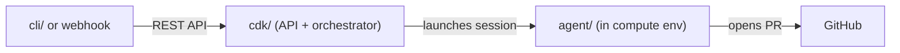

The repository is a monorepo with five packages. Each package owns a part of the platform and has its own build, tests, and mise tasks.

```
sample-autonomous-cloud-coding-agents/
├── cdk/          # Infrastructure and API (TypeScript, AWS CDK)
├── agent/        # Agent runtime (Python, Docker)
├── cli/          # CLI client (TypeScript, commander)
├── web/          # Operator console (TypeScript, React)
├── docs/         # Documentation site (Astro/Starlight)
├── mise.toml     # Monorepo task runner config
└── package.json  # Yarn workspace root
```

A task passes through these packages in order. The **CLI** (or a webhook) sends a request to the API that **CDK** deploys. The orchestrator Lambda prepares the task and launches an **agent** session in an isolated compute environment. The agent works autonomously until it opens a PR or the task ends. The **web** console uses the same REST API and is deployed only with the opt-in console stack. The **docs** package is independent and affects only the documentation site.



The sections below are a task-oriented guide to each package. Each one answers "I want to change X. Where do I look?" For the operator console, see [web/README.md](https://github.com/aws-samples/sample-autonomous-cloud-coding-agents/blob/main/web/README.md).

### `cdk/` - Infrastructure and API (TypeScript)

This package holds everything that runs on AWS: the CDK stack, the Lambda handlers, and the DynamoDB table definitions. Most backend changes happen here.

| I want to... | Look at |
|---|---|
| Add or change an API endpoint | `cdk/src/handlers/` for the Lambda, `cdk/src/constructs/task-api.ts` for the API Gateway wiring |
| Change task validation or admission | `cdk/src/handlers/shared/validation.ts`, `cdk/src/handlers/shared/create-task-core.ts` |
| Modify the orchestration flow | `cdk/src/handlers/orchestrate-task.ts`, `cdk/src/handlers/shared/orchestrator.ts` |
| Change how context is assembled for the agent | `cdk/src/handlers/shared/context-hydration.ts` |
| Add a DynamoDB table or modify a schema | `cdk/src/constructs/` (one construct per table) |
| Onboard repos or change Blueprint behavior | `cdk/src/constructs/blueprint.ts`, `cdk/src/stacks/agent.ts` |
| Change webhook authentication | `cdk/src/handlers/webhook-authorizer.ts`, `cdk/src/handlers/webhook-create-task.ts` |
| Add or update tests | `cdk/test/` mirrors `cdk/src/`. Each handler and construct has a colocated test file |

One convention matters here. API request and response types are in `cdk/src/handlers/shared/types.ts`. If you change them, also update `cli/src/types.ts` to keep the CLI in sync, and `web/src/core/api/types.ts` where the console mirrors the type.

To build and test, run `mise //cdk:build`. It compiles, lints, type-checks, tests, and synthesizes.

### `agent/` - Agent runtime (Python)

This package is the code that runs inside the compute environment (AgentCore MicroVM). It is the agent itself: the execution loop, the system prompts, the tool configuration, the memory writes, and the Docker image.

| I want to... | Look at |
|---|---|
| Change what the agent does during a task | `agent/src/pipeline.py` (execution flow), `agent/src/runner.py` (CLI invocation) |
| Modify system prompts | `agent/src/prompts/`, with the base template and the per-workflow variants (`coding/new-task-v1`, `coding/pr-iteration-v1`, `coding/pr-review-v1`) |
| Change agent configuration or environment | `agent/src/config.py` |
| Add or modify hooks (pre/post execution) | `agent/src/hooks.py` |
| Change the Docker image (add runtimes, tools) | `agent/Dockerfile` |
| Run agent quality checks | `mise //agent:quality` (lint, format, type check, dead code, tests). When the lint or the format step has changed a file, the task fails once and says so (the lint step lists its fixes). Run the task again |

To build and test, run `mise //agent:quality`. The unit tests run with the AWS credential sources removed and refuse every request that botocore tries to send. A refused request fails the run and is listed in the `AWS send guard` section at the end of the output. [agent/AGENTS.md](https://github.com/aws-samples/sample-autonomous-cloud-coding-agents/blob/main/agent/AGENTS.md) has the details. The CDK build bundles the agent image, so `mise run build` picks up agent changes.

### `cli/` - CLI client (TypeScript)

This package is the `bgagent` command-line tool. It authenticates through Cognito, calls the REST API, and formats output.

| I want to... | Look at |
|---|---|
| Add a new CLI command | `cli/src/commands/` (one file per command), `cli/src/bin/bgagent.ts` (program setup) |
| Change how the CLI calls the API | `cli/src/api-client.ts` |
| Modify authentication or token handling | `cli/src/auth.ts` |
| Update API types | `cli/src/types.ts`. It must match `cdk/src/handlers/shared/types.ts`. The console's subset mirror is `web/src/core/api/types.ts` |

To build and test, run `mise //cli:build`.

### `docs/` - Documentation site (Astro/Starlight)

Source docs are in `docs/guides/`, `docs/design/` and `docs/decisions/`. The root `CONTRIBUTING.md` is mirrored as well. The Starlight site under `docs/src/content/docs/` is generated. Do not edit it directly.

| I want to... | Look at |
|---|---|
| Update a user-facing guide | `docs/guides/` (USER_GUIDE.md, DEVELOPER_GUIDE.md, QUICK_START.mdx, PROMPT_GUIDE.md) |
| Update an architecture doc | `docs/design/` |
| Change the sidebar or site config | `docs/astro.config.mjs` |
| Change how docs are synced | `docs/scripts/sync-starlight.mjs` |

After you edit source docs, run `mise //docs:sync` or `mise //docs:build` to regenerate the site.

Two checks keep cross-references intact. Both run in CI on every pull request, as part of the required build:

- `mise //docs:link-check` checks the relative links of every Markdown file in the repository, tracked or new. It does not read a file that git ignores. The files are the sources in `docs/guides/`, `docs/design/` and `docs/decisions/`, and also package READMEs, `AGENTS.md` files, plugin skills and command files. The check confirms that the target file exists and that an anchor within the same file exists. It does not check an anchor that points into another file.
- `mise //docs:build` validates every internal link and anchor of the rendered site, anchors into other pages included, and fails with the page, line and link.

Neither check tests external `http(s)` URLs. That is deliberate, so that an unreliable network or a bot block cannot fail an unrelated PR.

A third check, also part of the required build, keeps the structure of the sources intact. `mise //docs:markdown-lint`, which `mise //docs:build` also runs, lints every tracked Markdown file with five rules: a table row whose cells do not match the header (renderers drop the extra cells), an image without alt text, a second top-level heading, a heading repeated under the same parent, and a skipped heading level. It reports the file, the line and the rule. [docs/AGENTS.md](https://github.com/aws-samples/sample-autonomous-cloud-coding-agents/blob/main/docs/AGENTS.md) lists the fix for each rule. A `markdownlint-disable` comment does not silence the lint. With the git hooks installed, the same lint also runs at commit time when a Markdown file is staged, so a broken table fails the commit and not only the build.