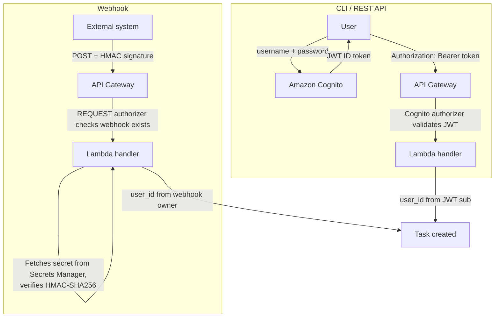

The platform uses two authentication mechanisms, depending on the channel:

- **CLI and REST API.** These use an Amazon Cognito User Pool with JWT tokens. Self-signup is disabled, so an administrator must create your account.
- **Webhooks.** These use HMAC-SHA256 signatures with per-integration shared secrets that are stored in AWS Secrets Manager.

AWS WAF protects both channels at the API Gateway edge with rate limiting and common exploit protection. Downstream services never see raw tokens or secrets. The gateway extracts the user identity and attaches it to internal messages.



**CLI and REST API flow:**

1. **Authenticate.** The user sends a username and password to Amazon Cognito through the CLI (`bgagent login`) or the AWS SDK (`initiate-auth`).
2. **Receive token.** Cognito validates the credentials and returns a JWT ID token. The CLI caches the token locally (`~/.bgagent/credentials.json`) and refreshes it automatically on expiry.
3. **Call the API.** Every request includes the raw ID token (no `Bearer` prefix) in the `Authorization: <token>` header.
4. **Validate.** The Cognito authorizer of API Gateway verifies the JWT signature, expiration, and audience. It rejects invalid tokens with `401`.
5. **Extract identity.** The Lambda handler reads the `sub` claim from the validated JWT and uses it as the `user_id` for task ownership and audit.

**Webhook flow:**

1. **Send request.** The external system, such as a CI pipeline or GitHub Actions, sends a `POST` to `/v1/webhooks/tasks` with two headers. `X-Webhook-Id` identifies the integration, and `X-Webhook-Signature` carries `sha256=<hex>`.
2. **Check webhook exists.** A Lambda REQUEST authorizer verifies that the webhook ID exists and is active in DynamoDB. It rejects revoked or unknown webhooks with `403`.
3. **Verify signature.** The handler fetches the shared secret of the webhook from AWS Secrets Manager and computes `HMAC-SHA256(secret, raw_request_body)`. It compares the result to the provided signature with a constant-time comparison (`crypto.timingSafeEqual`). It rejects mismatches with `403`.
4. **Extract identity.** The `user_id` is the Cognito user who originally created the webhook integration. That user owns the tasks that the webhook creates.

### Joining an existing deployment

Follow this section if your team already has ABCA deployed and someone, the "stack admin", has invited you. You do **not** run `cdk deploy`, you do **not** run `bgagent linear setup`, and you do not need AWS credentials. You are a tenant on a shared deployment.

There are three steps:

1. **Get a config bundle from your admin.** The admin runs `bgagent admin invite-user your-email@example.com` and sends you the output through Slack, 1Password, or email. The output looks like this:

   ```
   ✓ Created Cognito user your-email@example.com
   ✓ Set temporary password (teammate is prompted to set a permanent one on first login)

   Share with the new teammate:
   ────────────────────────────────────────────────────────────────
     email:         your-email@example.com
     temp password: K9$mPq2nL!vXf3Hb
     bundle:        eyJhcGlfdXJsIjoiaHR0cHM6Ly9hYmMxMjM…
   ────────────────────────────────────────────────────────────────
   ```

   The `bundle` is a base64 string that carries the four config fields (API URL, region, user pool ID, and app client ID), so you don't have to type them as separate flags. The **temp password is a one-time credential**. You replace it on first login in step 3, and after that the string the admin shared is no longer valid.

2. **Configure your CLI from the bundle:**

   ```bash
   bgagent configure --from-bundle <paste the base64 string>
   ```

3. **Log in and set your permanent password:**

   ```bash
   bgagent login --username your-email@example.com
   # paste the temp password when prompted for "Password:"
   # then, because this is your first login, you'll be prompted to set a
   # new (permanent) password and confirm it
   ```

   On first login, Cognito requires you to rotate the admin-generated temp password. The CLI prompts `New password:` and `Confirm new password:`, sets the new password, and caches your tokens in `~/.bgagent/credentials.json`. The CLI refreshes the tokens automatically after that. Later logins use your permanent password. Log in interactively. Omit `--password` so that the CLI can prompt you.

You now have access. `bgagent submit`, `bgagent list`, and `bgagent status` work against the shared stack. The platform attributes the tasks you submit to your Cognito user, and it scopes concurrency caps and budgets to you.

To rotate your password later, run `bgagent change-password`. It prompts for your current password, then for the new one twice. Cognito enforces the password policy of the pool, which is a minimum of 12 characters with an uppercase letter, a lowercase letter, a digit, and a symbol.

**You do not run** `bgagent linear setup`, `bgagent jira setup`, `bgagent jira app-setup`, or `bgagent slack setup`. Those are workspace-level operations that the stack admin or workspace admin performs once. If you want the platform to attribute Linear-triggered or Jira-triggered tasks to *you* instead of dropping them, the admin must map your Linear identity or Jira account to your Cognito user. Ask the admin about [Linear user linking](/sample-autonomous-cloud-coding-agents/using/linear-setup-guide#inviting-teammates) or [Jira user linking](/sample-autonomous-cloud-coding-agents/using/jira-setup-guide#6-link-your-jira-identity).

If commands fail with `Not configured` or `401 Unauthorized`, paste the bundle again and run `bgagent login` again. The bundle holds no secrets. Your password is separate from the bundle and is the credential.

### Get stack outputs

After deployment, retrieve the API URL and the Cognito identifiers. Set `REGION` to the AWS region where you deployed the stack, for example `us-east-1`. Use the same value for all `aws` and `bgagent configure` commands below. A mismatch often produces a confusing Cognito "app client does not exist" error.

```bash
REGION=<your-deployment-region>

API_URL=$(aws cloudformation describe-stacks --stack-name backgroundagent-dev \
  --region "$REGION" \
  --query 'Stacks[0].Outputs[?OutputKey==`ApiUrl`].OutputValue' --output text)
USER_POOL_ID=$(aws cloudformation describe-stacks --stack-name backgroundagent-dev \
  --region "$REGION" \
  --query 'Stacks[0].Outputs[?OutputKey==`UserPoolId`].OutputValue' --output text)
APP_CLIENT_ID=$(aws cloudformation describe-stacks --stack-name backgroundagent-dev \
  --region "$REGION" \
  --query 'Stacks[0].Outputs[?OutputKey==`AppClientId`].OutputValue' --output text)
```

### Invite a teammate (admin)

```bash
bgagent admin invite-user teammate@example.com
```

The command wraps Cognito `admin-create-user` with these defaults: email-verified, so that the account is usable immediately, and suppress-email, so that SES isn't required. It prints a shareable config bundle and an auto-generated strong **temporary** password. Send the bundle and the temp password to the teammate. The teammate uses them with `bgagent configure --from-bundle <bundle>` and `bgagent login --username <email>`. On that first login, Cognito prompts the teammate to set a permanent password that only the teammate knows. Because of that first-login rotation, the credential you shared over Slack or email stops being valid once the teammate has logged in. The admin-generated string is temporary by design.

The CLI command requires that the shell has AWS credentials with `cognito-idp:AdminCreateUser` on the configured user pool. You act as the stack admin, not as a Cognito-authenticated end user. An invite does not call `AdminSetUserPassword`, because the teammate rotates the password on first login. `bgagent admin reset-password` still uses `AdminSetUserPassword` to set a permanent password when an admin must recover an account.

**Pool constraints.** The pool enforces these server-side. The CLI handles them, but they are useful to know if you ever need to bypass the CLI with the raw AWS CLI:

- **Username MUST be an email address.** The pool is configured with email as the sign-in alias.
- **Password policy.** A password has at least 12 characters, with at least one uppercase letter, one lowercase letter, one digit, and one symbol.
- **`email_verified=true` attribute is required.** An invited user is in the `FORCE_CHANGE_PASSWORD` state by design, because the user rotates the temp password on first login. With `email_verified` set, `initiate-auth` returns the `NEW_PASSWORD_REQUIRED` challenge and login proceeds through it. Without `email_verified`, `initiate-auth` fails with `User is not confirmed`.
- **`--message-action SUPPRESS`** stops Cognito from trying to email the temp password. It is required unless you've set up SES verified identities.

#### Raw AWS CLI fallback

If you can't run `bgagent admin invite-user`, for example because you script the invite from CI without the CLI installed, use the underlying call:

```bash
aws cognito-idp admin-create-user \
  --region "$REGION" \
  --user-pool-id $USER_POOL_ID \
  --username user@example.com \
  --user-attributes Name=email,Value=user@example.com Name=email_verified,Value=true \
  --temporary-password 'TempPass123!@' \
  --message-action SUPPRESS
```

The call creates the user with a **temporary** password (state `FORCE_CHANGE_PASSWORD`) and pre-verifies the email, as `bgagent admin invite-user` does. The teammate rotates the temp password on the first `bgagent login`. Give the teammate the temp password and the four config fields by hand, or build the bundle with `echo '{"api_url":"…","region":"…","user_pool_id":"…","client_id":"…"}' | base64`.

> For human teammates, prefer the rotate-on-first-login default above. If you deliberately want a login-ready **permanent** password with no first-login prompt, for example for a service account, add a second call:
>
> ```bash
> aws cognito-idp admin-set-user-password \
>   --region "$REGION" \
>   --user-pool-id $USER_POOL_ID \
>   --username user@example.com \
>   --password 'YourPerm@nent1Pass!' \
>   --permanent
> ```

### Obtain a JWT token

```bash
TOKEN=$(aws cognito-idp initiate-auth \
  --region "$REGION" \
  --client-id $APP_CLIENT_ID \
  --auth-flow USER_PASSWORD_AUTH \
  --auth-parameters USERNAME=user@example.com,PASSWORD='YourPerm@nent1Pass!' \
  --query 'AuthenticationResult.IdToken' --output text)
```

Use this token in the `Authorization` header for all API requests.